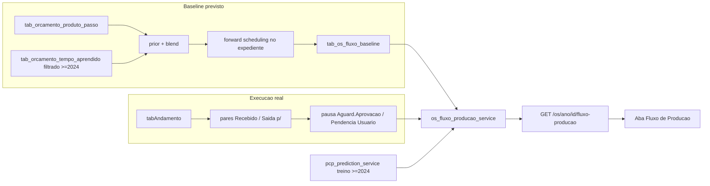

> Decisões confirmadas:
> - Escala de tempo **adaptativa** (horas quando a OS cabe em 1–2 dias, dias quando é mais longa).
> - Abordagem **faseada** (Fase 1 usável com dados derivados dos andamentos; Fase 2 com apontamento real).
> - Início/fim de etapa por **`Recebido` / `Saída p/`**.
> - Treino e medianas de previsão só com OS **a partir de 2024**.
> - Gantt começa na **produção de fato** (SEFOC/SIELT/SEIMP/SEPAC + gravação/expedição quando existirem no roteiro).
> - **`Aguard. Aprovação`** e **`Pendência Usuário`** pausam o cronômetro produtivo e disparam recalculo ao retomar.
> - Exibição da aba controlada por flag **`fluxo_producao`** na aba Desenvolvimento de `admin/configuracoes` (default desligada).

# Aba "Fluxo de Produção" — Gantt de acompanhamento da OS

## 1. Diagnóstico: o que existe e o que falta

O sistema tem as duas metades do Gantt, mas nenhuma delas na granularidade das imagens — com uma ressalva importante: o par de situações **`Recebido` → `Saída p/`** já é a semântica operacional de início e fim de etapa no chão.

**Existe e serve de base:**

- **Roteiro por produto** — `tab_orcamento_produto_passo` (`ordem`, `nome`, `setor_link`, `tipo`, `tecnologia`, `setup_min`, `min_por_un`, `min_por_pag`, `min_por_folha`), lido por `list_passos_por_produto(rotulo)` em [app/backend/services/orcamento_produto_passos_service.py](app/backend/services/orcamento_produto_passos_service.py). Seeds por família de produto em [app/backend/services/orcamento_passo_priors.py](app/backend/services/orcamento_passo_priors.py).
- **Fórmula de duração** — `prior_horas()` em [app/backend/services/orcamento_pessoal.py](app/backend/services/orcamento_pessoal.py): `setup_min + tiragem×min_por_un + pags×min_por_pag + folhas×min_por_folha`, com `blend_horas()` misturando a mediana real de `tab_orcamento_tempo_aprendido` pelo peso `n/(n+k)`.
- **Realizado por setor** — `stints_from_andamentos()` e `match_stints_to_passos()` em [app/backend/services/orcamento_realizado_service.py](app/backend/services/orcamento_realizado_service.py) já convertem o log de andamentos em intervalos por setor; **precisam ser especializadas** para o par `Recebido`/`Saída p/` e para excluir esperas do cliente (seção 2.5).
- **Previsão operacional** — `predict_for_item()` em [app/backend/services/pcp_prediction_service.py](app/backend/services/pcp_prediction_service.py) (KNN) devolve `previsao_proximo_andamento`, `previsao_conclusao`, `confianca`, `amostras`. O lookback atual (default 24 meses) **deve ser truncado para não treinar com OS anteriores a 2024**.
- **Tempo real** — WebSocket `system_update` já é emitido a cada mudança em `tabAndamento` ([app/backend/routers/realtime.py](app/backend/routers/realtime.py)) e consumido no frontend por `useSagraWebSocket` ([apps/web/src/hooks/useSagraWebSocket.ts](apps/web/src/hooks/useSagraWebSocket.ts)).

**Falta (bloqueia a fidelidade das imagens):**

- **Parser explícito de início/fim.** Hoje a duração é “qualquer andamento i até i+1”. O modelo correto é: **`Recebido` no setor = início da etapa**; **`Saída p/` = fim da etapa e passagem para a próxima**. Outras situações no mesmo setor (ex.: `Em Execução`, `Problemas Técnicos`) podem ocorrer entre o par, mas o cronômetro da etapa continua rodando.
- **Exclusão de tempo do cliente.** `Aguard. Aprovação` e `Pendência Usuário` **não** entram no tempo gasto de produção. O Gantt deve marcar pausa, congelar progresso e, ao retomar (`Recebido` / retorno ao setor produtivo), **recalcular `previsao_termino`**.
- **Recorte histórico ≥ 2024.** OS de 2023 para trás guardam só o último andamento (economia de espaço). Usá-las em mediana/KNN/aprendizado distorce a previsão. Toda estatística do fluxo (treino, blend, fallback de marcos) filtra `AnoProtocoloLink >= 2024`.
- **Marco zero = início de produção.** O gráfico **não** inclui entrada administrativa (SECOG/SEORG/Diretoria). Começa no primeiro evento em setor produtivo: **SEFOC, SIELT, SEIMP ou SEPAC**. Depois disso, etapas de gravação e expedição/entrega do roteiro (SEGEP, Gravação, Encadernação, SEDIR/Expedição/Correspondência) entram no eixo quando existirem.
- **Calendário de expediente correto.** `_next_business_day_open()` em [app/backend/services/pcp_prediction_service.py](app/backend/services/pcp_prediction_service.py) apenas soma um dia de calendário: fim de semana conta como 16h úteis e não há tabela de feriados.
- **Baseline congelado.** Se o previsto for recalculado a cada request, ele acompanha o realizado e o gráfico nunca mostra atraso. Precisa de snapshot versionado; a **reprojeção** do término (após pausa ou atraso) é campo separado do baseline.



---

## 2. Contrato de dados do Gantt

Este é o conjunto exato de informações que o endpoint deve devolver para desenhar as três imagens, já alinhado às regras de produção e pausa.

### 2.1 Cabeçalho (`resumo`)

- `os`: `nr_os`, `ano`, `titulo`, `produto`, `tiragem`, `pags`, `prioridade`, `entrega_prevista` (de `EntregData`).
- `status_geral`: `nao_iniciada` | `no_prazo` | `adiantada` | `atrasada` | `pausada_cliente` | `concluida` | `cancelada` | `sem_roteiro`.
- `agora`: ISO do servidor (nunca usar o relógio do cliente — é a linha "Agora – 12:20").
- `desvio_total_min`: positivo = atrasado, negativo = adiantado. **Calculado só com minutos produtivos** (expediente − pausas do cliente). Gera o badge "50 min atrasado" / "1h10 adiantado".
- `etapa_atual`: `{ id, rotulo, setor }` ou `null`. Em `pausada_cliente`, pode apontar a etapa produtiva interrompida.
- `pausa_cliente`: `{ ativa: bool, situacao, desde, minutos_pausados_acumulados }` — quando `ativa`, o progresso congela e a UI exibe estado de espera do cliente.
- `previsao_termino` e `previsao_termino_baseline`: o primeiro é a **reprojeção viva** (respeita pausa atual e tempo restante das etapas futuras); o segundo é o baseline original. Ao sair de pausa, `previsao_termino` é recalculada a partir de `agora` + restante produtivo.
- `confianca`: `alta` | `media` | `baixa` | `insuficiente`, e `amostras` (sempre com universo ≥ 2024).
- `escala`: `horas` | `dias`, mais `janela: { inicio, fim }` e `tick_min` — resolve a escala adaptativa no servidor.
- `expediente`: `{ abertura_hora, fechamento_hora }`.
- `inicio_producao_em`: primeiro `Recebido` (ou equivalente produtivo) em SEFOC/SIELT/SEIMP/SEPAC; se ainda não ocorreu, `null` e `status_geral: "nao_iniciada"`.
- `avisos`: lista de strings, ex. `"OS ainda não entrou em produção"`, `"Cronômetro pausado em Aguard. Aprovação"`, `"Baseline replanejado em 02/09 por alteração de tiragem"`, `"Previsão baseada apenas em OS a partir de 2024"`.

### 2.2 Etapas (`etapas[]`)

Identidade e posição:

- `id` (estável, ex. `"impressao-offset"`), `ordem`, `rotulo`, `rotulo_curto`, `setor`, `passo_id`, `tipo` (`produtiva` | `espera_cliente` | `gravacao` | `expedicao` | `fim`).
- **Sem etapa `entrada` administrativa no gráfico.** SECOG/SEORG/Diretoria ficam fora do eixo.

Previsto (baseline congelado):

- `previsto_inicio`, `previsto_fim`, `previsto_duracao_min`.
- `fonte_duracao`: `aprendido` | `blend` | `prior` | `mediana_setor` | `fallback`, mais `amostras`.

Realizado:

- `real_inicio`: timestamp do **`Recebido`** que abriu a etapa (ou `null`).
- `real_fim`: timestamp do **`Saída p/`** que fechou a etapa (ou `null` se ainda em execução/pausada).
- `real_duracao_min`: minutos úteis **produtivos** entre início e fim, **excluindo** intervalos em `Aguard. Aprovação` / `Pendência Usuário`.
- `pausas[]`: `{ situacao, inicio, fim | null, minutos }` — faixas de espera do cliente dentro da etapa (para desenhar hachura/gap no Gantt).
- `medicao`: `medida` (Fase 2, apontamento) | `inferida` (par Recebido/Saída p/) | `estimada` (sem par completo).
- `cod_status_inicio`, `cod_status_fim`, `operador` para tooltip.

Estado:

- `status`: `concluido` | `concluido_antecipado` | `em_execucao` | `pausado` | `atrasado` | `adiantado` | `pendente`.
- `progresso_pct`: na Fase 1, só na etapa atual e **somente enquanto não pausada**; fórmula `minutos_produtivos_decorridos / previsto_duracao_min` limitado a 99, com `progresso_estimado: true`. Em pausa, congela o último valor.
- `desvio_min` por etapa (também só minutos produtivos).

### 2.3 Como chegar às etapas das imagens

O roteiro atual tem 7 a 9 passos; as imagens têm ~12. A expansão é determinística:

- **Separar setup como etapa própria** quando `setup_min` for relevante (limiar configurável, ex. 15 min). Ex.: `SEIMP impressão offset` com `setup_min = 30` vira "Impressão – preparação da impressora".
- **Expandir acabamentos tipados** em etapas individuais usando `ACABAMENTO_PASSOS` de [app/backend/services/orcamento_passo_priors.py](app/backend/services/orcamento_passo_priors.py): `Dobra` → "Acabamento – dobradeira", `Cola` → "Acabamento – capeadeira", `Refile` → "Acabamento – refile".
- **Etapa "Corte do papel"** não existe hoje no roteiro (só como bloco textual em [app/backend/services/sequencia_producao_rules.py](app/backend/services/sequencia_producao_rules.py)); precisa ser cadastrada como passo (Fase 0).
- **Etapas `espera_cliente`** (prova / aprovação) aparecem no eixo como faixa de pausa, **sem** somar ao desvio produtivo nem à duração de baseline produtivo.
- **Gravação e expedição** entram depois do núcleo SEFOC/SIELT/SEIMP/SEPAC quando o roteiro/andamentos as tiverem.

### 2.4 Fallback obrigatório para OS sem roteiro

A família `E` de [app/backend/services/orcamento_passo_priors.py](app/backend/services/orcamento_passo_priors.py) não tem roteiro, e `list_passos_por_produto` devolve lista vazia para produtos não mapeados. Nesse caso o Gantt degrada para **marcos produtivos** (não os 7 marcos do portal cliente, que incluem Entrada):

1. Pré-impressão (SEFOC)
2. Impressão (SIELT / SEIMP)
3. Acabamento (SEPAC / Encadernação)
4. Gravação (SEGEP / Gravação) — se houver andamento
5. Expedição / Entrega (SEDIR / Expedição / Correspondência / Entregue)

Durações vêm da mediana histórica por setor **somente com OS ≥ 2024**, com `status_geral: "sem_roteiro"` e aviso explícito.

### 2.5 Regra canônica de início, fim e pausa (Fase 1)

```text
Para cada setor produtivo na ordem do roteiro:

  inicio = Data do andamento SituacaoLink = "Recebido" no setor
           (fallback: primeiro andamento produtivo no setor, se não houver Recebido explícito)

  fim    = Data do andamento SituacaoLink = "Saída p/" saindo do setor
           (o SetorLink do "Saída p/" é o setor de origem; o destino fica implícito no próximo Recebido)

  pausas = intervalos em que SituacaoLink ∈ {"Aguard. Aprovação", "Pendência Usuário"}
           entre inicio e fim (ou entre inicio e agora, se etapa aberta)

  real_duracao_min = business_minutes(inicio, fim_ou_agora) − sum(business_minutes de cada pausa)
```

Comportamento de **pausa / retomada**:

1. Sistema prevê duração de cada etapa no baseline.
2. Quando a OS entra em `Aguard. Aprovação` ou `Pendência Usuário`: `status_geral = pausada_cliente`, progresso congela, `previsao_termino` fica **adiada** pelo tempo que a pausa durar (ou marcada como indeterminada enquanto a pausa estiver ativa — preferência: adiar dinamicamente = `agora + restante_produtivo`, sem consumir o restante durante a pausa).
3. Quando o trabalho volta (novo `Recebido` / saída da situação de pendência para situação produtiva): cronômetro retoma; `previsao_termino` é **recalculada** = `agora + minutos restantes das etapas abertas e futuras` no expediente.
4. Desvio e badges comparam só tempo produtivo ao baseline; o tempo do cliente não conta como atraso da gráfica.

Constantes sugeridas no serviço:

```python
SETORES_INICIO_PRODUCAO = {"SEFOC", "SIELT", "SEIMP", "SEPAC"}
SETORES_POS_PRODUCAO = {"SEGEP", "Gravação", "Encadernação", "SEDIR", "Expedição", "Correspondência"}
SITUACOES_INICIO_ETAPA = {"Recebido"}
SITUACOES_FIM_ETAPA = {"Saída p/"}
SITUACOES_PAUSA_CLIENTE = {"Aguard. Aprovação", "Pendência Usuário"}
ANO_MIN_HISTORICO_PREVISAO = 2024
```

---

## 3. Fase 0 — Pré-requisitos (fazer antes da aba)

Sem estes itens o Gantt mostra números errados com aparência de precisão.

### 3.1 Serviço de expediente compartilhado

Novo `app/backend/services/expediente_service.py`, extraindo e corrigindo a lógica hoje privada em [app/backend/services/pcp_prediction_service.py](app/backend/services/pcp_prediction_service.py):

- `business_minutes_between(start, end)`, `add_business_minutes(start, minutes)`, `clamp_to_business_window(dt)`, `next_business_day_open(dt)`.
- Adicionar salto de fim de semana e consulta a feriados (com cache em memória), preservando as env vars `SAGRA_PCP_BUSINESS_OPEN_HOUR` / `SAGRA_PCP_BUSINESS_CLOSE_HOUR`.
- Reapontar `pcp_prediction_service` e `orcamento_realizado_service` para o módulo novo. Isso corrige a previsão do PCP como efeito colateral positivo, então precisa de teste de regressão em [app/backend/tests/test_pcp_prediction_service.py](app/backend/tests/test_pcp_prediction_service.py).

Nova tabela (MySQL-only, padrão dos schemas em `app/backend/*_schema.py` + script em `deploy/sql/`):

```sql
CREATE TABLE IF NOT EXISTS tab_calendario_nao_util (
  `data` DATE NOT NULL PRIMARY KEY,
  descricao VARCHAR(120) NOT NULL,
  tipo ENUM('feriado','recesso','ponto_facultativo','manutencao') NOT NULL DEFAULT 'feriado',
  criado_em DATETIME NOT NULL DEFAULT CURRENT_TIMESTAMP
);
```

Seed com feriados nacionais e o recesso da Câmara; CRUD em Configurações fica para depois (seed via SQL resolve o MVP).

### 3.2 Marco zero da produção

Definir `inicio_producao_em` como o **primeiro andamento em setor ∈ {SEFOC, SIELT, SEIMP, SEPAC}**, preferindo `SituacaoLink = "Recebido"` quando existir. **Sem fallback para `DataEntrada`** no eixo do Gantt: se a OS ainda não entrou nesses setores, a aba mostra estado `nao_iniciada` (mensagem clara, sem barras inventadas).

Persistir `inicio_producao_em` no baseline (item 3.3) na primeira vez que a produção começar, para o eixo não oscilar.

### 3.3 Baseline versionado

Nova tabela:

```sql
CREATE TABLE IF NOT EXISTS tab_os_fluxo_baseline (
  nro_protocolo INT NOT NULL,
  ano_protocolo INT NOT NULL,
  versao INT NOT NULL DEFAULT 1,
  inicio_producao_em DATETIME NULL,
  etapas_json JSON NOT NULL,
  produto VARCHAR(255) NULL,
  tiragem INT NULL,
  pags INT NULL,
  tecnologia VARCHAR(16) NULL,
  hash_entrada CHAR(64) NOT NULL,
  modelo_versao VARCHAR(32) NOT NULL,
  criado_em DATETIME NOT NULL DEFAULT CURRENT_TIMESTAMP,
  atualizado_em DATETIME NOT NULL DEFAULT CURRENT_TIMESTAMP ON UPDATE CURRENT_TIMESTAMP,
  PRIMARY KEY (nro_protocolo, ano_protocolo)
);
```

- `hash_entrada` = SHA-256 de `(produto, tiragem, pags, tecnologia, acabamentos, ids do roteiro)`. Se o hash mudar, incrementa `versao`, regrava e adiciona aviso "baseline replanejado".
- Gerado sob demanda na primeira abertura da aba **depois** que `inicio_producao_em` existir (ou, se a OS ainda não iniciou produção, devolver payload `nao_iniciada` sem gravar baseline).
- A pausa do cliente **não** invalida o baseline; só altera a reprojeção (`previsao_termino`).

### 3.4 Passos faltantes no roteiro

Cadastrar em `tab_orcamento_produto_passo` os passos ausentes para bater com a granularidade das imagens (corte do papel; conferir se dobra/cola/refile estão como passos e não só como acabamento textual). Configuração via a tela existente de Configurações → passos por produto.

### 3.5 Recorte de histórico para previsão

Em todo caminho que alimenta duração aprendida / mediana / KNN do fluxo:

- Filtrar `AnoProtocoloLink >= 2024` (e, onde couber, `AnoProtocolo >= 2024`).
- Documentar no serviço: OS ≤ 2023 são inválidas para treino porque só preservam o último andamento.
- Ajustar também o lookback efetivo de `pcp_prediction_service` quando reaproveitado pelo fluxo (floor em 2024-01-01), sem depender só de “últimos N meses”.

---

## 4. Fase 1 — Backend

### 4.1 Serviço

Novo `app/backend/services/os_fluxo_producao_service.py`, função principal:

```python
def build_fluxo_producao(ano: int, os_id: int, *, now: datetime | None = None) -> dict:
    """Monta previsto (baseline) + realizado (Recebido/Saída p/) + pausas + estado do Gantt."""
```

Pipeline:

1. Carregar OS via `map_os_to_payload(ano, os_id)` de [app/backend/services/orcamento_os_service.py](app/backend/services/orcamento_os_service.py).
2. Carregar andamentos (mesma query de `get_os_history`) e detectar `inicio_producao_em`. Se ausente → retorno `nao_iniciada`.
3. Roteiro via `list_passos_por_produto(produto)`; se vazio, fallback dos marcos produtivos (item 2.4).
4. Expandir passos em etapas do Gantt (item 2.3), **sem** etapa de entrada administrativa.
5. Duração por etapa com `prior_horas()` + `blend_horas()` usando amostras **≥ 2024**, registrando `fonte_duracao` e `amostras`.
6. Forward scheduling sequencial com `expediente_service.add_business_minutes` a partir de `inicio_producao_em` → grava/lê `tab_os_fluxo_baseline`.
7. Realizado: parser de pares **`Recebido` / `Saída p/`** por setor (item 2.5); extrair `pausas[]`; calcular `real_duracao_min` líquida.
8. Se situação atual ∈ pausa do cliente → `status_geral = pausada_cliente`, congelar progresso.
9. Estado por etapa (produtivo vs baseline vs `now`); `desvio_min` acumulado só com minutos produtivos.
10. Reprojeção do término: `agora` (ou fim da pausa lógica) + restante produtivo das etapas abertas/futuras no expediente; calibrar etapa atual com `predict_for_item()` do PCP **se** amostras ≥ 2024 forem suficientes.
11. Escala adaptativa: se `janela` ≤ 2 dias úteis, `escala: "horas"` com `tick_min: 30`; senão `escala: "dias"`. A `janela.inicio` é sempre `inicio_producao_em`.

### 4.2 Endpoint

Novo `app/backend/routers/os_fluxo_producao_routes.py`, registrado em [app/backend/routers/api.py](app/backend/routers/api.py):

- `GET /api/os/{ano}/{id}/fluxo-producao` → `{ resumo, etapas }`.
- Permissão: mesma da aba Histórico (`ctx_detalhes_os`).
- Cache em memória com TTL curto (8–15s) e header `X-Sagra-Cache`. Invalidar no `post_change` de andamento (inclusive mudanças para/de pausa do cliente).

Importante: **não** tocar em `/api/os/search`. A aba é sob demanda.

---

## 5. Fase 2 — Frontend

### 5.1 Cliente e hook

- `apps/web/src/api/osFluxoProducao.ts` — `fetchOsFluxoProducao(ano, id)` e os tipos do contrato da seção 2.
- Nova chave em [apps/web/src/api/query-keys.ts](apps/web/src/api/query-keys.ts): `fluxoProducao: (ano, id) => ["os", "fluxoProducao", ano, id]`.
- `apps/web/src/features/os/hooks/useOsFluxoProducao.ts` — `useQuery` com `enabled` na aba ativa, `refetchInterval` de 60s como rede de segurança.

### 5.2 Flag de desenvolvimento + aba no modal

A UI de toggles já é genérica: [DesenvolvimentoSettingsSection.tsx](apps/web/src/features/configuracoes/components/DesenvolvimentoSettingsSection.tsx) renderiza tudo que vier de `FEATURE_CATALOG`. Basta registrar a flag no backend — o checkbox aparece sozinho em `admin/configuracoes` → Desenvolvimento.

Em [app/backend/services/dev_features.py](app/backend/services/dev_features.py), acrescentar ao catálogo (mesmo formato de `sequencia_producao`):

```python
{
    "id": "fluxo_producao",
    "label": "Fluxo de produção",
    "description": (
        "Mostra a aba Fluxo de produção (Gantt) no detalhe da OS (modal de gerência)."
    ),
    "default": False,
},
```

Persistência continua em `config/dev_features.json` via `set_features_enabled` / endpoints já existentes (`GET/POST` admin + `GET` público de sessão). Sem router novo.

No modal [OsGerenciaDetailModal.tsx](apps/web/src/features/os/components/OsGerenciaDetailModal.tsx), espelhar o padrão de sequência de produção:

```tsx
const fluxoProducaoEnabled = useDevFeature("fluxo_producao");
const showFluxoProducaoTab = fluxoProducaoEnabled && !composing;
```

- Estender `GerenciaModalNavId` com `"fluxo-producao"` e incluir em `buildGerenciaModalNavSections` só quando `showFluxoProducaoTab`.
- Branch de render + `"fluxo-producao"` nas seções com `flex flex-col overflow-hidden`.
- Se a flag for desligada com a aba aberta, o `useEffect` de fallback de seção (já usado por `sequencia-producao`) deve voltar para uma seção válida.
- Default `False`: a aba não aparece até você ligar em Desenvolvimento e salvar.

### 5.3 Componentes do gráfico

Sem nova dependência. Layout = tabela fixa à esquerda + faixa de barras (CSS Grid).

- `ProducaoGanttPanel.tsx` — orquestra query, estados (carregando / erro / `nao_iniciada` / `sem_roteiro` / ok) e cabeçalho.
- `ProducaoGanttHeader.tsx` — cartões (Status geral, Horário atual, Etapa atual, Previsão de término) + badge de desvio + chip de pausa do cliente quando `pausa_cliente.ativa`.
- `ProducaoGanttChart.tsx` — grade temporal a partir de `inicio_producao_em`, linha "Agora", barras, **faixas de pausa** (hachura neutra / rótulo "Aguardando cliente"), legenda.
- `producaoGanttLayout.ts` — matemática pura (tempo → posição, ticks, escala adaptativa, rótulo de desvio, exclusão visual de pré-produção).

Estilo: `text-secondary-blue`, `border-sagra-border`, `cn()` de `@sagra/ui`, ícones `lucide-react`. Cores alinhadas às imagens (verde concluído, azul em execução, tracejado atrasado, cinza pendente, hachurado adiantado) + estilo dedicado para pausa do cliente.

Acessibilidade: cada etapa também é linha de tabela (situação, previsto, realizado líquido, pausas, desvio).

---

## 6. Fase 3 — Tempo real

Reaproveitar o que já existe, sem novo canal:

- Em `useOsFluxoProducao`, assinar `useSagraWebSocket` e invalidar a query em `system_update` da OS aberta — mesmo padrão de [apps/web/src/features/os/hooks/useOsRealtimeSync.ts](apps/web/src/features/os/hooks/useOsRealtimeSync.ts).
- Linha "Agora" e `progresso_pct` avançam com tick local de 30s ancorado em `resumo.agora`, **exceto** quando `pausa_cliente.ativa` (congelar).
- Invalidar cache do endpoint no pós-mudança de andamento (inclui entrada/saída de pausa).

---

## 7. Fase 4 — Apontamento por etapa (fidelidade total)

Só depois da Fase 1 validada. Transforma `medicao: "inferida"` (Recebido/Saída p/) em `"medida"` e dá percentual real. Escopo mínimo alinhado ao plano MES:

- Tabela `tab_os_etapa_apontamento` (`nro_protocolo`, `ano_protocolo`, `etapa_id`, `passo_id`, `status`, `iniciado_em`, `pausado_em`, `concluido_em`, `qtd_boa`, `qtd_refugo`, `ponto`, `maquina`).
- Máquina de estados com transições validadas; pausa do cliente continua vindo dos andamentos `Aguard. Aprovação` / `Pendência Usuário` mesmo com apontamento.
- UI de 3 botões no painel de setor/tablet; espelho opcional em `tabAndamento`.
- O serviço da Fase 1 prefere apontamento quando existir; mantém fallback Recebido/Saída p/.

---

## 8. Testes

Backend (pytest, `app/backend/tests/`):

- `test_expediente_service.py` — fim de semana, feriado, virada de expediente, `add`/`between` inversos.
- `test_os_fluxo_pares_andamento.py` — `Recebido` abre, `Saída p/` fecha; situações intermediárias não quebram o par; pausas `Aguard. Aprovação` / `Pendência Usuário` são subtraídas; retomada recalcula previsão.
- `test_os_fluxo_producao_service.py` — três cenários das imagens; `nao_iniciada` antes de SEFOC/SIELT/SEIMP/SEPAC; OS sem roteiro cai no fallback produtivo; amostras &lt; 2024 não entram em mediana/blend; `hash_entrada` mudando gera nova versão.
- Regressão em `test_pcp_prediction_service.py` após extração do expediente + floor 2024 quando usado pelo fluxo.
- Extensão de [app/backend/tests/test_dev_features.py](app/backend/tests/test_dev_features.py) — `fluxo_producao` no catálogo, default `False`, persiste e recarrega.

Frontend (vitest):

- `producaoGanttLayout.test.ts` — tempo→posição, ticks, escala adaptativa, formatação de desvio, janela começando em `inicio_producao_em`, render de faixas de pausa.
- `ProducaoGanttPanel.test.tsx` — três cenários + `nao_iniciada` + `pausada_cliente`.
- Ajuste em [apps/web/src/features/os/components/OsGerenciaDetailModal.test.tsx](apps/web/src/features/os/components/OsGerenciaDetailModal.test.tsx) — aba ausente com flag off; presente com `useDevFeature("fluxo_producao")` mockado como `true`.

---

## 9. Riscos e decisões conscientes

- **Precisão aparente.** Mitigação: `medicao` e `fonte_duracao` no contrato; padrão visual distinto para estimativas; rótulo "Previsto pelo sistema".
- **Pares incompletos.** Nem todo setor tem `Recebido` e `Saída p/` limpos. Fallback: primeiro andamento produtivo no setor como início; próximo `Saída p/` ou mudança de setor como fim; marcar `medicao: "estimada"` e aviso.
- **Roteiros incompletos.** Sem roteiro, fallback de marcos produtivos (não portal cliente). Medir cobertura antes de liberar.
- **Histórico ≥ 2024.** Reduz volume de treino, mas remove o ruído das OS legadas com 1 andamento. Preferível a mediana enviesada.
- **Pausa vs. atraso.** Tempo do cliente não conta como atraso da gráfica; a UI deve deixar isso explícito no badge/chip.
- **Escopo de otimização.** Fase 1 agenda só a própria OS (sem fila/capacidade de máquina). Sequenciamento com capacidade é o motor MES.
- **Sub OS / paralelismo.** Fora do MVP; uma raia sequencial.
