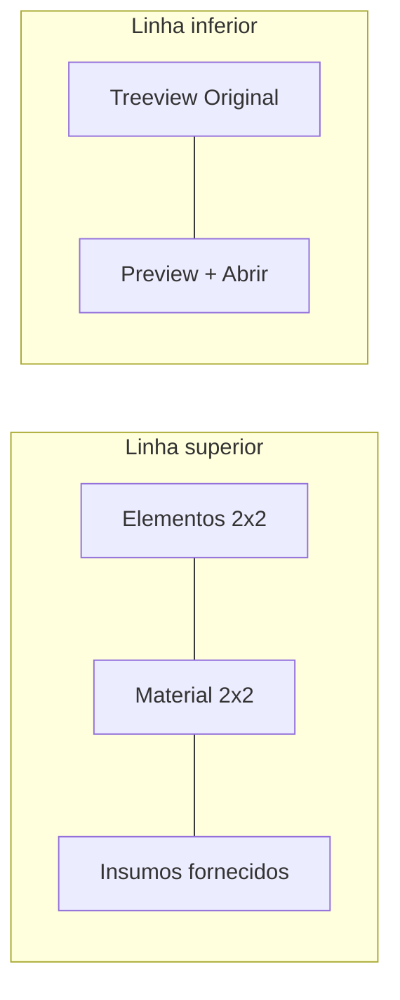
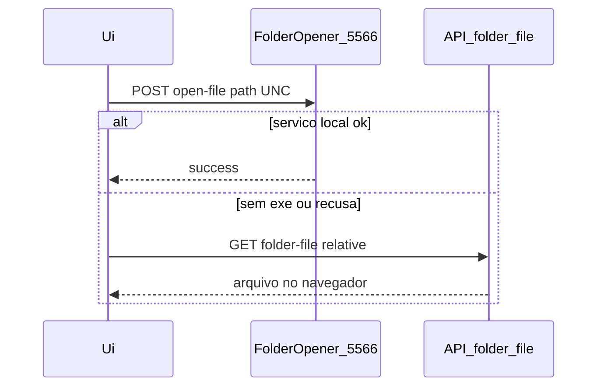

# Aba Material com pastas Original

## Escopo

Somente o modal de duplo clique da lista ([`OsGerenciaDetailModal.tsx`](apps/web/src/features/os/components/OsGerenciaDetailModal.tsx)). A página de Gerência ([`GerenciaFormGrid.tsx`](apps/web/src/features/gerencia/components/GerenciaFormGrid.tsx)) permanece com os dois painéis separados.

## Layout da aba (modal)

Nav: rótulo **Material**; aba **Elementos Gráficos** some do modal (conteúdo migrado). Página continua com as duas seções.

- Esquerda: Brasão, Timbre, Arte Gab., Assinatura em grade 2x2 (`CheckRow` boxed, compacto — não os cards com emoji).
- Centro: Amostra, Fotolito, Mod. Dobra, Prova Imp. em grade 2x2 (hoje no modal estão em 4 colunas e insumos embaixo).
- Direita: textarea Insumos fornecidos.
- Embaixo: árvore à esquerda e painel de preview à direita, ocupando o restante da altura do modal.

A área de conteúdo do modal hoje é `overflow-y-auto`. Na aba Material passar a `overflow-hidden` + coluna flex, para a árvore/preview rolarem por conta própria.

## Árvore das pastas Original

Reutilizar `GET /api/os/{ano}/{id}/folder-browse` ([`os_routes.py`](app/backend/routers/os_routes.py) + [`fetchOsFolderBrowse`](apps/web/src/api/os.ts)).

Novo componente [`apps/web/src/features/os/components/OsOriginalFilesPanel.tsx`](apps/web/src/features/os/components/OsOriginalFilesPanel.tsx):

- Lista só pastas cujo nome começa com `original` / `orignal` (mesma regra de [`get_os_versions`](app/backend/routers/os_routes.py)).
- Expandir pasta carrega filhos (pastas e arquivos), como no [`OsFolderBrowserModal.tsx`](apps/web/src/features/os/components/OsFolderBrowserModal.tsx).
- Clique no arquivo seleciona e dispara o preview à direita.
- Pasta da OS ausente / OS nova: estado vazio, sem quebrar o formulário.

`ano`/`id` vêm de `form.op_ano` e `form.op_os`. A árvore é só leitura mesmo em modo edição.

## Preview e Abrir

Novo endpoint **escopado à OS** (não passar UNC no query):

`GET /api/os/{ano}/{id}/folder-file?relative=Original/arquivo.pdf`

- Resolve com `_resolve_os_relative_path`.
- Exige que o relativo fique sob uma pasta Original.
- Serve só tipos já permitidos em [`file_access.py`](app/backend/security/file_access.py): `.pdf`, `.jpg`, `.jpeg`, `.png`, `.webp`.
- `FileResponse` inline para iframe/img e `window.open`.

Painel direito:

- PDF: iframe pequeno.
- Imagem: `object-contain`.
- Outro tipo (AI, CDR, TIF, etc.): “Pré-visualização indisponível”.
- Cabeçalho: nome do arquivo + botão **Abrir**.

Fluxo do Abrir (já existe [`sagraLocalOpener.ts`](apps/web/src/lib/sagraLocalOpener.ts)):

O exe atual só abre PDF/imagens (`os.startfile` com allowlist). Tipos gráficos (AI/INDD/CDR) não abrem no FolderOpener nem no navegador; a UI avisa. Não redistribuir o exe neste trabalho.

## Arquivos principais

- [`GerenciaFormSections.tsx`](apps/web/src/features/gerencia/components/GerenciaFormSections.tsx): `GERENCIA_SECTIONS` label `Material`; exportar `GERENCIA_MODAL_SECTIONS` sem `elementos`; `GerenciaMaterialSection` no layout modal vira o layout de 3 colunas + painel de arquivos; `renderGerenciaSection("elementos")` permanece para a página.
- [`OsGerenciaDetailModal.tsx`](apps/web/src/features/os/components/OsGerenciaDetailModal.tsx): nav usa `GERENCIA_MODAL_SECTIONS`; overflow especial na aba Material.
- [`os.ts`](apps/web/src/api/os.ts): `osFolderFileUrl(ano, id, relative)`.
- [`os_routes.py`](app/backend/routers/os_routes.py): `folder-file`.

## Testes

- Frontend: tab “Material”, nav do modal sem Elementos, três blocos visíveis, insumos não em largura total abaixo dos checks. Teste do painel: filtra pastas não-Original; Abrir tenta FolderOpener e cai no `window.open` da URL da API.
- Backend: traversal (`..`), relativo fora de Original, extensão bloqueada — no padrão de [`test_file_access.py`](app/backend/tests/test_file_access.py).

Página de Gerência: nenhum assert de heading/nav da página muda, exceto se o teste da ordem do modal for atualizado para `GERENCIA_MODAL_SECTIONS`.
