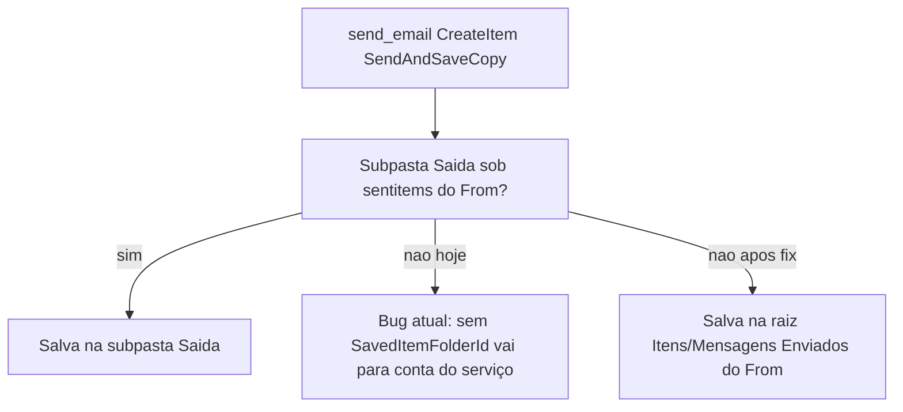

# Ajustes de envio de e-mails (remetente, Sent Items, andamento, cancelamento)

## 1. Remetentes OS vs SP — verificação

**Conclusão:** o padrão correto já está implementado.

| Faixa | Remetente padrão |
|-------|------------------|
| OS **&lt; 5000** | `sepim.deapa@camara.leg.br` |
| OS **≥ 5000** (SP/papelaria) | `papelaria.deapa@camara.leg.br` |

Nota: o código usa `>= 5000` (OS **5000** cai em papelaria). A UI/docs já falam “≥ 5000”.

Seleção em runtime: [`_resolve_send_plan`](app/backend/routers/email_routes.py) → `get_global_send_mailboxes()` em [`email_template_service.py`](app/backend/services/email_template_service.py), com fallback legado em [`email_config_service.py`](app/backend/services/email_config_service.py).

**Risco operacional (não é bug de código):** se em Configurações → Email existir `send_routing.by_type` (V2) preenchido para `proof`/`pt`/etc., esse valor **sobrescreve** a regra por número de OS. Na implementação, apenas **auditar/logar** o `mailbox_source` já retornado no send (`v2` | `global` | `legacy`) e, se a config V2 estiver desviando do padrão, limpar ou alinhar na UI — sem mudar a regra `>= 5000` sem pedido explícito.

Nenhuma mudança de mapeamento sepim/papelaria é necessária se a config global estiver nos defaults.

---

## 2. Itens / Mensagens Enviados — causa raiz e correção

### Regra de negócio (explícita)

As pastas de saída configuradas (`Saida de Provas`, `Saida de Prob. Tec.`, etc.) são **subpastas** da pasta de enviados da conta do **remetente** (`sepim.deapa` ou `papelaria.deapa`):

- No Outlook/Exchange isso aparece como **“Itens Enviados”** ou **“Mensagens Enviadas”** (mesmo folder distinguished `sentitems`; o rótulo muda conforme idioma/cliente).
- **Prioridade:** salvar na subpasta de saída, se ela existir sob essa pasta.
- **Fallback obrigatório:** se a subpasta **não** for localizada, a mensagem **deve** ficar salva na **própria** pasta Itens/Mensagens Enviados da conta do remetente.
- Critério de sucesso: a cópia **sempre** fica na mailbox do From — nunca “só enviada” sem cópia, e nunca na conta do serviço da API.

### Causa

Envio só via **Exchange EWS** (`CreateItem` + `MessageDisposition="SendAndSaveCopy"`) em [`ews_service.py`](app/backend/services/ews_service.py).

Hoje:

- Se a subpasta for encontrada sob `sentitems` da mailbox From → `SavedItemFolderId` com o `FolderId` dessa subpasta (comportamento desejado).
- Se **não** for encontrada (ou em outros callers sem `save_to_folder_id`) → **não** se envia `SavedItemFolderId`.

Sem `SavedItemFolderId`, o Exchange grava a cópia na **conta autenticada do serviço** (NTLM/SSPI da API), **não** em `sepim.deapa` / `papelaria.deapa`. Por isso os envios “somem” das caixas dos remetentes.

O standalone PHP já faz o certo: [`EwsMailSender.php`](standalone/ews-email-php/EwsMailSender.php) sempre define `DistinguishedFolderId Id="sentitems"` **com** `<Mailbox>` do `from_mailbox`.



### Correção (escolhida)

Em [`EWSService.send_email`](app/backend/services/ews_service.py):

1. Se `save_to_folder_id` estiver setado (subpasta localizada) → manter XML atual (`FolderId` da subpasta sob enviados do From).
2. Senão, se `from_mailbox` estiver setado → **sempre** emitir `SavedItemFolderId` apontando para a pasta distinguished `sentitems` **da mailbox do remetente** (Itens Enviados / Mensagens Enviadas):

```xml
<m:SavedItemFolderId>
  <t:DistinguishedFolderId Id="sentitems">
    <t:Mailbox>
      <t:EmailAddress>{from_mailbox}</t:EmailAddress>
    </t:Mailbox>
  </t:DistinguishedFolderId>
</m:SavedItemFolderId>
```

Isso garante o fallback do `send-pt` e de todos os outros callers que já passam `from_mailbox` (ativação, arquivos, testes de template, etc.): **a mensagem é salva** na conta do remetente, mesmo sem subpasta de saída.

Pré-requisito Exchange (já necessário para Send As): a conta da API precisa de permissão de **gravação** na mailbox compartilhada (Full Access / direito equivalente em Itens/Mensagens Enviados). Se a permissão faltar, o send pode falhar no save — tratar/logar erro EWS de forma clara.

**Fora de escopo neste ciclo:** espelhar a estratégia PHP `delegate_drafts` (Create em Drafts + SendItem), a menos que o fallback `sentitems` falhe em homologação.

---

## 3. Observação do andamento “Aguard. Aprovação” (prova)

Hoje em [`_pendencia_andamento_meta`](app/backend/routers/email_routes.py):

```text
Prova {versão} enviada por e-mail — arquivo: … — envio com anexo/portal
```

Destinatários **não** entram no payload de [`PendenciaAndamentoRequest`](app/backend/routers/email_routes.py); o front em [`EmailPendenciaDetail.tsx`](apps/web/src/features/email/components/EmailPendenciaDetail.tsx) não os reenvia no `onRegisterAndamento`.

### Formato alvo (substitui o texto atual de prova)

```text
P{versão} enviada para:
- email1@mail.com
- email2@mail.com
- emailN@mail.com
```

(`format_andamento_obs` continua prefixando o horário `HHhMM`.)

Situação permanece **`Aguard. Aprovação`**.

### Alterações

| Camada | Mudança |
|--------|---------|
| `PendenciaAndamentoRequest` | Campo `to: List[str] = []` |
| `_pendencia_andamento_meta` / `_register_pendencia_email_andamento` | Aceitar destinatários; montar obs no formato acima para `proof` |
| `send_pt` (quando `register_andamento=True`) | Passar `request.to` |
| Front (`EmailPendenciaDetail`, tipos em `api/email.ts`) | Incluir `to: destinatarios` no registro de andamento |
| Testes | Atualizar/estender `TestPendenciaAndamentoMeta` em [`test_email_pendencias.py`](app/backend/tests/test_email_pendencias.py) |

Default de conteúdo: **só** lista de destinatários (sem sufixos arquivo/modo), conforme o formato pedido.

---

## 4. Cancelamento de e-mail já enviado — análise (sem implementação)

| Objetivo | Viável? | Motivo |
|----------|---------|--------|
| Apagar cópia em **Itens Enviados** do remetente | Parcial | Exigiria persistir `ItemId`/`ChangeKey` do `CreateItem` (hoje `send_email` retorna `None`) e depois `DeleteItem`. Só remove a cópia do remetente. |
| **Recall** clássico do Outlook | Frágil / pouco confiável | Só ambiente Exchange interno, mensagem não lida, suporte EWS fraco vs Outlook desktop; falha com frequência. |
| Apagar da caixa do **destinatário** | Não com o stack atual | Exigiria impersonação/Full Access em cada mailbox de destino; o app não tem isso e não é adequado para e-mails externos. |
| Mitigar prova **portal** | Sim (app) | Invalidar token em `tabProofTokens` — o link para de funcionar; o e-mail permanece na caixa. |
| Mitigar prova **anexo** | Não via EWS | PDF já entregue. |

**Decisão:** não implementar “cancelar e-mail” nesta entrega. Se no futuro houver necessidade, o caminho realista é: (a) revogar token portal + (b) opcionalmente apagar cópia Sent Items se passarmos a guardar ItemId — **sem** promessa de exclusão no destinatário.

---

## Arquivos principais

- [`app/backend/services/ews_service.py`](app/backend/services/ews_service.py) — fallback `SavedItemFolderId` → raiz `sentitems` (Itens/Mensagens Enviados) da mailbox From
- [`app/backend/routers/email_routes.py`](app/backend/routers/email_routes.py) — obs de prova + `to` no andamento; busca de subpasta sob enviados do From permanece
- [`apps/web/src/features/email/components/EmailPendenciaDetail.tsx`](apps/web/src/features/email/components/EmailPendenciaDetail.tsx) — passar destinatários
- [`apps/web/src/api/email.ts`](apps/web/src/api/email.ts) — tipo do payload
- [`app/backend/tests/test_email_pendencias.py`](app/backend/tests/test_email_pendencias.py) — testes da nova obs
- Teste unitário leve do XML de save em EWS (mock/`_post` captura), se já houver padrão no repo

## Verificação

- Confirmar em log/resposta de send: OS &lt;5000 → sepim; ≥5000 → papelaria (sem override V2).
- Com subpasta presente: cópia em `Saida de Provas` / `Saida de Prob. Tec.` sob Itens/Mensagens Enviados do remetente.
- Sem subpasta: cópia na **raiz** Itens/Mensagens Enviados de sepim/papelaria (nunca na conta do serviço).
- Envio de prova + andamento: situação `Aguard. Aprovação` e obs com `P{n} enviada para:` + lista.
- Sem UI/API de cancelamento neste ciclo.