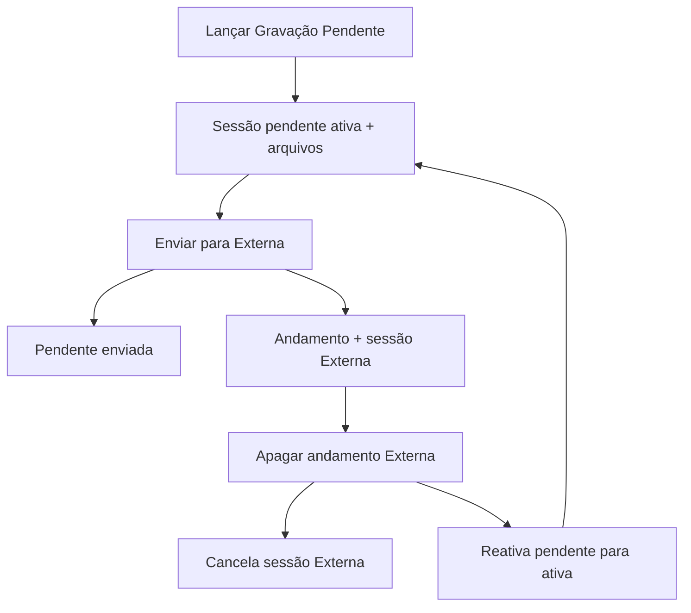

# Ajustes gravação pendente, lista de TIFs e exclusão

## Contexto

| Pedido | Causa atual |
|--------|-------------|
| Só PDFs no lançamento | Front e API exigem ≥1 máquina (`parsedChapas` / `validate_chapas_input`) |
| Texto Espelhos/Separações | Copy em [`GravacaoPendenteLaunchModal.tsx`](apps/web/src/features/gravacao-externa/components/GravacaoPendenteLaunchModal.tsx) ainda fala em “conjunto” |
| Filtro ao mudar pasta | [`NetworkFolderBrowserModal.tsx`](apps/web/src/features/gravacao-externa/components/NetworkFolderBrowserModal.tsx) só limpa `fileFilter` ao fechar o browser |
| Cad A/B separados | [`groupArquivosByChapa`](apps/web/src/features/gravacao-externa/utils/plateFilenameUtils.ts) agrupa por face; [`ArquivosChapaList`](apps/web/src/features/gravacao-externa/components/GravacaoExternaPreview.tsx) renderiza um card por face |
| Arquivos “somem” ao apagar Externa | Delete cancela externa; pendente fica `enviada`; UI só lê `Status = 'ativa'` |

**Decisão de escopo (agrupamento):** alterar o componente compartilhado da lista — a aba Pendente e a aba Externa passam a agrupar por caderno. Agrupar só na Pendente exigiria fork desnecessário.



---

## 1. Modal: PDF-only, textos e filtro de pasta

### 1.1 Aceitar lançamento só com PDFs

**Frontend** — [`GravacaoPendenteLaunchModal.tsx`](apps/web/src/features/gravacao-externa/components/GravacaoPendenteLaunchModal.tsx) `handleConfirm`:

- Manter regras atuais quando houver TIFs/máquinas (máquina obrigatória por linha com TIF, qty ≥ 1).
- Se `allTifArquivos.length === 0` e houver ≥1 PDF: permitir `parsedChapas = []` e **não** exigir máquina; pular validação conjuntos×páginas.
- Se houver TIFs: manter exigência de máquina e (quando há PDF com `pdfPageCount`) a validação de lâminas vs páginas.

**Backend** — alinhar a mesma regra:

- Em [`validate_chapas_input`](app/backend/services/gravacao_pendente_service.py) (ou no caller em [`os_routes.py`](app/backend/routers/os_routes.py) ~1375–1397 e em `update_pendente_session_arquivos`): permitir chapas vazias **somente** quando todos os arquivos validados forem PDF.
- Se houver TIF e chapas vazias, manter erro atual.
- [`format_gravacao_pendente_obs`](app/backend/routers/andamento_helpers.py): com chapas vazias, não listar máquinas vazias — usar algo como `Chapas por máquina:\n- (não informado)` + obs do usuário (padrão já usado em outros formatters).

Critério: lançar/alterar com só PDFs grava sessão `ativa` com arquivos PDF e zero linhas em `tab_os_gravacao_pendente_chapa`.

### 1.2 Texto abaixo dos PDFs

Trocar o bloco ~578–591 para:

```
Espelhos de chapas: {N} página(s)
Separações: {Y} TIF(s) ({Z} Lâmina(s))
```

Mapeamento dos contadores existentes: `pdfPageCount` → páginas; `tifSummary.fileCount` → TIFs; `tifSummary.groupCount` → Lâminas (ex-conjuntos). Ajustar pluralização (`página`/`páginas`, `TIF`/`TIFs`, `Lâmina`/`Lâminas`). Atualizar alerts/mensagens de mismatch que ainda dizem “conjunto” para “lâmina”, no mesmo sentido.

### 1.3 Limpar filtro ao mudar de pasta

Em [`NetworkFolderBrowserModal.tsx`](apps/web/src/features/gravacao-externa/components/NetworkFolderBrowserModal.tsx): ao alterar `relative` (home, voltar, clique em pasta, breadcrumb), `setFileFilter("")`. Implementação preferida: `useEffect` em `relative` (sem limpar no mount inicial desnecessário, ou limpar sempre que `relative` muda após open).

---

## 2. Lista de TIFs: agrupar por caderno → Frente / Verso

Arquivos principais:

- [`plateFilenameUtils.ts`](apps/web/src/features/gravacao-externa/utils/plateFilenameUtils.ts) (+ testes)
- [`GravacaoExternaPreview.tsx`](apps/web/src/features/gravacao-externa/components/GravacaoExternaPreview.tsx) (`ArquivosChapaList`)

### 2.1 Parse / agrupamento

Estender o parse de `Cad N X`:

- Extrair `cadernoNumber` e face (`A` → Frente, `B` → Verso; outras letras → rótulo da letra ou “Face X”).
- Nova função `groupArquivosByCaderno` (ou pós-processar `groupArquivosByChapa`) que produz:

```ts
{ cadernoKey: "Cad 0", displayLabel: "Cad 0", faces: [
  { face: "A", faceLabel: "Frente", ...PlateChapaGroup },
  { face: "B", faceLabel: "Verso", ...PlateChapaGroup },
]}
```

- Manter `groupKey` por face (necessário para composição/preview).
- Faces sem letra Cad (órfãos) continuam como cards avulsos ou seção “Outros”, sem quebrar o fluxo atual.

### 2.2 UI

Em `ArquivosChapaList`:

- Um card expansível por **caderno** (`Cad 0`, `Cad 1`).
- Expandido: subseções **Frente** e **Verso** (só as que existirem), cada uma com TIFs CMYK/Pantone + linha Composição (mesma lógica atual por face).
- `expandedKeys` passa a usar chave de caderno; ao selecionar arquivo/composição, expandir o caderno pai.
- Espelhos PDF e “others” permanecem como hoje.

Sem mudança de API/DB: agrupamento só no cliente a partir de `nome`.

---

## 3. Persistência dos arquivos ao apagar Gravação Externa

**Causa raiz:** ao apagar o andamento Externa, [`delete_os_history`](app/backend/routers/os_routes.py) chama `cancel_active_externa_sessions`; a sessão pendente permanece `enviada` com arquivos intactos, mas list/detail só enxergam `ativa`.

**Correção (backend):**

1. Nova função em [`gravacao_pendente_service.py`](app/backend/services/gravacao_pendente_service.py), ex.: `reactivate_pendente_after_externa_cancel(ano, os_id)`:
   - Localizar sessão externa cancelada (ou a que estava ativa) com `OrigemPendenteId` para a OS; fallback: última pendente `enviada` da OS.
   - `UPDATE ... SET Status = 'ativa', EnviadaEm = NULL, EnviadaPorPonto = NULL WHERE Id = ? AND Status = 'enviada'`.
2. Chamar logo após `cancel_active_externa_sessions` no delete do andamento Externa (~2096–2099).
3. Teste em [`test_gravacao_pendente_service.py`](app/backend/tests/test_gravacao_pendente_service.py) (ou teste de rota de delete): após cancelar externa, `get_active_pendente_session` volta a retornar a sessão com os mesmos arquivos/chapas.

**Não alterar** o cancelamento ao apagar o andamento “Gravação Pendente” (`cancel_active_pendente_sessions` em `ativa` permanece).

Front: nenhuma mudança obrigatória se a sessão voltar a `ativa`.

---

## Testes focados

- Backend: `validate_chapas_input` / create history PDF-only; reativação pós-delete Externa.
- Frontend: `plateFilenameUtils.test.ts` (Cad 0 A+B → um caderno com Frente/Verso); ajustes de copy/validação do modal se houver testes; filtro do browser se houver teste fácil.
- Rodar: testes pytest/vitest dos módulos tocados + typecheck se o diff TypeScript for amplo.

## Critérios de aceite

1. Lançar Gravação Pendente só com PDF(s), sem máquina/TIF → sucesso; com TIF sem máquina → continua bloqueado.
2. Resumo sob os PDFs no formato “Espelhos de chapas… / Separações… (N Lâmina(s))”.
3. Mudar de pasta no browser zera o filtro.
4. Lista mostra `Cad N`; expandido mostra Frente/Verso com TIFs + Composição.
5. Apagar andamento Gravação Externa mantém andamento Pendente e os arquivos/chapas visíveis e editáveis de novo (sem relançar).
