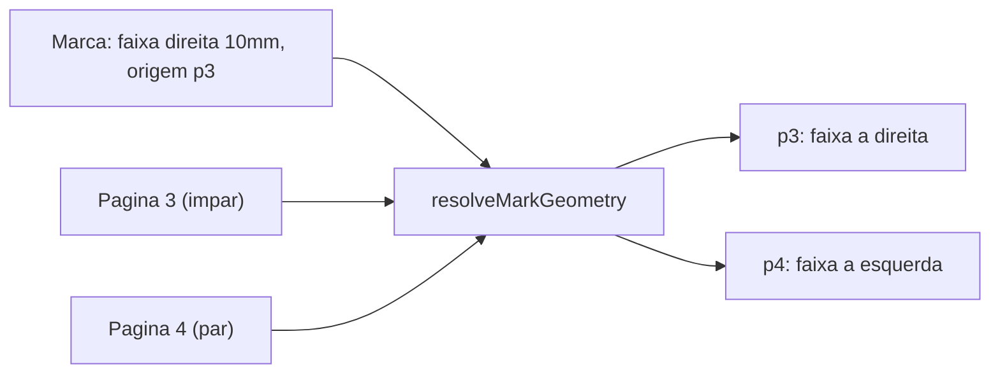
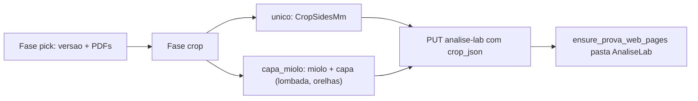

## Ajustes nas marcas do Análise Lab e passo de corte

Cinco ajustes nas ferramentas de marcação mais o passo de configuração de corte (item 6). Fora do lab, a única mudança é tornar dois componentes de crop da Prova WEB parametrizáveis por props opcionais.

### 1. Borda "todas" (`all`)

Valor canônico armazenado: `all` (rótulo PT-BR só na UI, mantendo o padrão de chaves em inglês já usado em `edge`/`cor`).

- [`analise_lab_service.py`](app/backend/services/analise_lab_service.py): `MARK_EDGES` passa a incluir `"all"`; `_validate_geometry` aceita `all` em `offset_corte` e `faixa`.
- [`AnaliseLabMarksLayer.tsx`](apps/web/src/features/analise-lab/AnaliseLabMarksLayer.tsx): com `edge === "all"`, `offset_corte` desenha as 4 linhas e `faixa` os 4 retângulos — uma única marca na lista, um único registro para editar.
- Formulário de faixa ganha campo "De (mm)" além de "Até (mm)" (hoje `fromMm` é fixo em 0).

### 2. Bordas e cores em PT-BR

Novo `apps/web/src/features/analise-lab/analiseLabLabels.ts` com três mapas usados por painel e lista:

- `EDGE_LABELS`: Superior, Direita, Inferior, Esquerda, Todas as bordas.
- `COLOR_LABELS`: Vermelho, Laranja, Amarelo, Verde, Azul, Roxo, Preto, Branco.
- `TIPO_LABELS`: Offset de corte, Faixa, Retângulo, Ponto, Medida, Grade — a lista de marcas hoje mostra `m.tipo` cru em [`AnaliseLabMarkTools.tsx`](apps/web/src/features/analise-lab/AnaliseLabMarkTools.tsx).

O mapa de cor → hex continua no layer (é render, não rótulo).

### 3. Medir sinaliza a medida do traço

- [`AnaliseLabInspector.tsx`](apps/web/src/features/analise-lab/AnaliseLabInspector.tsx): com `draft` definido e ferramenta `medida`, desenhar em SVG a linha de prévia do primeiro clique até o cursor (já existe `hoverMm`) com a distância viva em mm. Mesma prévia para `retangulo`, mostrando `L × A`.
- No layer, a medida gravada passa a exibir sempre o valor: hoje é `mark.rotulo || formatMm(dist)`, muda para `rotulo · 12,4 mm` (ou só o valor quando não há rótulo).

### 4. Editar marcas existentes (painel numérico)

- Novo `AnaliseLabMarkEditor.tsx`: clicar na marca da lista abre o editor com os campos do tipo (offset/faixa: borda + mm; retângulo: x, y, largura, altura; ponto: x, y; medida: 2 pontos + distância calculada; grade: passo) mais rótulo, cor, página (0 = todas) e espelhar. Botões Salvar, Cancelar, Excluir.
- Cliente HTTP: `updateAnaliseLabMark` em [`analiseLab.ts`](apps/web/src/api/analiseLab.ts) para o `PATCH .../marcas/{id}` que o backend já expõe.
- [`AnaliseLabPage.tsx`](apps/web/src/features/analise-lab/AnaliseLabPage.tsx): estado `selectedMarkId` e `handleUpdateMark` (atualiza `localMarks` e invalida a query). O layer recebe `selectedMarkId` e destaca a marca selecionada.

### 5. Espelhamento entre páginas pares e ímpares

Checkbox "Espelhar em páginas opostas" (padrão ligado), visível quando "Aplicar a todas as páginas" está marcado e o tipo é `faixa`, `retangulo` ou `offset_corte`.

Para saber qual paridade é a original, a marca guarda a página onde foi criada:

- [`analise_lab_schema.py`](app/backend/analise_lab_schema.py) ganha o helper `_column_exists` (padrão de [`prova_web_schema.py`](app/backend/prova_web_schema.py)) e `ALTER TABLE` idempotentes em `tabAnaliseLabMarca`: `Espelhar TINYINT(1) NOT NULL DEFAULT 0` e `PaginaOrigem INT NOT NULL DEFAULT 0`.
- `add_mark` / `update_mark` / `_row_to_mark` passam a tratar `espelhar` e `paginaOrigem`; `AnaliseLabMarkCreate` e `AnaliseLabMarkUpdate` em [`analise_lab_routes.py`](app/backend/routers/analise_lab_routes.py) recebem os dois campos.

Transformação em tempo de render (nada duplicado no banco), em `analiseLabGeometry.ts`:

```ts
// espelha quando a marca vale para todas as páginas e a paridade difere da origem
mirrored = mark.pagina === 0 && mark.espelhar
  && (pageNumber % 2) !== ((mark.paginaOrigem || 1) % 2);

mirrorEdge: left <-> right; top | bottom | all inalterados
retangulo:  xMm' = pageWidthMm - xMm - wMm  (y, w, h inalterados)
```

O layer chama `resolveMarkGeometry(mark, pageNumber, pageWidthMm)` antes de desenhar, então inspeção e aba Folhear ficam consistentes.



### 6. Configuração de corte com lombada e orelhas

Hoje o picker do lab vai direto do PDF para o render, e o `crop_json` sempre sai `null` — o técnico vê a página crua. O passo de corte passa a existir, cobrindo **único** e **capa e miolo** (lombada e orelhas). Folha dobrada e espiral ficam fora.

O render já está pronto: [`analise_lab_job_service.py`](app/backend/services/analise_lab_job_service.py) chama `ensure_prova_web_pages(..., crop_json=session.get("cropJson"))`, e [`AnaliseLabSave`](app/backend/routers/analise_lab_routes.py) já aceita `crop_json`. Falta produzir esse JSON e servir os metadados do PDF.

#### 6.1 Endpoints espelhados no lab

`GET /prova-web/pdf` e `GET /prova-web/crop-meta` exigem `ctx_prova_web` (`_require_prova_web` em [`prova_web_routes.py`](app/backend/routers/prova_web_routes.py)), então quem só tem `sb_analise` não pode usá-los. Dois endpoints novos em [`analise_lab_routes.py`](app/backend/routers/analise_lab_routes.py), espelhos diretos com gate `_require_analise`:

- `GET /os/{ano}/{os_id}/analise-lab/pdf?path=` — `FileResponse` inline, path via `resolve_os_relative_pdf`.
- `GET /os/{ano}/{os_id}/analise-lab/crop-meta?path=&detect_marks=` — `build_pdf_crop_meta` de [`prova_web_crop_service.py`](app/backend/services/prova_web_crop_service.py) (serviço puro, sem estado de prova).

No cliente [`analiseLab.ts`](apps/web/src/api/analiseLab.ts): `analiseLabSourcePdfUrl`, `fetchAnaliseLabCropMeta` e `crop_json` tipado como `ProvaWebCropJson` em vez de `Record<string, unknown>`.

#### 6.2 Reuso dos componentes de crop (props aditivas)

Em vez de duplicar o painel de corte e o assistente de capa, eles ganham uma fonte de dados injetável. Novo tipo em `apps/web/src/features/prova-web/provaWebCropSource.ts`:

```ts
export interface ProvaWebCropSource {
  pdfUrl: (relativePath: string) => string;
  fetchMeta: (relativePath: string, opts?: { detectMarks?: boolean }) => Promise<ProvaWebCropMetaResponse>;
  keyPrefix: string; // isola o cache do React Query
}
```

- [`useProvaWebCropMeta.ts`](apps/web/src/features/prova-web/useProvaWebCropMeta.ts): aceita `source?` opcional; sem ele, mantém `fetchProvaWebCropMeta` e a mesma query key (um único `useQuery`, ordem de hooks estável).
- [`ProvaWebCropPanel.tsx`](apps/web/src/features/prova-web/ProvaWebCropPanel.tsx): prop opcional `cropSource?`; usa `cropSource.pdfUrl(relativePath)` no preview pdf.js em vez de `provaWebSourcePdfUrl`.
- [`ProvaWebCoverWizard.tsx`](apps/web/src/features/prova-web/ProvaWebCoverWizard.tsx): repassa `cropSource` ao painel.

Sem a prop, Prova WEB staff e portal seguem idênticos. `provaWebCenteredCrop.ts` (seed de TrimBox/BleedBox e `coverSpreadTargetMm`) é reusado sem alteração.

#### 6.3 Fluxo no lab

`AnaliseLabSourcePicker` ganha `phase: "pick" | "crop"`, no padrão de [`ProvaWebFilePicker.tsx`](apps/web/src/features/prova-web/ProvaWebFilePicker.tsx): escolher versão e PDFs, **Continuar**, ajustar corte, **Gerar**. Novo `AnaliseLabCropAssistant.tsx` monta o JSON:

- `unico` → `{ unico: CropSidesMm }` (um `ProvaWebCropPanel`).
- `capa_miolo` → `{ miolo: CropSidesMm, capa: ProvaWebCapaCrop }`, com o miolo no painel e a capa no `ProvaWebCoverWizard` (layout spread, `lombadaMm`, `orelhaEsquerdaMm`, `orelhaDireitaMm`, mapeamento de faces).

O seed usa `formatoLarguraMm` / `formatoAlturaMm`, que `GET /analise-lab` já devolve via `resolve_formato_dimensions`. Ao clicar "Trocar arquivo" com sessão existente, o picker reabre já com `session.cropJson`, permitindo só reajustar o corte. Como o manifest passa a trazer `bookMockup`, a aba Folhear mostra o livro montado com lombada.



#### 6.4 Aviso quando o corte muda

Trocar o corte muda as dimensões da página, então marcas antigas em mm podem sair de lugar. Decisão: manter as marcas e avisar.

- Migração (junto com `Espelhar`/`PaginaOrigem`): `CropVersao INT NOT NULL DEFAULT 1` em `tabAnaliseLabSessao` e em `tabAnaliseLabMarca`.
- `upsert_session` incrementa `CropVersao` da sessão apenas quando o `crop_json` canônico difere do gravado; `add_mark` copia a versão corrente da sessão.
- `AnaliseLabPage` mostra uma faixa de aviso quando existe marca com `cropVersao` diferente da sessão: "N marcas foram criadas com outra configuração de corte e podem estar fora de posição."

### Testes

- pytest [`test_analise_lab.py`](app/backend/tests/test_analise_lab.py): `edge: "all"` aceito em `offset_corte` e `faixa`, borda inválida rejeitada, defaults de `espelhar`/`paginaOrigem`; `crop-meta` e `pdf` do lab rejeitam traversal e exigem `sb_analise`; `CropVersao` só incrementa quando o corte muda.
- vitest [`analiseLabGeometry.test.ts`](apps/web/src/features/analise-lab/analiseLabGeometry.test.ts): `mirrorEdge`, `xMm' = W - x - w`, no-op na mesma paridade e espelho na paridade oposta.
- vitest de contrato: `cropSource` ausente mantém a fonte da Prova WEB; assistant do lab monta `{ miolo, capa }` com lombada e orelhas.
- Regressão: suíte `test_prova_web_*` e o teste de contrato do flipbook seguem intactos.

### Verificação manual

Gerar o lab de uma OS capa+miolo informando lombada e orelhas, conferindo na aba Folhear que o livro sai montado; criar faixa de 10 mm à direita em página ímpar com "todas as páginas" + espelhar e conferir que na par aparece à esquerda; medir um traço vendo o valor durante o desenho; editar a faixa pelo painel; regerar com outro corte e conferir o aviso de marcas desatualizadas. Confirmar que `/prova-web/{ano}/{os}` e o portal do cliente seguem idênticos. Requer reiniciar a API (ALTER TABLE no startup).