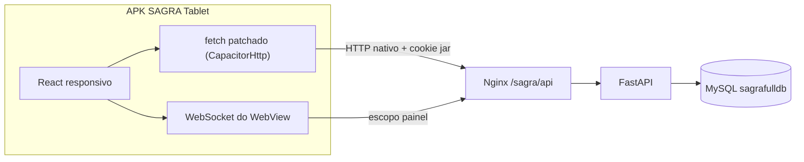

# APK do painel/tablet (pasta `mobile/`, isolada)

## Descobertas que definem a arquitetura

1. **Sessão é cookie `HttpOnly` + `SameSite=lax`, sem token/Bearer** ([session_auth.py](app/backend/security/session_auth.py)). Num WebView com origem local (`https://localhost`), o Android **não envia** esse cookie para `cgrafsysvm.camara.leg.br`. Solução sem tocar no servidor: ligar **`CapacitorHttp`** no `capacitor.config.ts`, que substitui `window.fetch`/`XMLHttpRequest` por HTTP nativo Java — usa o cookie jar do Android e ignora CORS/SameSite. O backend não faz nenhuma checagem de Origin/Referer/CSRF ([api_auth.py](app/backend/security/api_auth.py)), então isso funciona sem alteração.

2. **`cgrafsysvm.camara.leg.br` é host "internet pública"** ([cloudflare_access.py](app/backend/security/cloudflare_access.py)). Consequências obrigatórias:
   - `POST /auth/session` (ponto+nome) → **403**. O app deve usar `POST /auth/login` (ponto ou e-mail + **senha**).
   - Sessão por senha usa **permissões por ponto** (`user_permissions`), não por IP — ideal para celular, sem cadastro de IP.
   - Prefixos de produção: API em `https://cgrafsysvm.camara.leg.br/sagra/api/...`, WS em `wss://cgrafsysvm.camara.leg.br/sagra/api/ws/` ([nginx.conf](deploy/nginx/conf/nginx.conf)).

3. **A configuração do administrador já é acessível hoje.** `GET /sagra/api/settings/preferences/painel_setor` retorna a config salva do usuário e, se não houver, faz fallback automático para o padrão que o admin definiu na página Usuários (tabela `tabSetorPainelDefaults`, seção "Padrão do painel por setor"), injetando o setor do usuário ([settings_routes.py](app/backend/routers/settings_routes.py)). A chave `painel_tablet` **não existe** no backend (retorna 400) — por isso o app usará `painel_setor`. Nenhuma mudança de backend é necessária.

4. **WebSocket sem cookie cai no escopo `painel`**, que recebe exatamente `system_update`, `pcp_queue_update` e `force_refresh` ([realtime.py](app/backend/routers/realtime.py)) — tudo o que o quadro precisa. O polling com backoff continua como rede de segurança.

5. **Ambiente de build já pronto**: `JAVA_HOME` = JDK 17, `ANDROID_HOME` com `build-tools`, `platform-tools` e `platforms`. Dá para gerar o APK localmente.



## Isolamento total do projeto web

Pasta nova `mobile/` na raiz, **fora** do workspace pnpm (`pnpm-workspace.yaml` cobre só `apps/*` e `packages/*`). Para o pnpm não subir até a raiz, `mobile/` terá o próprio `pnpm-workspace.yaml` vazio, virando raiz independente. Assim `pnpm install`, `pnpm build` e `pnpm -r run build` da raiz continuam idênticos. O código compartilhado (ordenação, agrupamento em colunas, formatação de OS/SP) será **copiado e adaptado**, não importado — zero acoplamento.

## Estrutura

```
mobile/
  package.json, pnpm-workspace.yaml, .npmrc, .gitignore, README.md
  vite.config.ts, tsconfig*.json, index.html, capacitor.config.ts
  src/
    lib/        config.ts (URLs), http.ts, ws.ts, useBreakpoint.ts
    auth/       authStore.ts, session.ts, LoginScreen.tsx
    board/      types.ts, constants.ts, utils.ts, api.ts,
                useBoardConfig.ts, useBoardData.ts,
                BoardScreen.tsx, ColumnTabs.tsx, KanbanBoard.tsx, OsCard.tsx
    os/         api.ts, OsSheet.tsx, OsSummary.tsx, AndamentoForm.tsx,
                FaceCapture.tsx, PontoKeypad.tsx
  android/      (gerado por `cap add android`, versionado)
  scripts/build-apk.ps1
```

## Design responsivo

- **Celular (< 640px)**: uma coluna por vez. Barra de chips no topo com título da coluna e contagem, deslizável; cards em lista vertical com alvo de toque ≥ 56px, número da OS grande (OS/SP formatado por `formatOsNumber`), título em 2 linhas, situação e badge de prioridade. Detalhe da OS abre como folha em tela cheia com abas "Resumo" e "Lançar andamento".
- **Tablet (≥ 640px)**: kanban com as colunas da config; se não couberem, rolagem horizontal com colunas de largura mínima fixa. Detalhe abre em modal dividido (resumo à esquerda, lançamento à direita), como na web.
- Tema escuro com tokens próprios (portados de `dashboard-setor.css`), tipografia com `clamp()`, respeito a `env(safe-area-inset-*)` e suporte a retrato/paisagem.

## Fluxo funcional (paridade com `/painel/tablet`)

1. **Login** — `POST /sagra/api/auth/login` (ponto/e-mail + senha). Sessão persiste no cookie jar nativo; o app revalida com `GET /auth/me` na abertura.
2. **Permissão e configuração** — `GET /permissions` exige `sb_dashboard_tablet`; `painel_setores` define os setores visíveis. `GET /settings/preferences/painel_setor` traz colunas/títulos/andamentos definidos pelo admin; fallback para `GET /settings/setor-painel-default/{setor}` e, por último, os defaults do código. Sem edição de layout no app — só um seletor de setor no cabeçalho quando o usuário tem mais de um permitido.
3. **Quadro** — `GET /os/search?setor=&painel=1&include_finished=false&limit=200` combinado com `GET /pcp/queue?setor=&painel=1`, usando a mesma lógica de merge, ordenação por `pcp_ordem`/prioridade e destaque de novidades (`processDashboardData`). WebSocket para atualização imediata + polling de 5 min conectado / backoff 5–30s desconectado.
4. **Lançar andamento** — `GET /os/{ano}/{id}/details` no resumo; captura facial silenciosa pela câmera frontal via `getUserMedia` → `POST /tablet/face/verify` (multipart pelo fetch patchado, anexando um `File` real para o bridge serializar corretamente); fallback por teclado de ponto (`GET /tablet/ponto/{ponto}`, `POST /tablet/ponto/register`); atalhos `Recebido` / `Em Execução` / `Saída p/` mais lista completa; setor de destino obrigatório nos prefixos de `TABLET_DESTINO_PREFIXES`; bloqueio de `Entregue`, `Cancelada`, `Cancelado`, `Gravação Pendente`; grava com `POST /os/{ano}/{id}/history` enviando `face_token` e `from_tablet: true`.
5. **Fora de escopo por decisão sua**: ditado por voz (a Web Speech API não existe em WebView Android) e o modal de configuração de colunas dentro do app.

## Configuração Android

- `appId: br.leg.camara.sagra.tablet`, `appName: SAGRA Tablet`, `webDir: dist`, `plugins.CapacitorHttp.enabled: true`, `androidScheme: https`.
- `AndroidManifest.xml`: `INTERNET`, `CAMERA`, `usesCleartextTraffic` desligado (produção é HTTPS) e `networkSecurityConfig` apontando para um XML que permite texto claro apenas para `10.1.1.73`/`cgrafsysvm` — assim o mesmo APK também serve para a intranet se necessário.
- `orientation="unspecified"` e `resizeableActivity` para funcionar em retrato e paisagem; tela ativa via `KeepAwake`.
- Ícones e splash gerados a partir de um SVG simples, sem depender de assets do app web.

## Build

`mobile/scripts/build-apk.ps1` encadeia: `pnpm install` → `pnpm build` → `npx cap sync android` → `gradlew assembleDebug` (ou `assembleRelease` com `-Release`, lendo keystore de variáveis de ambiente, keystore fora do versionamento). Saída em `mobile/android/app/build/outputs/apk/`.

Para validar a responsividade sem dispositivo, o `vite.config.ts` terá proxy de `/sagra/api` para `https://cgrafsysvm.camara.leg.br` com `changeOrigin` e reescrita de domínio de cookie, permitindo rodar `pnpm dev` no navegador e testar em várias larguras.

## Riscos a confirmar durante a execução

- **Certificado TLS**: se `cgrafsysvm.camara.leg.br` usar CA interna da Câmara, o Android rejeita a conexão. O `network_security_config.xml` já será criado com o ponto de extensão para confiar num certificado em `res/raw/` — só precisaremos do arquivo `.crt` se isso acontecer.
- **Senha do usuário**: quem só usava ponto+nome na LAN pode não ter senha cadastrada; nesse caso é preciso ativar a conta pelo fluxo de e-mail antes de usar o APK.
- **Multipart via CapacitorHttp**: há histórico de bugs com `Blob`; usaremos Capacitor 7 e `File` nomeado, com teste específico do `/tablet/face/verify` antes de fechar.
