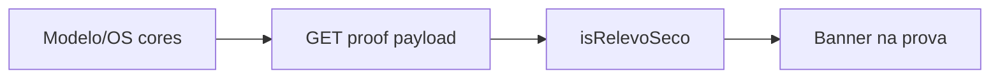

# Aviso de relevo seco na aprovação

## Contexto

Relevo seco é a variante de **cores** do modelo/OS (`Relev Seco` / `Relevo seco`), normalizada em [`papelaria_models_service.py`](app/backend/services/papelaria_models_service.py) por `_normalizar_cores_os` (`"relev"` / `"relevo"` → `"relev seco"`).

A página de aprovação compartilha [`ClienteProofPage.tsx`](apps/web/src/features/cliente/components/proof/ClienteProofPage.tsx) (portal público e `/cliente/.../prova`). Hoje o payload **não inclui `cores`**, então a UI não consegue detectar o caso.

Escopo: **ambas** as telas (mesmo componente).

## Abordagem



1. Backend: resolver e enviar `cores` no contexto Papelaria da prova.
2. Frontend: detectar relevo seco e mostrar banner fixo acima do PDF/mockup.

## Alterações

### 1. Backend — expor `cores`

Em [`proof_papelaria_service.py`](app/backend/services/proof_papelaria_service.py):

- Em `resolve_papelaria_proof_context`: ler `cores` do modelo (`get_modelo_by_id`); se vazio, fallback da OS (`tabDetalhesServico.Cores` / `CoresDescricao`).
- Incluir `"cores"` no dict do contexto e em `build_portal_papelaria_edit_payload`.

Em [`proof_portal_routes.py`](app/backend/routers/proof_portal_routes.py) (`GET /client/proof/{ano}/{os_id}`):

- Se `papelaria_edit` existir, `cores` já vem no objeto.
- Se houver `papelaria_ctx` sem edit completo, ainda assim enviar `cores` no payload (campo top-level `cores` ou stub mínimo em `papelaria`) para o banner funcionar quando há PDF Papelaria sem job de edição.

Helper reutilizável (ex.: `is_relevo_seco_cores(cores: str) -> bool`) ao lado de `_normalizar_cores_os`, para testes e possível uso no route se preferirmos flag booleana. Preferência: enviar a string `cores` e detectar no front com a mesma regra (`/relev/i`), espelhando o backend.

### 2. Frontend — tipos + detecção

Em [`proof-portal.ts`](apps/web/src/api/proof-portal.ts):

- Adicionar `cores?: string` em `ProofPortalPapelariaData` e, se necessário, em `ProofPortalData`.

Helper pequeno (ex. em `ClienteProofPortalExtras.tsx` ou util local):

```ts
export function isRelevoSecoCores(cores?: string | null): boolean {
  return /relev/i.test((cores ?? "").trim());
}
```

### 3. Frontend — banner em destaque

Em [`ClienteProofPortalExtras.tsx`](apps/web/src/features/cliente/components/proof/ClienteProofPortalExtras.tsx), novo componente no estilo do banner âmbar existente (`ClienteProofPortalInstructionBanner`):

Texto (sentido do pedido):

> **Importante:** Os contornos e textos em vermelho não serão impressos. São apenas indicadores da posição do relevo seco no produto.

Em [`ClienteProofPage.tsx`](apps/web/src/features/cliente/components/proof/ClienteProofPage.tsx):

- Calcular `showRelevoSecoNotice` a partir de `data?.papelaria?.cores` (e fallback top-level se houver).
- Renderizar o banner com `shrink-0` **acima** da área de conteúdo na vista principal de aprovação (ramo `showMockup` e, se aplicável, PDF Papelaria sem mockup), para permanecer visível sem cortar o produto.

Não alterar o tamanho do mockup nem a página staff da Papelaria.

### 4. Testes

- Backend: caso curto em teste existente de proof/papelaria (ou `test_papelaria_models_service`) para `is_relevo_seco_cores` / normalização.
- Frontend: teste unitário do helper `isRelevoSecoCores` (`Relev Seco` → true; `Policromia` → false).

## Critérios de aceite

- Prova Papelaria com cores de relevo seco mostra o aviso em destaque na aprovação.
- Prova sem relevo seco não mostra o aviso.
- Contornos/textos vermelhos continuam visíveis no PDF; só o texto explicativo é adicionado.
- Portal público e área logada do cliente compartilham o mesmo comportamento.
