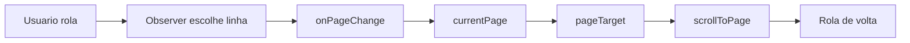

_Rascunho de plano — revise e ajuste antes de implementar._

# Ações de item da /analise no Análise Lab + zoom e correção de rolagem

## Contexto apurado

Na `/analise` as ações por item são (ver [AnaliseItemsTree.tsx](apps/web/src/features/analise/components/AnaliseItemsTree.tsx) e [AnalisePage.tsx](apps/web/src/features/analise/components/AnalisePage.tsx)):

- Arrastar item entre componentes com `@dnd-kit/core` (`useDraggable` na linha do item, `useDroppable` na zona do componente, `handleDragEnd` valida mesma versão), persistindo via `POST /analise/item/update { id_item, componente }`.
- "Replicar PT" (ícone `Copy`), habilitado quando o item é de versão anterior (`isItemFromOlderVersion`), que reinsere o item na versão atual via `POST /analise/item/add`.
- Cadeado "Resolução obrigatória" → `POST /analise/item/toggle-resolucao-obrigatoria`.
- Chave inglesa "Corrigido" (controle interno SEFOC, some do portal do cliente) + textarea "Observação da correção" → `POST /analise/item/toggle-corrigido-sefoc`.
- Não existe reordenação por `Ordem` na `/analise` (a coluna nem existe em `tabAnaliseItens`); no Lab existe `Ordem`, então a reordenação por arrasto dentro do componente sai de graça junto com o DnD.

No Lab, [tabAnaliseLabItem](app/backend/analise_lab_schema.py) já tem `Componente`, `Ordem`, `ResolucaoObrigatoria` e `VersaoLabel`; falta `CorrigidoSefoc`/`ObsCorrecaoSefoc`. Itens de versões anteriores vivem na mesma sessão com outro `VersaoLabel`, e [AnaliseLabItemList.tsx](apps/web/src/features/analise-lab/AnaliseLabItemList.tsx) já os agrupa e marca como "leitura".

## Bug de rolagem na visualização dupla (causa raiz)

Em [AnaliseLabInspector.tsx](apps/web/src/features/analise-lab/AnaliseLabInspector.tsx) o efeito de navegação depende de `pageTarget.page`, não só do `nonce`:

```205:209:apps/web/src/features/analise-lab/AnaliseLabInspector.tsx
  useEffect(() => {
    if (!pageTarget?.page) return;
    scrollToPage(pageTarget.page);
    // eslint-disable-next-line react-hooks/exhaustive-deps
  }, [pageTarget?.nonce, pageTarget?.page]);
```

Como o pai passa `pageTarget={{ page: currentPage, nonce: pageNonce }}` e recebe `onPageChange={(page) => setCurrentPage(page)}` ([AnaliseLabPage.tsx](apps/web/src/features/analise-lab/AnaliseLabPage.tsx) L826-827), rolar dispara `onPageChange` → muda `currentPage` → muda `pageTarget.page` → `scrollToPage` rola de volta para o início da linha. Em modo duplo isso é pior porque a linha `[14,15]` tem duas páginas e o observador com `rootMargin: "100% 0px"` escolhe a linha por `intersectionRatio` de forma instável.



Correções: navegar apenas quando o `nonce` mudar (guardar `lastNonceRef`), detectar a linha ativa pela posição de rolagem (linha que cobre o centro da área visível, com rAF) em vez do `intersectionRatio`, manter o `IntersectionObserver` só para lazy load, emitir `onPageChange` apenas quando o número mudar de fato, e liberar o `suppressObserverRef` no evento `scrollend` (com timeout de segurança) em vez de 500 ms fixos.

## Backend

1. [analise_lab_schema.py](app/backend/analise_lab_schema.py): incluir `CorrigidoSefoc TINYINT(1) NOT NULL DEFAULT 0` e `ObsCorrecaoSefoc TEXT NULL` no `_CREATE_TAB_ITEM_SQL` e como `_ensure_column` (padrão já usado para `ItemID`).
2. [analise_lab_items_service.py](app/backend/services/analise_lab_items_service.py):
   - `_SELECT_ITEM`/`_row_to_item`: expor `corrigidoSefoc` e `obsCorrecaoSefoc`.
   - `update_item(..., corrigido_sefoc=None, obs_correcao_sefoc=None)`; ao desmarcar corrigido, limpar a observação.
   - `build_replica_payload(item, *, versao_label)` — helper puro que copia `titulo`, `htmlSnapshot`, `obs`, `componente`, `escopo`, `pagina`, `paginas`, `idProblemaPadrao`, `resolucaoObrigatoria`, e zera `itemAnaliseId`/`corrigidoSefoc`.
   - `replicate_items(sessao_id, item_ids, *, versao_label, copiar_marcas=False)` usando o helper; com `copiar_marcas`, duplica as linhas de `tabAnaliseLabMarca` com `ItemID` apontando para o novo item.
   - `reorder_items(sessao_id, ordered_ids)` gravando `Ordem` pela posição (ignora ids de outra sessão).
3. [analise_lab_routes.py](app/backend/routers/analise_lab_routes.py):
   - `AnaliseLabItemUpdate` ganha `corrigido_sefoc: Optional[bool]` e `obs_correcao_sefoc: Optional[str]`.
   - `POST /os/{ano}/{os_id}/analise-lab/itens/replicar` com `{ item_ids: list[int], copiar_marcas: bool = False }`, usando o `VersaoLabel` atual da sessão; retorna os itens criados.
   - `POST /os/{ano}/{os_id}/analise-lab/itens/reordenar` com `{ ordem: list[int] }`.
4. [analise_lab_report_service.py](app/backend/services/analise_lab_report_service.py) `mirror_items_to_analise`: propagar `ResolucaoObrigatoria`, `CorrigidoSefoc` e `ObsCorrecaoSefoc` no INSERT/UPDATE de `tabAnaliseItens` (hoje só copia `ID_ProblemaPadrao`, `Componente`, `Versao`, `Obs`, `HTML_Snapshot`), reaproveitando os helpers de migração de coluna de [analise_routes.py](app/backend/routers/analise_routes.py).

## Frontend — lista de itens

5. [api/analiseLab.ts](apps/web/src/api/analiseLab.ts): `corrigidoSefoc`/`obsCorrecaoSefoc` em `AnaliseLabItem` e em `UpdateAnaliseLabItemPayload`; novas funções `replicateAnaliseLabItems` e `reorderAnaliseLabItems`.
6. Novo `apps/web/src/features/analise-lab/analiseLabItemsTree.ts` (espelhando [analiseItemsTree.ts](apps/web/src/features/analise/analiseItemsTree.ts)): `buildLabItemsTree(items, currentVersaoLabel)`, `labItemDragId`, `labComponentDropId`, `isLabVersionReadOnly` e `canDropLabItem(source, target)` (mesmo `versaoLabel`, componente diferente ou reordenação dentro do mesmo componente).
7. Reescrever [AnaliseLabItemList.tsx](apps/web/src/features/analise-lab/AnaliseLabItemList.tsx):
   - `DndContext` + `PointerSensor` com `activationConstraint: { distance: 6 }`; item `useDraggable`, cabeçalho/lista de cada componente `useDroppable`; drop entre componentes chama `onMoveComponent(itemId, componente)`; drop dentro do mesmo componente chama `onReorder(ids)`.
   - Por item: selo "Obrigatória" (âmbar) e "Corrigido" (verde); botões cadeado (`Lock`/`LockOpen`), chave inglesa (`Wrench`), lixeira; e, em grupo de versão anterior, botão `Copy` "Replicar".
   - No cabeçalho de cada versão anterior, botão "Replicar todos" abrindo o diálogo do item 8.
8. Novo `AnaliseLabReplicateDialog.tsx`: lista os itens da versão de origem com checkboxes (todos marcados por padrão), opção "copiar marcas vinculadas" (desmarcada) e botão confirmar.
9. [AnaliseLabItemPanel.tsx](apps/web/src/features/analise-lab/AnaliseLabItemPanel.tsx): checkbox "Resolução obrigatória", checkbox "Corrigido (controle interno)" e, quando marcado, textarea "Observação da correção (interno)"; ambos entram no `payload` do Salvar.
10. [AnaliseLabPage.tsx](apps/web/src/features/analise-lab/AnaliseLabPage.tsx): handlers `handleMoveItemComponent`, `handleReorderItems`, `handleToggleResolucao`, `handleToggleCorrigido` e `handleReplicateItems`, todos com atualização otimista em `localItens` e rollback em erro (padrão de `handleDeleteItem`), seguido de `invalidate()`.

## Frontend — zoom e rolagem na Inspeção

11. [analiseLabFit.ts](apps/web/src/features/analise-lab/analiseLabFit.ts): helpers puros `nextZoomFromWheel(zoom, deltaY, ctrlKey)` (passo exponencial, clamp 0.25–3), `zoomStep(zoom, dir)` para os atalhos e `anchorScrollAfterZoom({ scrollLeft, scrollTop, pointer, oldZoom, newZoom })`, que devolve a nova posição de rolagem mantendo o ponto sob o cursor.
12. [AnaliseLabInspector.tsx](apps/web/src/features/analise-lab/AnaliseLabInspector.tsx):
    - Listener `wheel` não passivo (`addEventListener("wheel", h, { passive: false })`) no scroller: com `ctrlKey`, `preventDefault()` e aplica o zoom ancorado no cursor, desligando o `fitMode`; sem `ctrlKey`, rolagem normal contínua (comportamento atual mantido).
    - Atalhos `Ctrl` + `+` / `-` / `0` enquanto a aba Inspeção estiver ativa (`0` volta ao "Ajustar").
    - Aplicar as correções de laço/rolagem descritas na seção do bug.

## Frontend — layout dos balões no Folhear

Hoje o palco do flipbook centraliza um slot de duas páginas (`slotWidth = baseSize.width * 2`) dentro de um contêiner com `overflow-hidden`, e a camada de balões é `absolute inset-0` desse slot, com metade dos balões caindo à esquerda:

```487:494:apps/web/src/features/prova-web/ProvaWebFlipbook.tsx
        <div
          className="relative flex shrink-0 items-center justify-end"
          style={{
            width: slotWidth,
            height: baseSize.height,
            maxWidth: "100%",
          }}
        >
```

16. [ProvaWebFlipbook.tsx](apps/web/src/features/prova-web/ProvaWebFlipbook.tsx) e [ProvaWebViewerShell.tsx](apps/web/src/features/prova-web/ProvaWebViewerShell.tsx): nova prop opcional `stageGutterRight?: number` (0 por padrão, usada só pelo Lab).
    - No palco, aplicar `style={{ paddingRight: stageGutterRight }}`; com o `justify-center` atual, o preview desloca para a esquerda e a faixa reservada fica livre à direita.
    - Descontar a faixa na medição (`w: el.clientWidth - padX - stageGutterRight`), para o `computeFlipbookPageSize` recalcular a página em vez de estourar a área.
    - Incluir `gutterRight` no contexto de `renderStageOverlay` e ampliar o contêiner do overlay para cobrir slot + faixa (`style={{ right: -gutterRight }}`), senão o SVG e os balões são cortados pela borda do slot.
17. [AnaliseLabPage.tsx](apps/web/src/features/analise-lab/AnaliseLabPage.tsx): definir `BALLOON_GUTTER = 360` (com piso responsivo, por exemplo `Math.min(360, Math.max(260, largura * 0.28))`), passar como `stageGutterRight` ao `ProvaWebViewerShell` e repassar ao `AnaliseLabBalloonLayer`.
18. [analiseLabBalloons.ts](apps/web/src/features/analise-lab/analiseLabBalloons.ts): `packBalloons` deixa de dividir entre `left`/`right`. Todos os balões ficam empilhados numa coluna única em `bubbleX = slotWidth + 12`, com `width = gutterRight - 24`, ordenados por página e depois por `yMm`, mantendo o empilhamento vertical com clamp na altura do palco. O campo `side` sai do `PackedBalloon` (ou fica fixo em `"right"`), e `packBalloons` passa a receber `gutterRight` e `balloonWidth`.
19. [AnaliseLabBalloonLayer.tsx](apps/web/src/features/analise-lab/AnaliseLabBalloonLayer.tsx): desenhar `line` e `circle` de âncora somente quando `b.hasMark`. Sem marca, nada é desenhado sobre a página — o número de referência aparece só no cabeçalho do balão (remover o `<text>` do `refNumber` sobre a página). A largura do balão passa a vir da faixa em vez do `w-[210px]` fixo.

## Frontend — conteúdo do balão

20. Novo `apps/web/src/features/analise-lab/analiseLabBalloonHtml.ts` com `toBalloonHtml(html, itemTitulo)`:
    - reaproveita `prepareAnaliseShadowContent` de [analise/utils.ts](apps/web/src/features/analise/utils.ts), que já remove `<style>`, `<script>` e o rótulo redundante e devolve só o corpo;
    - percorre o fragmento com `DOMParser` removendo `style`, `class`, `width`, `height`, `bgcolor` e `align`, e desembrulhando `<font>`/`<o:p>`;
    - mantém a estrutura (`p`, `br`, `ul`, `ol`, `li`, `strong`, `em`, `u`, `a`, `h1`–`h4`, `table`, `img`) e desembrulha o resto.
21. [AnaliseLabProblemBalloon.tsx](apps/web/src/features/analise-lab/AnaliseLabProblemBalloon.tsx): trocar o `AnaliseHtmlViewer` (iframe com CSS do Word) por um `div` com `dangerouslySetInnerHTML={{ __html: toBalloonHtml(...) }}` e classes próprias — texto pequeno, `[&_p]:mb-1.5`, `[&_ul]:list-disc [&_ul]:pl-4`, `[&_br]:content-[""]`, `[&_img]:max-w-full`, `[&_table]:w-full [&_td]:border [&_td]:px-1` — preservando parágrafos e quebras de linha. O painel Problema da Inspeção continua com o viewer atual.

## Testes

13. Pytest em [test_analise_lab.py](app/backend/tests/test_analise_lab.py) (a suíte é de funções puras, sem banco): cobrir `build_replica_payload` (campos copiados, `itemAnaliseId`/`corrigidoSefoc` zerados) e a normalização de `reorder_items`.
14. Vitest novo `analiseLabItemsTree.test.ts` (agrupamento por versão/componente, versão anterior é somente leitura, regras de `canDropLabItem`) e casos adicionais em `analiseLabFit.test.ts` para `nextZoomFromWheel`, `zoomStep` e `anchorScrollAfterZoom`. Em `analiseLabBalloons.test.ts`, cobrir o empilhamento em coluna única à direita (todos com `bubbleX` na faixa, sem sobreposição) e, em `analiseLabBalloonHtml.test.ts`, a remoção de `style`/`class` com preservação de `<p>` e `<br>`.
15. Rodar `pnpm test` e `pnpm --filter @sagra/web exec tsc --noEmit` (ignorando o erro pré-existente `TS6310` de `packages/api-types`).