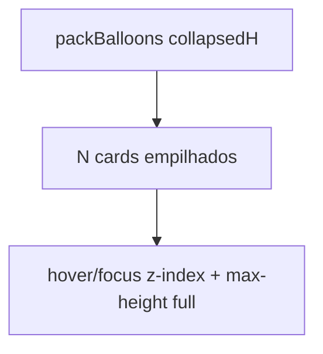

# Balões empilhados + providências por item

## Defaults (se não houver resposta às perguntas)

- **Seed:** parse do HTML da biblioteca (`.action-item` / lista sob `.providencias-bar`) + linha fixa «Autorizar impressão desconsiderando o problema»; depois o usuário edita/seleciona.
- **Escopo:** Análise Lab nesta entrega (Inspeção + balões Folhear). Snapshot HTML continua atualizado para PDF/portal. Espelho estruturado para classic só no mirror de conclusão quando existir `ItemAnaliseID`.

## Parte 1 — Empilhar balões (sem «+N problemas»)

Hoje [`AnaliseLabBalloonLayer.tsx`](apps/web/src/features/analise-lab/AnaliseLabBalloonLayer.tsx) usa `MAX_VISIBLE = 3` e um chip `+{overflow} problemas`.

**Abordagem:**

- Remover o limite de render + o botão de overflow.
- Empacotar com altura **colapsada** fixa (ex. ~120–140px: cabeçalho + prévia), não a altura medida expandida — hover/focus **não** atualiza `heightsByItemId` (evita re-pack).
- Cada card: `overflow-hidden`, sombra entre camadas; hover **ou** focus (teclado/touch): `z-index` alto + `max-height` full (conteúdo completo por cima dos vizinhos).
- Pack continua em [`analiseLabBalloons.ts`](apps/web/src/features/analise-lab/analiseLabBalloons.ts) com `collapsedHeight`; compactação vertical se passar do stage.
- Atualizar testes de pack/heights; Folhear folhas e flipbook usam a mesma layer.



## Parte 2 — Tabela de providências por item da OS

### Schema

Nova tabela (garantida em [`analise_lab_schema.py`](app/backend/analise_lab_schema.py) / ensure columns):

```sql
tabAnaliseLabItemProvidencia (
  ID PK,
  LabItemID INT NOT NULL,  -- FK tabAnaliseLabItem ON DELETE CASCADE
  Texto TEXT NOT NULL,
  Tipo VARCHAR(64) NOT NULL DEFAULT 'livre',
    -- 'livre' | 'autorizar_impressao'
  Ordem INT NOT NULL DEFAULT 0,
  Selecionada TINYINT(1) NOT NULL DEFAULT 1,
  Origem VARCHAR(16) NOT NULL DEFAULT 'manual',
    -- 'biblioteca' | 'sistema' | 'manual'
  DataRegistro / DataAtualizacao
)
```

Escopo = **item Lab da OS** (`LabItemID`), não a biblioteca.

### Regras de negócio

- Em todo item: garantir uma linha `Tipo='autorizar_impressao'` com texto fixo «Autorizar impressão desconsiderando o problema» (`Origem='sistema'`).
- **`Selecionada = 0` nesse tipo ⇒ `ResolucaoObrigatoria = 1`**; `Selecionada = 1` ⇒ `ResolucaoObrigatoria = 0`. Remover o checkbox «Resolução obrigatória» do painel Lab; o flag continua no item (portal/mirror).
- Seed no registro da biblioteca: parser HTML (`.action-item` ou fallback heurístico) → linhas `Origem='biblioteca'`, `Selecionada=1`, + linha sistema.
- Edição de texto/ordem/seleção só afeta as linhas daquele `LabItemID`.
- Ao salvar seleção/texto: regenerar bloco `.providencias-bar` + `.action-list` dentro de `HtmlSnapshot` (só providências selecionadas) para PDF/portal.

### API

Em rotas Lab existentes / novas:

- Listar providências com o item (embed em `GET analise-lab` / itens).
- `PUT/PATCH` bulk por item: `{ providencias: [{ id?, texto, tipo, ordem, selecionada }] }` + sync de `ResolucaoObrigatoria`.
- Seed automático em `register_from_library` / create item.

Front: tipos em [`analiseLab.ts`](apps/web/src/api/analiseLab.ts).

## Parte 3 — UI Inspeção

Em [`AnaliseLabItemPanel.tsx`](apps/web/src/features/analise-lab/AnaliseLabItemPanel.tsx):

- Seção **Providências**: lista (uma linha = checkbox `Selecionada` + input texto editável + remover se não for `sistema`).
- Botão «Adicionar providência».
- Linha sistema sempre presente, não removível; texto fixo ou só leitura.
- Remover checkbox «Resolução obrigatória»; mostrar estado derivado (ex. badge «Resolução obrigatória» quando autorizar impressão **não** está marcada).
- HTML do problema (descrição) permanece no editor; bloco de providências no snapshot é gerado a partir da lista (não editar providências no HTML livre).

## Parte 4 — UI balão Folhear

Em [`AnaliseLabProblemBalloon.tsx`](apps/web/src/features/analise-lab/AnaliseLabProblemBalloon.tsx):

- Corpo principal: título + descrição **sem** o bloco de providências (strip no `toBalloonHtml` ou snapshot já separado).
- Botão **«Ver providências»**: expande o card e lista só as `Selecionada`.
- Compatível com stack colapsado: expandir providências no hover full; se colapsado, o botão também força expand.

## Parte 5 — Testes

- Front: pack com N>3 sem overflow chip; hover não muda pack heights.
- `ensurePage`/parser HTML → lista de textos; `autorizar_impressao` força `resolucaoObrigatoria`.
- Backend: CRUD providências + cascade delete; mirror seta `ResolucaoObrigatoria` coerente.

## Fora de escopo nesta entrega

- Portal cliente lendo a tabela diretamente (continua via HTML projetado).
- Classic Análise UI de providências (só sync de flag/HTML no mirror).
- Alterar biblioteca `tabProblemasPadrao` para tabela estruturada (HTML continua a fonte do seed).
