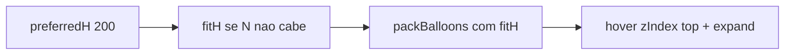

# Balões com fit na página + dedupe Autorizar impressão

## Problema

1. **Balões:** a layer força `BALLOON_COLLAPSED_H = 130` e cards sempre “colapsados” ([`AnaliseLabBalloonLayer.tsx`](apps/web/src/features/analise-lab/AnaliseLabBalloonLayer.tsx)), o que ficou pior que o layout anterior.
2. **Duplicata:** «Autorizar impressão…» pode aparecer duas vezes — uma como `livre` (texto vindo do HTML da biblioteca / snapshot projetado) e outra como `autorizar_impressao` (sistema). [`ensureAutorizarDraft`](apps/web/src/features/analise-lab/analiseLabProvidencias.ts) só checa `tipo`; [`replace_for_item`](app/backend/services/analise_lab_providencias_service.py) aceita várias linhas `autorizar_impressao` e não remove `livre` com o mesmo texto.

## Parte 1 — Balões: altura natural + fit + hover

Arquivos: [`analiseLabBalloons.ts`](apps/web/src/features/analise-lab/analiseLabBalloons.ts), [`AnaliseLabBalloonLayer.tsx`](apps/web/src/features/analise-lab/AnaliseLabBalloonLayer.tsx), [`AnaliseLabProblemBalloon.tsx`](apps/web/src/features/analise-lab/AnaliseLabProblemBalloon.tsx), testes em [`analiseLabBalloons.test.ts`](apps/web/src/features/analise-lab/analiseLabBalloons.test.ts).

**Comportamento escolhido (conforme o pedido):**

- Preferência de altura = **altura natural anterior** (`PREFERRED_H ≈ 200`), não 130 colapsado.
- Sem chip `+N`: continuar renderizando todos.
- Se `n * preferred + (n-1)*gap > stageHeight`, calcular altura uniforme:
  - `fitH = floor((stageHeight - margins - (n-1)*gap) / n)`, clamp em `[MIN_H ≈ 72, PREFERRED_H]`.
- Pack usa `fitH` (não reempacota no hover).
- Card em repouso: `maxHeight = fitH`, `overflow-hidden` (conteúdo cortado se preciso).
- Hover/focus: `z-index` máximo (acima de todos) + `maxHeight` expandido (~420) para mostrar o conteúdo completo — sem alterar o pack.

Em `packBalloons`: extrair helper `computeFitBalloonHeight(stageHeight, count, gap, preferred, minH)` e usar como `balloonHeight` efetivo quando `heightsByItemId` não for passado.

Na layer: remover constante de colapso 130; passar `fitHeight` por balão; hover só sobe z-index e marca expandido.

Manter «Ver providências» no balão; expandir no hover continua compatível.

## Parte 2 — Dedupe «Autorizar impressão…»

**Backend** ([`analise_lab_providencias_service.py`](app/backend/services/analise_lab_providencias_service.py)):

- Helper `is_autorizar_texto(texto)` + `dedupe_autorizar_rows(rows)`:
  - no máximo **uma** linha `tipo=autorizar_impressao` (sistema, texto fixo);
  - descartar qualquer `livre` cujo texto normalize igual a `AUTORIZAR_TEXTO`;
  - se houver só texto livre igual, promover para a linha sistema.
- Aplicar em `replace_for_item` (antes do insert) e em `seed_for_item` / `ensure_autorizar_row` (também limpar livres duplicados existentes no item).
- Em `list_for_item` (ou logo após seed/ensure): se detectar duplicatas persistidas, limpar (DELETE das extras) para corrigir dados já gravados sem migração manual.

**Frontend** ([`analiseLabProvidencias.ts`](apps/web/src/features/analise-lab/analiseLabProvidencias.ts), painel):

- `ensureAutorizarDraft` / `toProvidenciaDrafts`: dedupe por texto normalizado + tipo; uma só linha sistema.
- `seedProvidenciasDraft` já ignora o texto; reforçar o mesmo helper.

## Parte 3 — Testes

- Pack: com N alto, `fitH < preferred` e todos cabem no stage; hover não entra no pack.
- Providências: HTML com action-item «Autorizar impressão…» + seed ⇒ 1 linha sistema; replace com 2 autorizar / livre+sistema ⇒ 1; front draft idem.
- Pytest nos helpers de parse/dedupe em [`test_analise_lab.py`](app/backend/tests/test_analise_lab.py).

## Fora de escopo

- Voltar chip `+N problemas`.
- Medição por `ResizeObserver` de altura real por card (fit uniforme basta).
- Portal/classic além do HTML já projetado.