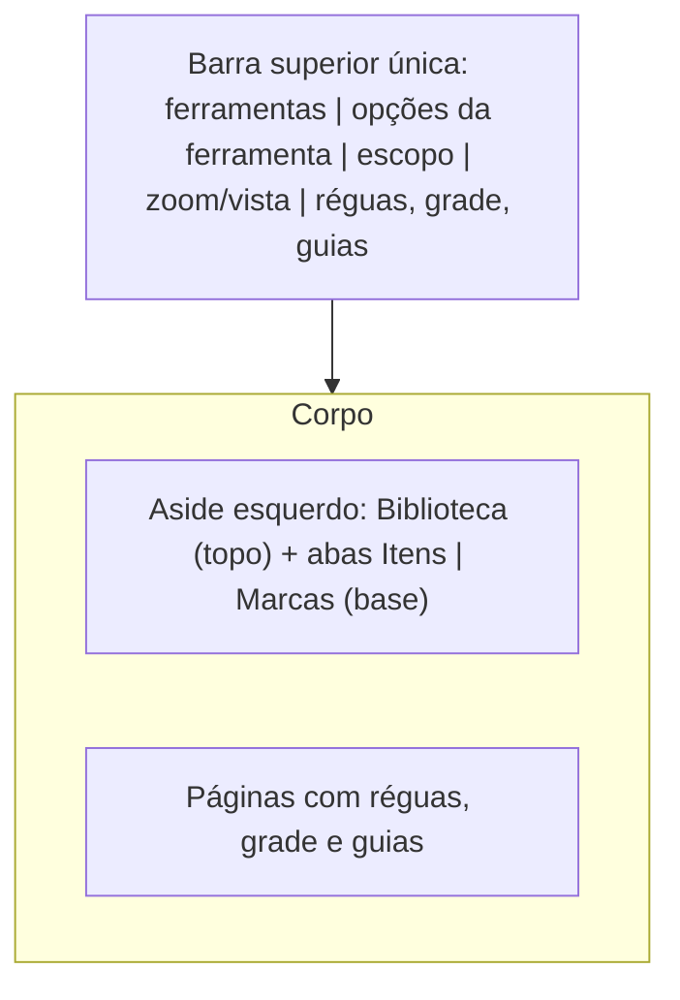

# Barra de ferramentas estilo CorelDRAW na Inspeção

## Layout alvo



Grade e guias são auxílio visual apenas da Inspeção: não aparecem no Folhear (que usa `renderPageOverlay` com [`AnaliseLabMarksLayer`](apps/web/src/features/analise-lab/AnaliseLabMarksLayer.tsx)) nem no relatório.

## 1. Preferências de vista (localStorage por OS)

Novo [`analiseLabViewPrefs.ts`](apps/web/src/features/analise-lab/analiseLabViewPrefs.ts), no padrão de `loadInspectorViewMode` de [`analiseLabFit.ts`](apps/web/src/features/analise-lab/analiseLabFit.ts):

```ts
export interface InspectorViewPrefs {
  rulers: boolean;      // default true
  grid: boolean;        // default false
  gridStepMm: number;   // default 10, clamp 1..100
  guides: boolean;      // default true
  guidesXMm: number[];  // guias verticais
  guidesYMm: number[];  // guias horizontais
}
loadViewPrefs(ano, osId) / saveViewPrefs(ano, osId, prefs)
```

Chave `analise-lab:view:{ano}:{osId}`; merge com defaults e clamp na leitura (JSON inválido cai no default). Guias valem para todas as páginas do documento.

Helper puro `gridLinesMm(sizeMm, stepMm): number[]` no mesmo arquivo.

## 2. Barra única

Novo [`AnaliseLabToolbar.tsx`](apps/web/src/features/analise-lab/AnaliseLabToolbar.tsx), renderizado dentro de [`AnaliseLabInspector.tsx`](apps/web/src/features/analise-lab/AnaliseLabInspector.tsx) no lugar da barra de zoom atual (bloco `flex shrink-0 flex-wrap items-center justify-center gap-2 border-b ...`). Assim zoom/`viewMode` continuam locais ao inspector e as ferramentas chegam por props.

Grupos, separados por divisórias verticais, tudo em uma linha (com `flex-wrap` para telas estreitas):

- Ferramentas: botões icon-only (`title` + `aria-label`) reusando `TOOLS` de [`AnaliseLabMarkTools.tsx`](apps/web/src/features/analise-lab/AnaliseLabMarkTools.tsx).
- Opções da ferramenta ativa, compactas (`h-7`, `text-[11px]`): borda, Offset/De/Até, profundidade da sangria, espessura, cor, rótulo e botão Inserir — os mesmos campos de hoje, em linha em vez de empilhados.
- Escopo: “Todas as páginas”, spec de páginas e “Espelhar”.
- Vista: `-`, `+`, `100%`, Ajustar, página dupla, `Página X / N` e `zoom% · L × A`.
- Auxiliares: toggles Réguas, Grade (com input de passo em mm ao lado) e Guias, mais “Limpar guias”.

[`AnaliseLabMarkTools.tsx`](apps/web/src/features/analise-lab/AnaliseLabMarkTools.tsx) deixa de exportar componente: mantém `AnaliseLabTool`, `TOOLS` e `toolToTipo`, e o JSX antigo é removido (o aside não o usa mais).

`AnaliseLabInspector` recebe `markTools` (o objeto `markToolsProps` já montado em [`AnaliseLabPage.tsx`](apps/web/src/features/analise-lab/AnaliseLabPage.tsx)) e `prefs` / `onPrefsChange`.

## 3. Réguas, grade e guias na página

Em [`AnaliseLabInspectorPage.tsx`](apps/web/src/features/analise-lab/AnaliseLabInspectorPage.tsx):

- Novas props `showRulers`, `grid`, `gridStepMm`, `guidesXMm`, `guidesYMm`, `onAddGuide`, `onRemoveGuide`.
- As réguas (`absolute -left-6` e `absolute -top-5`) só renderizam com `showRulers`; o `p-4` do scroller vira espaço suficiente para elas.
- Novo SVG de apoio abaixo das marcas: linhas de grade a cada `gridStepMm` (cinza claro, `strokeWidth` 0.5) e guias (azul tracejado), `pointer-events-none`.
- Arrasto na régua: com `tool === "faixa"` continua criando faixa; nas demais ferramentas cria guia (`onAddGuide("x" | "y", mm)`), com preview durante o arrasto. Clique numa guia com a ferramenta Selecionar remove (`onRemoveGuide`).

O estado das guias vive em `AnaliseLabInspector` (vindo das prefs), então todas as páginas mostram as mesmas guias.

## 4. Ferramenta Grade vira só visual

- Remover `"grade"` de `AnaliseLabTool` e de `TOOLS`, e o bloco “Passo (mm) / Inserir grade”.
- Remover `onAddGrade` e o estado `stepMm` de [`AnaliseLabPage.tsx`](apps/web/src/features/analise-lab/AnaliseLabPage.tsx) (o passo agora é `prefs.gridStepMm`).
- Manter `"grade"` em `AnaliseLabMarkTipo`, no `MARK_TYPES` do backend e o desenho em `AnaliseLabMarksLayer`, para não quebrar marcas já gravadas.

## 5. Painel esquerdo

Em [`AnaliseLabPage.tsx`](apps/web/src/features/analise-lab/AnaliseLabPage.tsx), no `aside` de `w-[332px]`:

- Remover a fileira de abas Biblioteca/Itens/Marcas do topo.
- Topo fixo: select “Ao registrar” + [`AnaliseLabLibrary`](apps/web/src/features/analise-lab/AnaliseLabLibrary.tsx) (ocupando a metade superior, `min-h-0 flex-1`).
- Base (onde ficava “Ferramentas”): abas **Itens | Marcas** com `AnaliseLabItemList` e o editor/lista de marcas, em bloco `flex-1 min-h-0` com scroll próprio; divisória entre os dois blocos.
- `leftPane` passa a ser `"itens" | "marcas"` (default `"itens"`); `setLeftPane("biblioteca")` em `onStartLinking` sai (a biblioteca está sempre visível).

## 6. Visualização dupla sem espaço entre páginas

Em [`AnaliseLabInspector.tsx`](apps/web/src/features/analise-lab/AnaliseLabInspector.tsx), a linha de páginas hoje é:

```tsx
className="flex items-start justify-center gap-4 overflow-visible"
```

Passa a `gap-0` na vista dupla (mantendo `gap-4` na simples, onde não faz diferença visual mas preserva o respiro), e o espaçamento entre linhas continua no container vertical.

Só isso não basta: em [`AnaliseLabInspectorPage.tsx`](apps/web/src/features/analise-lab/AnaliseLabInspectorPage.tsx) a página aplica `margin: tool === "sangria" ? \`${bleedPadY}px ${bleedPadX}px\`` para reservar área fora do papel, o que reabriria o vão no meio do par. Nova prop `innerEdge?: "left" | "right"` (o lado colado ao par, definido pelo inspector via `pageInRow`) zera só a margem desse lado, mantendo a folga nas bordas externas e no topo/base.

Detalhes a conferir na implementação:

- O anel da página ativa usa `ring-2 ring-offset-2`; sem gap ele encosta na vizinha. Trocar por `ring-2` sem offset na vista dupla, para o destaque não simular espaço.
- As réguas são `absolute -left-6` / `-top-5` (fora da caixa), e a régua esquerda já só aparece com `showLeftRuler`, que na vista dupla vale apenas para a primeira página da linha — logo não voltam a separar o par.

## 7. Testes

Vitest novo `analiseLabViewPrefs.test.ts`: defaults com storage vazio, clamp do passo, JSON inválido cai no default, round-trip de guias. Rodar `pnpm --filter web exec vitest run src/features/analise-lab`.

## Critérios de aceite

1. Uma única barra no topo da Inspeção com ferramentas, opções da ferramenta ativa, escopo, zoom e auxiliares.
2. Réguas, grade (com passo) e guias ligam/desligam pela barra e sobrevivem ao reload da mesma OS.
3. Guias criadas arrastando da régua; removidas com Selecionar ou “Limpar guias”.
4. Grade e guias não aparecem no Folhear.
5. Aside com Biblioteca em cima e abas Itens/Marcas embaixo, sem abas no topo.
6. Na vista dupla as duas páginas ficam encostadas, sem vão lateral, inclusive com a ferramenta Sangria ativa e com a página ativa destacada.
7. Vitest do lab passa.
