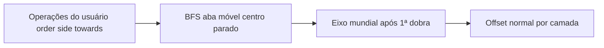

# Tríptico carteira: centro fixo e 2ª aba sobre a 1ª

## Contexto (já existe no modelo)

O motor genérico já expressa carteira como duas operações independentes sobre o painel central parado, sem `buildCFold`:

- Preset exemplo [`triptico_carteira_esquerda`](apps/web/src/features/prova-web/fold-engine/foldPresets.ts): `o1` vinco esquerdo `movingSide=negative` (só `p0`); `o2` vinco direito `movingSide=positive` (só `p2`); ambas `towards=front`.
- BFS em [`resolveMovingPanels`](apps/web/src/features/prova-web/fold-engine/foldTopology.ts) já isola uma aba se o lado móvel e o vinco estiverem corretos.
- O assistente já permite editar **ordem**, **lado móvel** e **direção** — isso permanece a fonte da verdade (nada de hardcode “sempre esquerda primeiro” no renderer).

## Hipótese do bug (sintoma ~2ª dobra falha / “salta” / fica plana)

Após a 1ª aba fechar ~180° sobre o centro:

1. **Hinge da 2ª** — `resolveWorldHinge` exige segmentos colineares no espaço mundial; tolerâncias ou uso do snapshot `before` vs matrizes já dobradas podem marcar eixo inválido → operação pulada → aba direita “plana”.
2. **Colisão OBB** — a 2ª aba sobre a 1ª + centro gera penetração; mesmo com o filtro `safe < 50%`, casos limítrofes ainda podem degradar o fecho.
3. **Empilhamento** — rotação pura em torno do vinco deixa a 2ª aba no mesmo plano da 1ª; falta **folga ao longo da normal** (`paperThicknessMm + renderGapMm`) proporcional às camadas já fechadas.

## Abordagem (sem voltar a construtores por preset)

### 1. Garantir “centro parado”

Em [`foldKinematics.ts`](apps/web/src/features/prova-web/fold-engine/foldKinematics.ts) / validação auxiliar:

- Para cada operação, o conjunto móvel **não** pode incluir painéis do outro lado do vinco que tocam o “miolo” estacionário adjacente de forma errada.
- Teste/assert explícito: carteira 3 painéis → op esquerda move só `p0`; op direita move só `p2`; união do estacionário contém sempre o painel central.
- Se o usuário configurar mal (ex. `movingSide` invertido e BFS pega metade da folha), o wizard já mostra erro; reforçar mensagem “esta operação movimentaria o centro”.

### 2. Hinge estável na 2ª dobra

Em `resolveWorldHinge`:

- Preferir segmentos transformados pelo painel **estacionário adjacente ao vinco** (já feito); se falhar colinearidade após a 1ª dobra, **fallback**: eixo no espaço local do painel estacionário anexado ao crease (borda do centro), transformado só por essa matriz — não exigir alinhamento entre múltiplos segmentos se só existe um.
- Afrouxar um pouco `AXIS_DISTANCE_EPSILON` só quando `edges.length === 1` (case 1D trifold).
- Nunca silenciosamente pular a operação: se o fallback também falhar, manter erro no banner (já existe `solverMsg`).

### 3. Empilhamento por camadas (essencial para “direita sobre esquerda”)

Em `evaluateFoldState`, ao aplicar cada operação com `open01 < 1`:

- Contar quantas operações **anteriores** (menor `order`, já parcialmente fechadas) dobraram para a **mesma face** (`towards`) sobre o mesmo “suporte” (painel compartilhado no conjunto estacionário, tipicamente o centro).
- Após a rotação em torno do vinco, aplicar translação `frontNormal * layerIndex * renderThickness * (1 - open01)` no conjunto móvel (ou deslocar o ponto do hinge nessa normal antes de rotacionar — equivalente visual).
- `layerIndex` começa em 1 na primeira aba que fecha sobre o centro; a 2ª recebe 2 → fica por cima sem z-fight.

Isso vale para **qualquer ordem** escolhida no assistente (L→R ou R→L).

### 4. Colisão não impedir fecho de carteira

Em [`foldCollision.ts`](apps/web/src/features/prova-web/fold-engine/foldCollision.ts):

- Excluir do teste OBB também pares “aba móvel × abas já fechadas no mesmo lado do centro” quando a penetração esperada é só de empilhamento (ou elevar o limiar: se `safe < 0.85 * target`, preferir empilhamento + ângulo alvo em vez de abrir a aba).
- Manter a regra atual `safe < 50%` → discard; alinhar para não zerar a 2ª dobra.

### 5. Assistente (UX, sem mudar o contrato)

Em [`ProvaWebFoldWizard.tsx`](apps/web/src/features/prova-web/ProvaWebFoldWizard.tsx):

- Textos claros: “Fecha 1º / Fecha 2º”, “Móvel: esquerda|direita”, “Sobre a frente do miolo”.
- Diagrama: painel central sempre em destaque como base; abas móveis da operação selecionada.
- Presets `triptico_carteira_esquerda` / `_direita` continuam só como **atalhos** que preenchem `operations`; o usuário pode reordenar depois (`personalizada`).

### 6. Testes

Vitest em topologia + kinematics:

- Carteira L→R: em `unfold=0`, `p0` e `p2` com rotação ~±π relativo ao centro; centro matriz só translação; `p2.z` (ou offset normal) acima de `p0`.
- Carteira R→L: simétrico.
- `resolveMovingPanels` nunca inclui o painel do meio.
- Determinismo / sem NaN após as duas operações.

## Arquivos principais

- [`foldKinematics.ts`](apps/web/src/features/prova-web/fold-engine/foldKinematics.ts) — hinge fallback + stack offset
- [`foldCollision.ts`](apps/web/src/features/prova-web/fold-engine/foldCollision.ts) — não matar 2ª dobra
- [`foldTopology.ts`](apps/web/src/features/prova-web/fold-engine/foldTopology.ts) — asserts/testes de conjunto móvel
- [`ProvaWebFoldWizard.tsx`](apps/web/src/features/prova-web/ProvaWebFoldWizard.tsx) — rótulos/diagrama
- Testes em `fold-engine/*.test.ts`

## Fora de escopo

- Não reintroduzir `buildCFold` / hierarquia hinge.
- Não alterar `unico` / `capa_miolo` / livro CSS.
