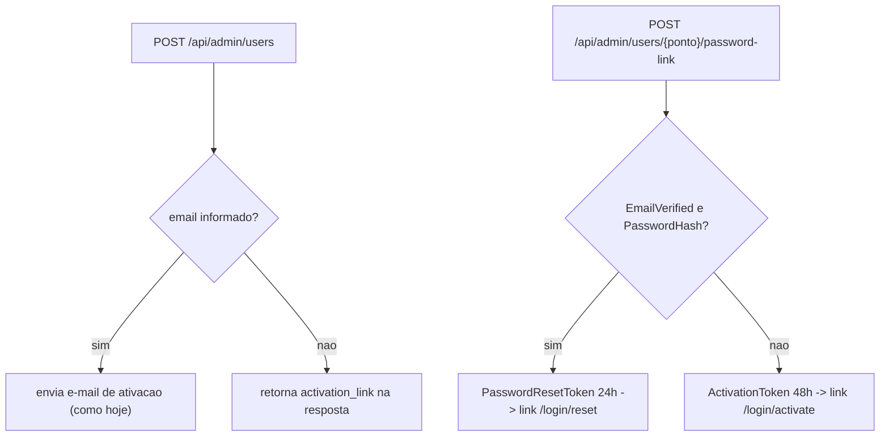

# Cadastro sem e-mail e link de redefinição de senha

## Contexto verificado

- Login internet já aceita **ponto** além de e-mail (`_lookup_password_user` em [app/backend/routers/auth_routes.py](app/backend/routers/auth_routes.py)), então usuário sem e-mail consegue logar.
- `EmailVerified` funciona na prática como "conta ativada": `/api/auth/activate` o seta para 1 ao definir senha. Não depende de e-mail.
- `tabUsuarios.Email` é `NULL`-able com índice único `uq_tabUsuarios_email` ([app/backend/user_auth_schema.py](app/backend/user_auth_schema.py)) — sem e-mail deve gravar `NULL`, nunca `''`.
- Links: `build_activation_link` (`/login/activate?token=`) em [app/backend/services/activation_email_service.py](app/backend/services/activation_email_service.py) e `build_password_reset_link` (`/login/reset?token=`) em [app/backend/services/password_reset_email_service.py](app/backend/services/password_reset_email_service.py).
- `/api/auth/reset-password*` exige `EmailVerified=1`; para conta ainda não ativada o link correto é o de ativação.

## Backend — [app/backend/routers/user_admin_routes.py](app/backend/routers/user_admin_routes.py)

1. `UserCreateRequest.email`: `Optional[EmailStr] = None`, com `field_validator(mode="before")` convertendo string vazia/espaços em `None`.
2. `create_auth_user`:
   - `email = str(body.email).strip().lower() if body.email else None`; checagem de duplicidade só quando houver e-mail.
   - INSERT/UPSERT inalterado (passa `None` → `NULL`).
   - Com e-mail: envia e-mail como hoje. Sem e-mail: não envia e retorna `{"status": "ok", "ponto", "email": None, "activation_link": build_activation_link(token)}`.
3. Novo endpoint `POST /api/admin/users/{ponto}/password-link` (`require_master_ip`):
   - 404 se usuário não existe; 400 se `AuthAtivo = 0`.
   - Se `EmailVerified` e `PasswordHash`: grava `PasswordResetToken` (expira em 24h) e retorna `{"tipo": "reset", "link": build_password_reset_link(token), "expires_at": ...}`.
   - Caso contrário: grava novo `ActivationToken` (48h) e retorna `{"tipo": "ativacao", "link": build_activation_link(token), ...}`.
   - Não envia e-mail (só gera e exibe).
4. [app/backend/routers/user_routes.py](app/backend/routers/user_routes.py) `list_users`: incluir coluna calculada `ContaInternet` (`Email IS NOT NULL OR PasswordHash IS NOT NULL OR ActivationToken IS NOT NULL OR EmailVerified = 1`) para o front saber quem tem conta internet mesmo sem e-mail.

## Frontend

- [apps/web/src/api/adminUsers.ts](apps/web/src/api/adminUsers.ts): `email?: string | null` no payload; `createAuthUser` passa a retornar `{ ponto; email: string | null; activation_link?: string }`; nova `generatePasswordLink(ponto)` → `{ tipo: "reset" | "ativacao"; link: string; expires_at?: string }`.
- [apps/web/src/features/usuarios/components/UserAdminPanel.tsx](apps/web/src/features/usuarios/components/UserAdminPanel.tsx):
  - Novo componente local `CopyableLink` (input readonly + botão Copiar com ícone `Copy`/`Check`), com fallback de cópia via `input.select()` + `document.execCommand("copy")` quando `navigator.clipboard` indisponível (intranet em HTTP não é secure context).
  - `UserCadastroForm`: remover validação obrigatória de e-mail; rótulo "E-mail (opcional)"; texto de ajuda e botão ("Cadastrar" / "Cadastrar e enviar e-mail" conforme houver e-mail). Ao receber `activation_link`, guardar em estado e renderizar `CopyableLink` abaixo do formulário com aviso "Envie este link ao usuário para definir a senha (válido por 48h)" e botão para dispensar.
  - Modal de edição: botão "Redefinir senha" (ícone `KeyRound`) que chama `generatePasswordLink`, exibe `CopyableLink` com legenda conforme `tipo` (redefinição 24h / ativação 48h). Limpar link ao abrir/fechar o modal.
  - `UserRowActions`: nova prop `contaInternet`; botão "Permissões" passa a aparecer quando `hasEmail || contaInternet`. "Reenviar" continua exigindo e-mail.
- [apps/web/src/features/usuarios/components/UsuariosPage.tsx](apps/web/src/features/usuarios/components/UsuariosPage.tsx): passar `contaInternet={user.ContaInternet}`; na coluna E-mail mostrar "(pendente)" também para conta internet sem e-mail não ativada. Ajustar o tipo da linha que tem `Email`/`EmailVerified`.

## Testes

- [app/backend/tests/test_spa_public_access.py](app/backend/tests/test_spa_public_access.py) (ou novo `test_user_admin_password_link.py`): cadastro sem e-mail não chama `send_activation_email` e retorna `activation_link`; `email=""` vira `None`; `password-link` retorna `tipo="reset"` para conta ativada e `tipo="ativacao"` para não ativada; 404 para ponto inexistente.
- Novo `apps/web/src/features/usuarios/components/UserAdminPanel.test.tsx`: cadastro sem e-mail exibe link copiável; botão "Redefinir senha" no modal exibe link retornado.
- Validar com `pnpm test` e `pnpm --filter @sagra/web typecheck`.

## Decisões assumidas (ajustáveis)

- Link de redefinição gerado pelo admin expira em 24h (o "esqueci a senha" usa 1h); ativação mantém 48h.
- "Redefinir senha" em conta não ativada (ou sem conta internet) gera link de ativação, pois o fluxo de reset exige conta ativada.
