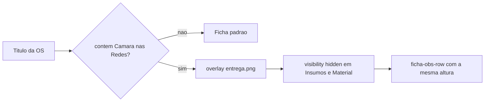

# Carimbo "entrega.png" na ficha da OS

## Comportamento

Na rota [`GET /api/reports/requisicao/{ano}/{id}`](app/backend/routers/requisicao_routes.py), se `d.Titulo` (`servico_titulo`) **contiver** o texto "Camara nas Redes":

- Exibir o carimbo `entrega.png` centralizado sobre o bloco direito da linha "Observações Gerais / Insumos / Material Entregue".
- Ocultar visualmente os textos das seções **Insumos Fornecidos** e **Material Entregue** (cabeçalhos + conteúdo).
- **Não** usar `display: none` nem remover colunas: o espaço em branco permanece com a mesma altura da ficha padrão, para não deslocar "Dados de Entrega", "Avisos" e o restante.

A detecção será substring, sem diferenciar maiúsculas e com/sem acento (`Camara` / `Câmara`), para títulos reais no banco.

O carimbo de prioridade em Avisos não muda e pode coexistir.

## Arquivo do carimbo

Mover [`entrega.png`](entrega.png) (raiz) para [`app/backend/templates/entrega.png`](app/backend/templates/entrega.png), o mesmo diretório do template canônico e do padrão de [`carimbo.png`](app/backend/routers/requisicao_routes.py) (`_resolve_carimbo_data_uri`).

A imagem tem fundo preto. No overlay usar `mix-blend-mode: multiply` para o preto sumir na impressão e restar o carimbo vermelho (sem editar o PNG).

Não é necessário copiar o PNG para `app/frontend/`: a rota embute o arquivo em data URI a partir do diretório do template. O empacote já copia só `requisicao.html` para o frontend ([`package-release.ps1`](deploy/scripts/package-release.ps1)).

## Backend

Em [`app/backend/routers/requisicao_routes.py`](app/backend/routers/requisicao_routes.py):

- Generalizar `_resolve_carimbo_data_uri` para aceitar o nome do arquivo (reuso para `carimbo.png` e `entrega.png`).
- Helper `_titulo_indica_camara_nas_redes(titulo)` (normalização Unicode + `casefold`).
- No context da ficha:
  - `carimbo_entrega_src` — data URI de `entrega.png`
  - `show_carimbo_entrega` — PNG existe **e** o título casa

## Template (estrutura intacta)

Editar só o canônico [`app/backend/templates/requisicao.html`](app/backend/templates/requisicao.html). Não reordenar/remover as duas colunas. Não editar [`app/frontend/requisicao.html`](app/frontend/requisicao.html) (cópia de build/legado).

No bloco existente (por volta das linhas 849–864):

- Manter o `section-box` e o `row` das duas colunas.
- Colocar `position: relative` no `section-box` (já tem `height: 100%`).
- Inserir o `` de overlay **como irmão**, no mesmo espírito do carimbo de prioridade em Avisos.
- No `row` interno, se `show_carimbo_entrega`: `visibility: hidden` (ocupa espaço; não colapsa).

CSS novo (além de `.overlay-carimbo`):

- `.overlay-carimbo-entrega`: absoluto, centro, `max-width`/`max-height` ~90% da caixa, `object-fit: contain`, `pointer-events: none`, `mix-blend-mode: multiply`, `z-index` acima do conteúdo oculto.
- Garantir o mesmo tratamento em `@media print` (`print-color-adjust` já existe no template).

A linha `.ficha-obs-row` (min/max height de impressão) permanece como está.

## Testes

Novo [`app/backend/tests/test_requisicao_carimbo_entrega.py`](app/backend/tests/test_requisicao_carimbo_entrega.py) cobrindo os helpers, sem bater no banco:

- título casa: `"Camara nas Redes"`, `"Câmara nas Redes"`, substring no meio, case misto
- título não casa: vazio, outro texto
- data URI: arquivo presente vs ausente

Rodar `python -m pytest app/backend/tests/test_requisicao_carimbo_entrega.py -q`.

## Verificação na ficha

Abrir uma OS cujo título contenha "Camara nas Redes" em `/impressao/requisicao/{ano}/{id}` e confirmar: carimbo na área direita da linha de observações; Insumos/Material invisíveis; bloco abaixo (Dados de Entrega / Avisos) na mesma posição; ficha sem o texto no título permanece igual.

Se não houver OS de amostra, usar mock do `execute_query` no teste da rota ou uma OS de homologação.
