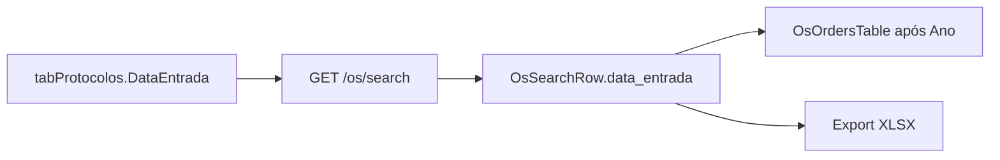

# Coluna Data de entrada na lista da home

## Contexto

A lista da home (`OsHomePage` → [`OsOrdersTable.tsx`](apps/web/src/features/os/components/OsOrdersTable.tsx)) hoje é:

**Nr OS | Ano | Produto | Solicitante | Título | Situação | Setor | Prioridade | Data**

A última coluna (“Data”) é `data_entrega` (`tabProtocolos.EntregData`). A data de entrada **já vem** no JSON de `GET /api/os/search` como `data_entrada` (`p.DataEntrada AS data_entrada` em [`os_search_service.py`](app/backend/services/os_search_service.py)), mas o tipo TS e a tabela ignoram o campo.

## UI (desktop e mobile)

Em [`OsOrdersTable.tsx`](apps/web/src/features/os/components/OsOrdersTable.tsx), inserir coluna após `ano`:

- `accessorKey: "data_entrada"`
- Header **Entrada** (compacto, para não confundir com “Data” = entrega)
- Mesmo `formatDateBr` da coluna de entrega, `size` ~76, `tabular-nums`

No card mobile, mostrar a entrada sem substituir o prazo: manter `data_entrega` no canto superior e incluir a entrada na linha de metadados (ex. `Entrada dd/mm/aaaa`).

Sub OS: a linha filha já herda o protocolo via `...parent` em [`osTableRows.ts`](apps/web/src/features/os/osTableRows.ts); não sobrescrever `data_entrada` (hoje só `data_entrega` é trocado pelo andamento da sub).

## Tipos e ordenação

Em [`types.ts`](apps/web/src/features/os/types.ts):

- `OsSearchRow.data_entrada?: string | null`
- Incluir `"data_entrada"` em `OsSortColumn`

Clique no cabeçalho já usa `manualSorting` + `onSortChange`. Para isso funcionar:

- **Visão local** (home com ano): em [`osHomeViewFilters.ts`](apps/web/src/features/os/osHomeViewFilters.ts), ordenar por `data_entrada` (string ISO) e remover o cast `RowWithEntryDate`. `rowSortDate` (fallback entrega/entrada) permanece só para prioridade / default / `data_entrega`.
- **Servidor** (sem ano / relatório paginado): adicionar `"data_entrada": "p.DataEntrada"` em `OS_SEARCH_SORT_COLUMNS_BASE` em [`os_search_service.py`](app/backend/services/os_search_service.py).

## Export XLSX da lista

Em [`os_search_export_service.py`](app/backend/services/os_search_export_service.py), inserir `("Entrada", "data_entrada")` após Ano em `OS_LIST_EXPORT_COLUMNS`, para o Excel da home acompanhar a tabela.

## Testes

- Vitest: caso em [`osHomeViewFilters.test.ts`](apps/web/src/features/os/osHomeViewFilters.test.ts) ordenando por `data_entrada`.
- pytest: se houver teste de colunas de export, atualizar; senão um assert mínimo no mapa de sort ou nas colunas de export.

Verificar na UI: lista do ano → coluna Entrada após Ano, formato `dd/mm/aaaa`; Sub OS expandida mostra a mesma data do protocolo; export XLSX com a coluna na mesma posição.
