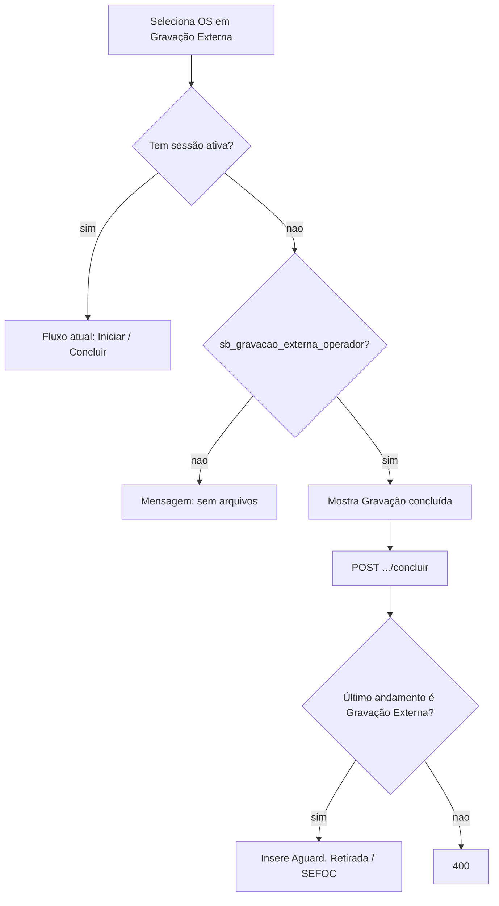

# Concluir gravação externa sem arquivos

## Problema

Na aba OPs em andamento de [`GravacaoExternaTab.tsx`](apps/web/src/features/gravacao-externa/components/GravacaoExternaTab.tsx), quando a OS está em situação **Gravação Externa** mas sem sessão (`gravacao_status === "sem_sessao"` / sem `gravacao_externa_id`), o painel inteiro é substituído pela mensagem “ainda não há arquivos vinculados” e **`GravacaoExternaActions` não monta**.

O endpoint `POST /gravacao-externa/{ano}/{id}/concluir` também exige sessão ativa e status `iniciada`, então concluir sem arquivos falharia mesmo com o botão visível.

Fluxo com sessão (com ou sem arquivos na lista) permanece intacto: Iniciar → Concluir.

## Abordagem (mínima)

Assunção confirmada pelo código: “sem arquivos” = OS na lista sem sessão (`!selectedHasSession`). Nesse caso, operador autorizado conclui direto (sem criar sessão vazia e sem exigir Iniciar).

## Backend

Arquivos: [`gravacao_externa_service.py`](app/backend/services/gravacao_externa_service.py), [`gravacao_externa_routes.py`](app/backend/routers/gravacao_externa_routes.py).

1. Em `concluir_gravacao`, se **não** houver sessão ativa:
   - Exigir que o último andamento operacional da OS seja `Gravação Externa` (reusar padrão de `list_os_gravacao_externa` / `ultimo_operacional_cod_subquery`); senão `400`.
   - Inserir andamento `Aguard. Retirada` / `SEFOC` com a mesma obs de hoje (`format_gravacao_concluida_obs` — chapas vazias → “não informado”).
   - Chamar `_notify_concluir_gravacao` (busca/MDB/WS de andamento).
   - **Não** atualizar `tab_os_gravacao_externa`, **não** enviar e-mail de sessão, **não** `push_gravacao_externa_concluida` (não há `id` de sessão).
   - Retornar detalhe sintético compatível com `GravacaoExternaDetailResponse` (`id: 0`, `status: "concluida"`, `arquivos/mensagens: []`, demais campos vazios/derivados da OS).

2. Na rota `post_concluir_gravacao`:
   - Com sessão: manter `_require_operator_or_assigned_fornecedor` (inalterado).
   - Sem sessão: exigir só `_has_operator_permission` (não fornecedor sem sessão).

3. Testes em [`test_gravacao_externa_service.py`](app/backend/tests/test_gravacao_externa_service.py) / [`test_gravacao_externa_routes.py`](app/backend/tests/test_gravacao_externa_routes.py):
   - Concluir sem sessão com OS em Gravação Externa → andamento correto.
   - Sem sessão e situação diferente → 400.
   - Sem sessão e sem permissão de operador → 403.
   - Caminho com sessão `iniciada` permanece como nos testes atuais.

## Frontend

Arquivo principal: [`GravacaoExternaTab.tsx`](apps/web/src/features/gravacao-externa/components/GravacaoExternaTab.tsx).

1. Substituir o painel `!selectedHasSession` para, quando `can("sb_gravacao_externa_operador")` (não só `canOperate` com fornecedor):
   - Manter o aviso de “sem arquivos vinculados”.
   - Mostrar botão **Gravação concluída** (mesmo estilo/confirm de `handleConcluir`).
   - Sem botão Iniciar, download, chat ou detalhe de sessão.
2. Sem permissão de operador: manter só a mensagem atual.
3. Após sucesso: invalidação já feita pela mutation; limpar `selected` para a OS sumir da lista “em andamento”.
4. Ajuste pontual de teste se existir cobertura do empty-state; [`GravacaoExternaActions.test.tsx`](apps/web/src/features/gravacao-externa/components/GravacaoExternaActions.test.tsx) não precisa mudar (componente com sessão inalterado).

## Não alterar

- Criação de sessão (`validate_arquivos_input` continua exigindo ≥1 arquivo).
- Iniciar, download, chat, entrega de chapas, Gravação Pendente.
- Andamento/obs/setor do concluir **com** sessão.
