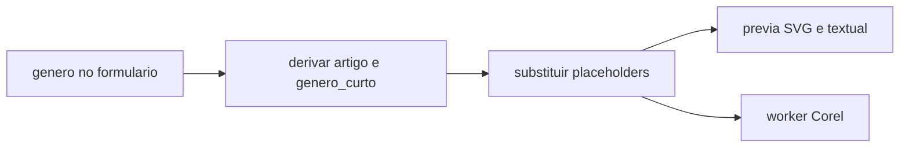

# Concordância do/da na papelaria

## Abordagem

Não criar `if` no JSON. Continuar com `{variavel}` simples.

Dois placeholders **derivados**, calculados a partir de `genero` no momento da substituição:

- `{artigo}` → `do` (padrão) ou `da` se `genero` contiver `deputada` (case insensitive)
- `{genero_curto}` → `Deputado` ou `Deputada`

`{genero}` permanece `"Deputado Federal"` / `"Deputada Federal"` e os modelos que só usam `{genero}` (cartões, pasta, etc.) não mudam.

Exemplos de template:

- Timbrado / Bloco: `Gabinete {artigo} {genero_curto}\n{nome_deputado}\n- {partido}/{uf}`
- Cabeçalho com cargo completo: `Gabinete {artigo} {genero} {nome_deputado} - {partido}/{uf}`



Regra de gênero: feminino só se `"deputada"` aparecer no valor; vazio ou qualquer outro texto (incl. o default `Deputado Federal`) → masculino. Assim o comportamento atual se mantém quando o usuário não preenche gênero.

## Onde injetar (obrigatório nos 3 caminhos de geração)

A substituição hoje está duplicada e só faz lookup. Enriquecer **antes** do `dados.get`:

- Backend: [`app/backend/services/papelaria_models_service.py`](app/backend/services/papelaria_models_service.py) — `substituir_variaveis` e `extrair_variaveis`
- Worker: [`worker/papelaria_worker/corel_generator.py`](worker/papelaria_worker/corel_generator.py) — mesma lógica (prova e `.cdr` iguais)
- Frontend: [`apps/web/src/features/papelaria/preview/templateEngine.ts`](apps/web/src/features/papelaria/preview/templateEngine.ts) — `applyPreviewTemplate`

No painel Corel, [`PapelariaCorelPanel.tsx`](apps/web/src/features/papelaria/components/PapelariaCorelPanel.tsx) tem um `substituirVariaveisPreview` próprio: passar a usar `applyPreviewTemplate` para não divergir.

Opcional e pequeno: o CLI legado [`Modelos/papelaria/papelaria.py`](Modelos/papelaria/papelaria.py) com a mesma regra, se ainda for usado para gerar CDR fora da web.

Helper único em cada lado (não precisa de pacote compartilhado Python/TS):

```python
def enriquecer_variaveis_derivadas(dados: dict) -> dict:
    out = dict(dados)
    feminino = "deputada" in str(out.get("genero") or "").lower()
    out["artigo"] = "da" if feminino else "do"
    out["genero_curto"] = "Deputada" if feminino else "Deputado"
    return out
```

Sempre **sobrescrever** `artigo` / `genero_curto` a partir de `genero` (não aceitar valor digitado).

## Não virar campo de formulário

`{artigo}` e `{genero_curto}` não entram em `ORDEM_VARIAVEIS` / `ROTULOS_VARIAVEIS`.

Em `extrair_variaveis` (backend e worker) e em `extractVariaveisFromTemplate` / `extractFieldKeysFromTemplate` (frontend), **remover** essas chaves do conjunto de variáveis do usuário. Assim:

- não aparecem em `campos_formulario`
- não viram campo dinâmico em `buildDynamicTemplatesForVariaveis`
- `groupFieldsByFace` já ignora chaves sem campo; o filtro evita lixo em `VariaveisJson`

`build_campos_formulario` também ignora a lista derivada como rede de segurança.

Não persistir as derivadas no prefill (`build_prefill_corel`): só existem na hora de renderizar.

## Templates conhecidos (pedido)

Atualizar a string canônica de cabeçalho (novos inspects / imports):

- `_COREL_CABECALHO` em [`papelaria_models_service.py`](app/backend/services/papelaria_models_service.py)
- `COREL_CABECALHO` em [`dynamicFields.ts`](apps/web/src/features/papelaria/preview/dynamicFields.ts)
- [`tools/papelaria_mockups/generate_preview_json_from_pdfs.py`](tools/papelaria_mockups/generate_preview_json_from_pdfs.py)

Arquivos de mockup:

- [`Modelos/papelaria/pdfs/json/TimbradoA4.json`](Modelos/papelaria/pdfs/json/TimbradoA4.json)
- [`Modelos/papelaria/pdfs/json/BlocoA5.json`](Modelos/papelaria/pdfs/json/BlocoA5.json)

Configs **já gravadas no MySQL** (`PreviewConfigJson` / `ConfigCampos`) não mudam sozinhas. Incluir um replace pontual na inicialização da tabela de modelos (mesmo espírito de `ensure_*` já existente): só a substring exata `Gabinete do Deputado` → `Gabinete {artigo} {genero_curto}` em JSON/texto desses campos. Não tocar em “Gabinete do Presidente” nem em outros textos.

Ingles (`Federal Deputy` hardcoded) fica fora deste escopo.

## Testes

- Backend: `substituir_variaveis` masculino / feminino / vazio; `extrair_variaveis` não devolve `artigo` nem `genero_curto`; cabeçalho canônico usa os novos placeholders.
- Frontend: casos em [`templateEngine.test.ts`](apps/web/src/features/papelaria/preview/templateEngine.test.ts); `groupFieldsByFace` não exige campos derivados.
- Prefill existente em [`test_papelaria_prefill_corel.py`](app/backend/tests/test_papelaria_prefill_corel.py) permanece: continua só `genero`, sem novas chaves obrigatórias.

## O que não muda

- Sintaxe `{foo}` existente
- Valor e rótulo de `genero`
- Cartões/pastas com `"template": "{genero}"`
- Formulário, OS matching, fila de jobs (o worker só passa a preencher as derivadas na substituição)
