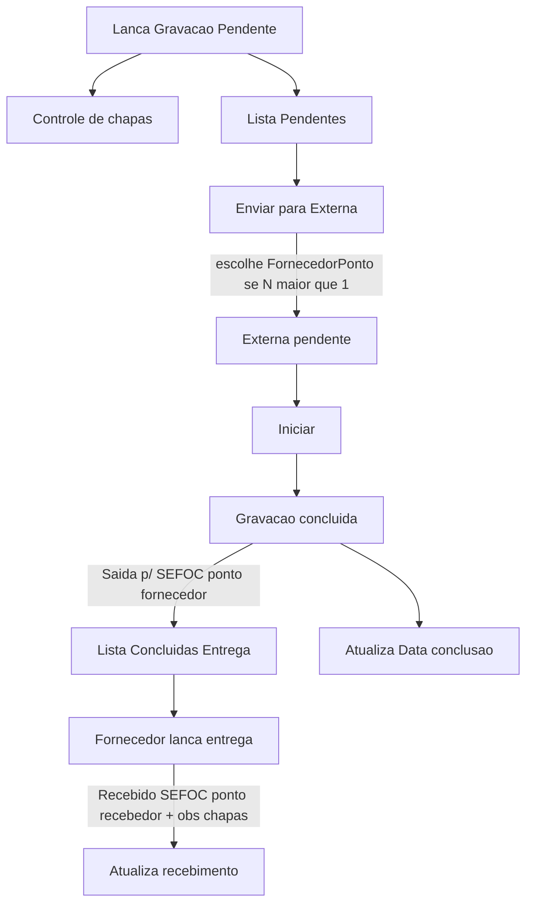

# Plano: Controle de chapas, fornecedor e pós-conclusão

## Decisões fechadas

- **Fornecedor** lança a entrega das chapas.
- **Controle de chapas gravadas** passa a incluir a OS **assim que existir sessão/andamento de Gravação Pendente**; conclusão e entrega **atualizam** a mesma linha.
- Campos de controle (NF, datas de recebimento no painel, cotas/preços) ficam **só no MySQL**. Andamentos pedidos (`Saída p/` / `Recebido`) continuam em `tabAndamento` (fluxo operacional atual), **sem** espelhar o “controle extra” no MDB.
- Ao concluir: andamento **`Saída p/` + setor `SEFOC`**, ponto = **ponto do fornecedor logado** (não o ponto que enviou / launcher).
- Ao entregar: andamento **`Recebido` + setor `SEFOC`**, ponto = **ponto informado** (quem recebeu); obs automática com chapas por máquina já registradas na sessão pendente.

## Fluxo-alvo (preserva o atual e estende)

**Não remover:** lançar pendente, arquivos, chat, iniciar/download, permissões `sb_gravacao_*` existentes, cota global (evolui via modal Detalhes).

---

## Fase 0 — Schema MySQL (expandir, compatível)

Migrar via `ensure_*_schema` + `_column_exists` (padrão já usado em [`gravacao_pendente_schema.py`](C:\dev\SagraWeb\app\backend\services\gravacao_pendente_schema.py) / [`gravacao_externa_schema.py`](C:\dev\SagraWeb\app\backend\services\gravacao_externa_schema.py) / [`user_auth_schema.py`](C:\dev\SagraWeb\app\backend\services\user_auth_schema.py)).

**Usuário**
- `tabUsuarios.Fornecedor TINYINT(1) NOT NULL DEFAULT 0`

**Sessão externa** ([`tab_os_gravacao_externa`](C:\dev\SagraWeb\app\backend\services\gravacao_externa_schema.py))
- `FornecedorPonto VARCHAR(32) NULL` + índice
- `ConcluidaEm DATETIME NULL`, `ConcluidaPorPonto VARCHAR(32) NULL`
- Campos de entrega (controle MySQL): `EntregaLancadaEm`, `RecebidoPorPonto`, `RecebidoPorNome`, `PagamentoNfEm` (nullable; pagamento pode ser preenchido depois por interno se necessário)

**Config / cotas** (nova tabela ou extensão da singleton)
- Manter `tab_gravacao_pendente_config.CotaInicialChapas`
- Nova `tab_gravacao_pendente_maquina_config`: máquinas fixas `Komori`, `SM74`, `PM52` com `CotaChapas`, `PrecoChapa` (DECIMAL)
- Nova `tab_gravacao_pendente_fornecedor_cota`: `FornecedorPonto`, `CotaChapas` (controle por fornecedor)
- Opcional: `tab_gravacao_pendente_cota_ajuste_log` se o modal Detalhes permitir alterar cota global com observação (auditoria)

**Controle list base:** query passa a partir de `tab_os_gravacao_pendente` (não só `ge.Status='concluida'`), LEFT JOIN externa + protocolo/título.

---

## Fase 1 — Fornecedor no cadastro e na sessão

- UI: checkbox **Fornecedor** em [`UserCadastroForm`](C:\dev\SagraWeb\apps\web\src\features\usuarios\components\UserAdminPanel.tsx) (criar + editar).
- API admin: `POST/PUT /admin/users` aceitam `fornecedor: bool`.
- Expor em `/auth/me` como `fornecedor` (mesmo padrão de `setor`).
- Ao marcar fornecedor, orientar (ou auto-sugerir) permissão `sb_gravacao_externa` para acessar a página; **não** misturar tipo com ACL via `Setor`.

---

## Fase 2 — Enviar para externa com seleção de fornecedor

Arquivos-chave: [`enviar_para_gravacao_externa`](C:\dev\SagraWeb\app\backend\services\gravacao_pendente_service.py), [`GravacaoPendenteTab.tsx`](C:\dev\SagraWeb\apps\web\src\features\gravacao-externa\components\GravacaoPendenteTab.tsx).

- `GET /admin/users?fornecedor=1` ou endpoint dedicado `GET /gravacao-pendente/fornecedores` (lista `Fornecedor=1`).
- Body de envio: `{ setor, fornecedor_ponto }`.
  - Se **0** fornecedores: erro amigável.
  - Se **1**: pré-seleciona / envia sem prompt.
  - Se **N>1**: modal de seleção obrigatório.
- Persistência: `FornecedorPonto` na sessão externa criada.

**Filtro para fornecedor** em [`list_os_gravacao_externa`](C:\dev\SagraWeb\app\backend\services\gravacao_externa_service.py) / detail access:
- Se `user.fornecedor`: só OSs com `FornecedorPonto = session.ponto`.
- Internos com `sb_gravacao_externa` / operador: veem todas (comportamento atual preservado).
- Sessões antigas sem `FornecedorPonto`: internos veem; fornecedores **não** (evita vazamento).

---

## Fase 3 — Conclusão: SEFOC + ponto do fornecedor + lista “Entrega”

Arquivos-chave: [`concluir_gravacao`](C:\dev\SagraWeb\app\backend\services\gravacao_externa_service.py) (`SETOR_GRAVACAO_CONCLUIDA = "SEGEP"` → **`SEFOC`**).

- Trocar setor do andamento para `SEFOC`.
- Ponto do andamento = **ponto autenticado do fornecedor** que conclui (`operador_ponto`), **não** `_resolve_ponto_andamento_gravacao_externa` baseado no launcher / CodStatus da sessão GeX.
- Gravar `ConcluidaEm` / `ConcluidaPorPonto`.
- Após concluir, OS **sai** da lista ativa e entra na **nova sublista** na aba Gravação Externa: “Concluídas — entrega de chapas” (só as `concluida` **sem** entrega lançada; fornecedor vê só as suas).

UI: estender [`GravacaoExternaPage`](C:\dev\SagraWeb\apps\web\src\features\gravacao-externa\components\GravacaoExternaPage.tsx) / [`GravacaoExternaTab`](C:\dev\SagraWeb\apps\web\src\features\gravacao-externa\components\GravacaoExternaTab.tsx) com filtro/segmento `em_andamento | aguardando_entrega` sem apagar ações de iniciar/concluir/chat.

---

## Fase 4 — Lançamento de entrega (fornecedor)

- Novo endpoint `POST /gravacao-externa/{ano}/{id}/entrega-chapas` body: `{ recebido_por_ponto: string }` (nome resolvido no backend).
- Validações: sessão `concluida`, entrega ainda não lançada, caller é o `FornecedorPonto` (ou interno com permissão elevada se quisermos override — **default: só fornecedor dono**).
- MySQL: preenche datas/quem recebeu.
- Andamento: `Recebido` / `SEFOC` / `Ponto = recebido_por_ponto`; obs via helper novo `format_gravacao_entrega_obs(chapas)` (mesmo formato de chapas de [`format_gravacao_concluida_obs`](C:\dev\SagraWeb\app\backend\routers\andamento_helpers.py)).
- UI modal na lista de concluídas: informar ponto de quem recebeu (input/lookup de usuários internos) + preview das chapas (somente leitura) + confirmar.

Pagamento NF: campo editável depois no Controle (interno `sb_gravacao_pendente`) via `PATCH` leve — não bloqueia a entrega.

---

## Fase 5 — “Controle de chapas gravadas” (substitui Histórico concluídas)

Arquivos: [`GravacaoPendenteTab.tsx`](C:\dev\SagraWeb\apps\web\src\features\gravacao-externa\components\GravacaoPendenteTab.tsx), API `GET .../historico` → renomear semanticamente para controle (manter path ou alias compatível).

**Título:** “Controle de chapas gravadas”.

**Colunas compactas:** OS/Ano, Cliente (`Titular`), Total de chapas, Data de conclusão (`ConcluidaEm`, vazia até concluir).

**Botão expandir** → painel lateral (drawer) com o restante:
- Data inclusão = data do andamento/sessão **Gravação Pendente** (`CriadoEm` pendente)
- Cliente, Título (`tabDetalhesServico.Titulo`)
- Qtd chapas por máquina
- Data encaminhamento Externa (`EnviadaEm`)
- Fornecedor (nome/ponto)
- Data/hora conclusão (`ConcluidaEm`)
- Data recebimento, quem recebeu, Data pagamento NF

Layout: lista estreita à esquerda; expansão “para a lateral” sem forçar horizontal scroll de 10 colunas no grid compacto.

Cota banner: trocar `+/-` por botão **Detalhes** (próxima fase); input continua read-only.

---

## Fase 6 — Modal Detalhes (cota / preço / fornecedor)

Novo componente no padrão `fixed inset-0` de [`GravacaoPendenteLaunchModal`](C:\dev\SagraWeb\apps\web\src\features\gravacao-externa\components\GravacaoPendenteLaunchModal.tsx):

- Cota inicial global (edição via modal com valor absoluto ou delta + observação → grava ajuste no log; substitui `delta ∈ {-1,1}`).
- Cota por fornecedor (lista de usuários `Fornecedor=1`).
- Preço de chapa e cota por máquina (`Komori`, `SM74`, `PM52`).

APIs CRUD sob `/gravacao-pendente/config/...` protegidas por `sb_gravacao_pendente`.

---

## Compatibilidade e anti-regressão

| Área | Garantia |
|------|----------|
| Conclusão atual SEGEP | Só muda para SEFOC no fluxo GeX; demais andamentos intocados |
| Listas ativa pendente/externa | Continuam; filtros novos só restringem fornecedor |
| Sessões sem fornecedor | Internos operam; fornecedor não vê |
| Histórico antigo `concluida` | Ainda aparece no Controle quando houver pendente origem; backfill `ConcluidaEm ≈ IniciadoEm` opcional só se NULL |
| Testes | Atualizar/estender `test_gravacao_pendente_service.py`, testes de concluir (SEFOC + ponto), novos testes entrega/filtro fornecedor; FE: `GravacaoPendenteHistoricoCota.test.tsx` → Detalhes |

Ordem de implementação sugerida: **schema → usuário fornecedor → enviar+filtro → concluir SEFOC → entrega → controle UI → modal Detalhes**, com checks focados ao fim de cada fase.

## Critérios de aceite

1. Criar usuário com flag Fornecedor; ele aparece no seletor de envio.
2. Com 2+ fornecedores, envio exige seleção; fornecedor A não vê OSs de B.
3. OS entra no Controle ao lançar Gravação Pendente; conclusão e entrega atualizam a mesma linha.
4. “Gravação concluída” gera `Saída p/` / `SEFOC` com ponto do fornecedor; OS vai para lista de entrega.
5. Entrega gera `Recebido` / `SEFOC` com ponto informado + obs de chapas; campos extras só MySQL.
6. Lista compacta + expansão lateral com todas as colunas pedidas.
7. Modal Detalhes edita cotas/preços das 3 máquinas e cotas por fornecedor.
8. Fluxos existentes (iniciar, chat, download, cancelamentos) continuam funcionando para usuários internos.