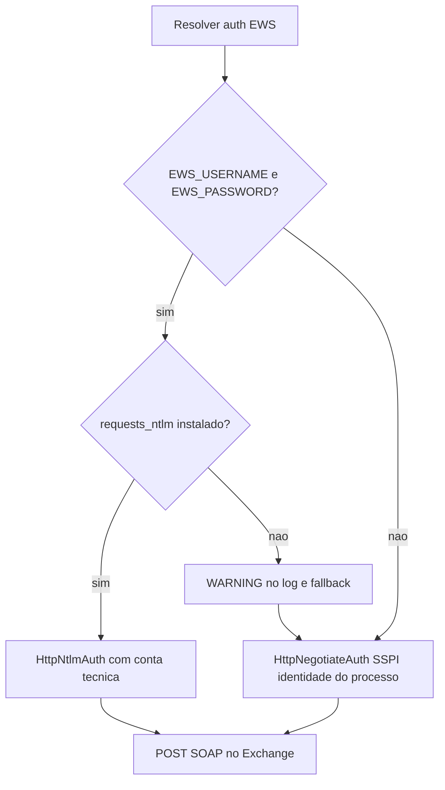

# Corrigir envio de e-mail no DEV (EWS/NTLM)

## Causa raiz (alta confiança)

O SAGRA **não usa SMTP**. Envio/recebimento passam por **Exchange EWS** (`https://ce.camara.leg.br/EWS/Exchange.asmx`) em [`app/backend/services/ews_service.py`](app/backend/services/ews_service.py).

Fluxo de autenticação atual:



Evidências no ambiente DEV (`C:\dev\SagraWeb`):

| Checagem | Resultado |
|----------|-----------|
| `EWS_USERNAME` / `EWS_PASSWORD` em [`config/.env`](config/.env) | **Já definidos** (conta técnica, alinhado ao que você autorizou) |
| Pacote `requests_ntlm` no Python atual | **Ausente** (`False`) |
| Pacote `requests_negotiate_sspi` | Presente |
| [`app/backend/requirements.txt`](app/backend/requirements.txt) | Só lista `requests-negotiate-sspi`; **não lista** `requests-ntlm` |

Com isso, o DEV entra no branch de fallback (linhas 58–63 de `ews_service.py`): credenciais explícitas são **ignoradas** e a API autentica como o usuário Windows da sessão (ex.: `p_918713`), sem as permissões Exchange da conta técnica. Em produção o processo costuma rodar com identidade/SSPI que já tem acesso — por isso “prod funciona, DEV não”.

Não há kill-switch que desligue e-mail só porque `ENV=development` nas rotas principais de envio (PT/prova/inbox). Soft-fail em DEV existe só em e-mails de ativação/reset (logam o link e não re-lançam).

## Correção

### 1. Tornar `requests-ntlm` dependência oficial

Em [`app/backend/requirements.txt`](app/backend/requirements.txt), adicionar:

```text
requests-ntlm>=1.2.0
```

(ao lado de `requests-negotiate-sspi`).

Instalar no Python do DEV e reiniciar a API (`iniciar-servidor.bat` / processo uvicorn).

### 2. Fail-fast quando credenciais existirem sem o pacote

Em [`app/backend/services/ews_service.py`](app/backend/services/ews_service.py) (e espelho em [`app/services/services/ews_service.py`](app/services/services/ews_service.py) se ainda for usado): no `ImportError` de `requests_ntlm` **quando** há user+password, **lançar erro claro** em vez de cair em SSPI. Isso evita o mesmo “silêncio” no futuro.

### 3. Validação

1. Confirmar import: `python -c "import requests_ntlm; print('ok')"`.
2. Reiniciar API; no log deve aparecer: `EWS: usando autenticação NTLM (EWS_USERNAME definido no ambiente)` — **não** o warning de fallback.
3. Na UI: módulo E-mail → Conectar / envio de teste (ou `POST /api/email/config/connect`).
4. Se ainda falhar com 401: revisar senha da conta técnica no `.env` (sem commitar) e conectividade a `ce.camara.leg.br`.

### 4. Docs / template (mínimo)

- [`config/.env.example`](config/.env.example): notar que `EWS_USERNAME`/`EWS_PASSWORD` exigem `requests-ntlm`.
- [`docs/EMAIL_EWS_ENVIO_E_MONITORAMENTO.md`](docs/EMAIL_EWS_ENVIO_E_MONITORAMENTO.md): marcar `requests-ntlm` como **obrigatório** quando houver credenciais explícitas (hoje diz “opcional”).

## O que **não** mudar

- Não commitar `config/.env` nem senhas.
- Não alterar URL EWS, proxy (`trust_env = False` já está correto) nem lógica de Send As / caixas.
- Credenciais de produção no DEV já estão alinhadas à sua autorização; o gap é só o pacote + fallback silencioso.

## Critério de aceite

Envio de e-mail no DEV autentica via NTLM com as mesmas variáveis `EWS_*` e completa um envio/teste de conexão sem 401 por identidade SSPI local.