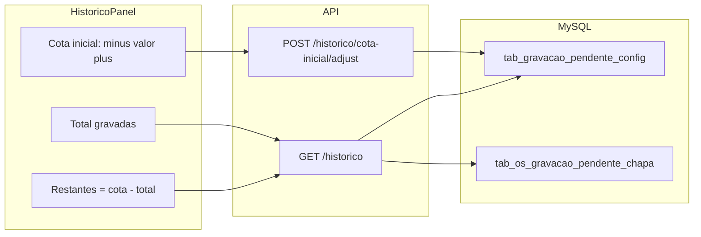

# Cota inicial no histórico concluídas

## Contexto atual

O painel **Histórico concluídas** em [`GravacaoPendenteTab.tsx`](apps/web/src/features/gravacao-externa/components/GravacaoPendenteTab.tsx) já consome `GET /gravacao-pendente/historico` e exibe `total_chapas_geral` (soma de chapas das gravações concluídas), calculado em [`list_historico_concluidas`](app/backend/services/gravacao_pendente_service.py):

```384:393:app/backend/services/gravacao_pendente_service.py
    total_chapas_row = db.execute_query(
        """
        SELECT COALESCE(SUM(c.QuantidadeChapas), 0) AS total_chapas
        FROM tab_os_gravacao_pendente_chapa c
        INNER JOIN tab_os_gravacao_externa ge
            ON ge.OrigemPendenteId = c.GravacaoPendenteId
        WHERE ge.Status = 'concluida'
        """
    )
```

**Decisão confirmada:** cota **global** (compartilhada por todos com acesso à aba).

---

## Comportamento desejado



| Campo UI | Regra |
|----------|--------|
| **Cota inicial** | Inteiro >= 0; ajuste **somente** via botões `-` / `+` (passo 1); valor exibido em input `readOnly` |
| **Total gravadas** | `total_chapas_geral` (já existente) |
| **Restantes** | `cota_inicial_chapas - total_chapas_geral` (pode ficar negativo; destacar visualmente se `< 0`) |

Botão `-` desabilitado quando `cota_inicial === 0`.

---

## Parte 1 — Persistência (MySQL)

Estender [`gravacao_pendente_schema.py`](app/backend/services/gravacao_pendente_schema.py):

```sql
CREATE TABLE IF NOT EXISTS tab_gravacao_pendente_config (
  Id TINYINT NOT NULL PRIMARY KEY DEFAULT 1,
  CotaInicialChapas INT NOT NULL DEFAULT 0,
  AtualizadoEm DATETIME DEFAULT NULL,
  AtualizadoPorPonto VARCHAR(32) DEFAULT NULL,
  CHECK (Id = 1)
);
INSERT IGNORE INTO tab_gravacao_pendente_config (Id, CotaInicialChapas) VALUES (1, 0);
```

Novas funções em [`gravacao_pendente_service.py`](app/backend/services/gravacao_pendente_service.py):

- `get_cota_inicial_chapas() -> int`
- `adjust_cota_inicial_chapas(delta: int, ponto: str) -> int` — valida `delta in (-1, 1)`, impede cota < 0, atualiza linha `Id=1`

---

## Parte 2 — API

Arquivo: [`gravacao_pendente_routes.py`](app/backend/routers/gravacao_pendente_routes.py)

**Estender** `GravacaoPendenteHistoricoResponse`:

```python
cota_inicial_chapas: int = 0
chapas_restantes: int = 0  # cota - total_chapas_geral
```

**GET** `/gravacao-pendente/historico` — após `list_historico_concluidas`, incluir cota e restante.

**POST** `/gravacao-pendente/historico/cota-inicial/adjust`:

- Body: `{ "delta": 1 | -1 }`
- Permissão: `sb_gravacao_pendente` (mesmo guard do histórico)
- Retorno: `{ "cota_inicial_chapas": N, "total_chapas_geral": T, "chapas_restantes": N-T }`

---

## Parte 3 — Frontend

### API + hooks

[`gravacaoPendente.ts`](apps/web/src/api/gravacaoPendente.ts):

- Tipos estendidos no retorno de `fetchGravacaoPendenteHistorico`
- `adjustGravacaoPendenteCotaInicial(delta: 1 | -1)`

[`useGravacaoPendente.ts`](apps/web/src/api/hooks/useGravacaoPendente.ts):

- `useAdjustGravacaoPendenteCotaMutation()` — invalida `queryKeys.gravacaoPendente.historico`

### UI

Novo componente [`GravacaoPendenteHistoricoCota.tsx`](apps/web/src/features/gravacao-externa/components/GravacaoPendenteHistoricoCota.tsx):

- Layout compacto no cabeçalho do histórico (substituir/complementar o span atual de total)
- Controle stepper: `Minus` | input readOnly | `Plus` (padrão lucide, similar a botões existentes no módulo)
- Linha de resumo: **Total gravadas** e **Restantes**
- `isPending` durante mutation; desabilitar +/- enquanto carrega

Integrar em [`GravacaoPendenteTab.tsx`](apps/web/src/features/gravacao-externa/components/GravacaoPendenteTab.tsx) dentro de `historicoPanel` (header, linhas 340–347).

---

## Parte 4 — Testes

Backend ([`test_gravacao_pendente_service.py`](app/backend/tests/test_gravacao_pendente_service.py) ou novo arquivo):

1. `adjust_cota_inicial_chapas(+1)` incrementa; `(-1)` decrementa; não passa de 0
2. GET histórico retorna `chapas_restantes = cota - total` (mock DB)

Frontend (opcional, leve):

- `GravacaoPendenteHistoricoCota.test.tsx` — input readOnly; botões disparam mutation; `-` disabled em 0

---

## Verificação manual

1. Rodar schema (`ensure_gravacao_pendente_schema` via servidor ou script existente)
2. Abrir Gravações Pendentes → painel Histórico concluídas
3. Ajustar cota com +/-; confirmar que não aceita digitação
4. Concluir uma gravação externa e ver **Total gravadas** e **Restantes** atualizarem após refetch
