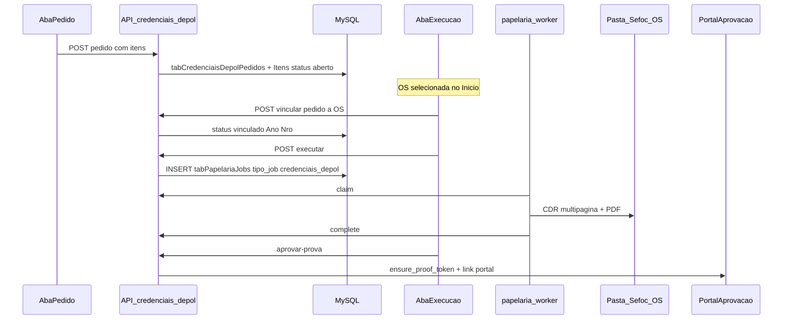

# Credenciais DEPOL — plano de implementação

## Decisões travadas

- **Pedido:** independente de OS; persiste itens (modelo JPG + até 3 linhas) até alguém vincular.
- **Vínculo:** na aba Execução, com OS já selecionada (session como Papelaria); um pedido ↔ uma OS.
- **Execução:** só com pedido vinculado à OS da sessão; gera **um CDR multipágina** (1 página/credencial, 85×120 mm), PDF em `{OS}/Sefoc/`, e fluxo de prova/aprovação reutilizando os helpers de papelaria.
- **Isolamento:** feature, API, tabelas e permissão próprias; worker Papelaria ganha um ramo novo por `tipo_job` sem mudar o caminho `create` atual.

## Fluxo



## Isolamento (não mexer)

- Não alterar UI/matching/produtos de [`PapelariaCorelPanel`](apps/web/src/features/papelaria/components/PapelariaCorelPanel.tsx) nem `PAPELARIA_PRODUCTS`.
- Não alterar `gerar_arquivo_corel` existente; novo gerador paralelo.
- Não editar `app/frontend/`, `deploy/release/`, backups.
- Tocques mínimos compartilhados: nav + RBAC + um `elif` no claim/process do worker + config de paths.

## 1. Persistência

Novo SQL em [`deploy/sql/create_credenciais_depol.sql`](deploy/sql/create_credenciais_depol.sql):

- `tabCredenciaisDepolPedidos`: `ID`, `Titulo` (opcional), `Observacao`, `Status` (`aberto|vinculado|em_execucao|concluido|cancelado|falha`), `CriadoPor`, `CriadoEm`, `AnoProtocolo` NULL, `NroProtocolo` NULL, `VinculadoPor`, `VinculadoEm`, `JobID` NULL.
- `tabCredenciaisDepolItens`: `ID`, `PedidoID`, `Ordem`, `ModeloArquivo` (basename JPG), `Linha1`, `Linha2` NULL, `Linha3` NULL; CHECK implícito na API: 1–3 linhas não vazias consecutivas.

Bootstrap/ensure no startup do serviço (mesmo padrão de schemas papelaria), sem migrator automático.

## 2. Config de caminhos

Em [`config/config.example.json`](config/config.example.json) (e leitura via `config_manager`):

```json
"credenciais_depol": {
  "jpg_dir": "J:\\_Temp\\2025\\Credenciais Depol\\JPG",
  "svg_dir": "J:\\_Temp\\2025\\Credenciais Depol"
}
```

SVGs esperados: `TXT01.svg` (1 linha), `TXT02.svg` (2), `TXT03.svg` (3). Worker e API validam existência no claim/execução.

No worker [`config.example.yaml`](worker/papelaria_worker/config.example.yaml): espelhar os mesmos paths (ou herdar via payload do job para não depender de YAML divergente — **payload do claim inclui caminhos absolutos resolvidos pela API**).

## 3. Backend API (router dedicado)

Novo [`app/backend/routers/credenciais_depol_routes.py`](app/backend/routers/credenciais_depol_routes.py) + [`app/backend/services/credenciais_depol_service.py`](app/backend/services/credenciais_depol_service.py), montado em [`api.py`](app/backend/routers/api.py) sob `/api/credenciais-depol`.

| Endpoint | Função |
|----------|--------|
| `GET /modelos` | Lista JPGs do `jpg_dir` (nome, url/thumb se viável via file serve local) |
| `GET /modelos/{nome}/thumb` | Serve imagem para galeria (somente basename, path jail) |
| `POST /pedidos` | Cria pedido + itens (sem OS) |
| `GET /pedidos` | Lista (`status`, `abertos`, etc.) |
| `GET /pedidos/{id}` | Detalhe + itens |
| `PATCH /pedidos/{id}` | Editar só se `aberto` |
| `POST /pedidos/{id}/cancelar` | Cancela se não executado |
| `POST /pedidos/{id}/vincular` | Body `{ano, nro}` — exige OS existir; status → `vinculado` |
| `POST /pedidos/{id}/desvincular` | Só se `vinculado` e sem job ativo |
| `POST /pedidos/{id}/executar` | Exige vinculado à OS da request; cria job |
| `GET /pedidos/{id}/job` | Status do job / arquivos |
| `POST /pedidos/{id}/aprovar-prova` | Delega a `ensure_proof_token` + andamento SEFOC (mesmo padrão de [`papelaria_jobs_service`](app/backend/services/papelaria_jobs_service.py)) |
| `POST /pedidos/{id}/descartar-prova` | Espelho fino do fluxo papelaria |

**Executar** grava em `tabPapelariaJobs` com:

- `TipoJob = credenciais_depol`
- `NroProtocolo` / `AnoProtocolo` da OS vinculada
- `ModeloID = NULL`, `ArquivoModelo = ""` (ou sentinela)
- `DadosJson`: `{ "pedido_id", "itens": [...], "jpg_dir", "svg_dir", "page_w_mm": 85, "page_h_mm": 120 }`
- Reusa `resolve_os_papelaria_dir` + `build_output_filenames` para `output_dir` / nomes CDR/PDF

Assim o **mesmo worker** claim/complete/fail/heartbeat continua válido.

## 4. Worker — ramo isolado

Em [`worker/papelaria_worker/worker.py`](worker/papelaria_worker/worker.py), no início de `_process_job_body`:

- Se `tipo_job == "credenciais_depol"` → chamar novo `gerar_credenciais_depol(...)` e **não** resolver `arquivo_modelo` papelaria.
- Demais `tipo_job` inalterados.

Novo módulo [`worker/papelaria_worker/credenciais_depol_generator.py`](worker/papelaria_worker/credenciais_depol_generator.py):

1. `CreateDocument` (documento em branco).
2. Para cada item (ordem):
   - Página 85×120 mm (`Unit` mm / `SizeWidth`/`SizeHeight` conforme API Corel do ambiente).
   - `Import` JPG do modelo → enquadrar na página (full-bleed).
   - Escolher SVG `TXT0{n}.svg` pelo número de linhas preenchidas.
   - `Import` SVG → localizar shapes de texto (convenção: ordem dos objetos texto ou nomes `LINHA1..3` — **validar nos SVGs reais na implementação**; fallback: preencher textos artísticos na ordem de criação).
   - Aplicar `Linha1..N` via mesma lógica segura de `alterar_texto` já usada em papelaria.
3. Remover página em branco inicial se o Corel criar uma default.
4. Salvar CDR → copiar para Sefoc → exportar PDF (reusar `exportar_pdf` / `_copiar_arquivo_final`).
5. `complete` com basenames; pedido → `concluido` (API no complete ou callback dedicado que atualiza `tabCredenciaisDepolPedidos` sem afetar jobs `create`).

Hook no complete da API: se `TipoJob=credenciais_depol`, atualizar status do pedido + `JobID`; não alterar comportamento dos jobs papelaria.

## 5. Frontend

Padrão cotas/estoque:

- Rota [`apps/web/src/routes/_authenticated/credenciais-depol.tsx`](apps/web/src/routes/_authenticated/credenciais-depol.tsx) + `AuthGuard` `sb_credenciais_depol`.
- Feature [`apps/web/src/features/credenciais-depol/`](apps/web/src/features/credenciais-depol/) com `CredenciaisDepolPage` (duas abas).
- API client [`apps/web/src/api/credenciais-depol.ts`](apps/web/src/api/credenciais-depol.ts) + query keys.

**Aba Pedido (sem OS):**

- Galeria de modelos (`GET /modelos` + thumbs).
- Ao selecionar: campos Linha 1–3 (Linha 1 obrigatória; 2/3 opcionais; UI indica que o SVG usado depende da quantidade preenchida).
- “Incluir no pedido” → lista local editável (remover/reordenar).
- “Enviar pedido” → `POST /pedidos`; limpa rascunho; feedback com ID.

**Aba Execução (exige OS):**

- Lê `sagra_current_os_id` / `ano` (mesmas chaves de [`papelariaSession.ts`](apps/web/src/features/papelaria/papelariaSession.ts) — **somente leitura**, sem alterar gates do Sidebar de Papelaria).
- Sem OS: mensagem + link para Início.
- Com OS: lista pedidos `aberto` para vincular + pedidos já vinculados a essa OS.
- Ações: Vincular → Executar → poll job → preview/download CDR/PDF → Aprovar/Descartar prova (espelho UX enxuto de `PapelariaProofPanel`, sem mockup 3D).

Nav: entrada em [`nav-config.ts`](apps/web/src/components/layout/nav-config.ts) “Credenciais DEPOL” → `/credenciais-depol`.

RBAC: `sb_credenciais_depol` em types frontend, `UserAdminPanel` label, backend `permissions` / `user_auth_schema` / `SPA_ROUTE_PERMISSIONS`.

## 6. Prova / aprovação

Reutilizar `ensure_proof_token` e endpoints de download já usados por jobs papelaria **via wrappers** na API DEPOL (não obrigar o usuário a abrir `/papelaria`). Portal `/portal/aprovacao/$token` permanece o mesmo. E-mail de prova: se o fluxo de e-mail filtrar só OS ≥5000/papelaria, estender o classificador **somente** para produto/contexto DEPOL quando o job for `credenciais_depol` — sem mudar templates de papelaria.

## 7. Testes e verificação

- Backend: service unit tests (criar pedido, vincular, recusar executar sem vínculo, path jail de modelos, complete atualiza status).
- Worker: testes puros do seletor SVG (1/2/3 linhas) e montagem de payload; COM mockado se já houver padrão.
- Frontend: typecheck; testes leves do reducer da lista do pedido se houver padrão vitest na feature.
- Manual: pedido sem OS → criar OS no fluxo normal → vincular → executar no PC com Corel → CDR/PDF em Sefoc → aprovar → abrir portal.
- Regressão: um job papelaria `create` ainda processa como antes (teste de não-regressão no branch `tipo_job`).

## Critérios de aceite

1. Pedido criado sem OS selecionada; itens com 1–3 linhas e modelo JPG.
2. Pedido aparece na Execução para vínculo só com OS na sessão.
3. Executar gera CDR com N páginas 85×120 mm, JPG + SVG TXT0N corretos, textos preenchidos.
4. Arquivos na pasta Sefoc da OS; link de aprovação funcional como papelaria.
5. `/papelaria` e demais módulos sem mudança funcional.
