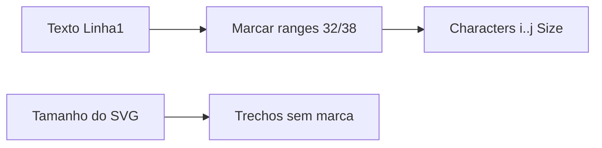

# Formatação Linha 1 + campo único no pedido DEPOL

## Regras de tipografia (Linha 1 apenas)

Entrada: texto plano da primeira linha (ex.: `25.1 S`). Linhas 2 e 3 não recebem override — mantêm o que veio no SVG.

| Condição | Tamanho |
|---|---|
| Texto só dígitos/espaços **ou** só letras/espaços (sem `.`) | Não alterar — tamanho já no SVG |
| Após um `.`, o **próximo dígito** (um caractere `0-9`) | **32 pt** |
| **Letra isolada**: token de exatamente 1 letra (`A-Z`/`a-z`), delimitado por início/fim/espaço/pontuação não-letra | **38 pt** |
| Demais caracteres da Linha 1 | Tamanho do SVG (não forçar) |

Exemplo `25.1 S`:
- `25.` → SVG
- `1` (dígito logo após `.`) → 32 pt
- `S` (letra isolada) → 38 pt

Constantes no worker (não configuráveis na UI nesta entrega): `DEPOL_L1_DIGIT_AFTER_DOT_PT = 32`, `DEPOL_L1_ISOLATED_LETTER_PT = 38`.

## Worker Corel

Arquivo principal: [`worker/papelaria_worker/credenciais_depol_generator.py`](worker/papelaria_worker/credenciais_depol_generator.py).

1. **Helper puro** `compute_linha1_font_ranges(texto: str) -> list[{start, end, size_pt}]` (índices 0-based inclusive/exclusive, Unicode-safe por caractere Python):
   - Varre o texto; para cada `.` seguido de dígito, marca esse dígito com 32.
   - Tokeniza por espaços e marca tokens `^[A-Za-Z]$` / letra Unicode isolada com 38.
   - Sem overlap problemático: se um mesmo índice cair nas duas regras (improvável), prevalece 38 só se for letra; dígito após ponto fica 32.
2. **`_aplicar_fonte_ranges_corel(shape, ranges, logs)`** após `alterar_texto`:
   - Usar COM `shape.Text.Story.Characters` por intervalo (1-based no Corel: `Characters(start+1, length)` ou equivalente da versão).
   - Setar `.Size = pt` em cada range.
   - Se Characters por range falhar, logar aviso e seguir (texto já gravado).
3. Em **`_aplicar_linhas_na_pagina`**: para `idx == 0` apenas, após escrever o texto, aplicar ranges. Linhas 2/3: só `alterar_texto`.

Testes unitários (sem COM) em [`app/backend/tests/test_credenciais_depol_worker_helpers.py`](app/backend/tests/test_credenciais_depol_worker_helpers.py):
- `"25.1 S"` → ranges no `1` (32) e no `S` (38)
- `"12345"` / `"ABC"` → lista vazia
- `"10.2"` → só o `2` em 32
- `"A B C"` → três letras isoladas em 38

## Pedido: um campo multilinha

Frontend: [`CredenciaisDepolPage.tsx`](apps/web/src/features/credenciais-depol/components/CredenciaisDepolPage.tsx) (+ preview).

- Substituir 3 inputs por **1 `textarea`** (placeholder tipo “Linha 1\nLinha 2\nLinha 3”).
- Helpers compartilhados (ex. em `CredenciaisDepolLivePreview.tsx` ou util do feature):
  - `textoToLinhas(texto) -> { linha1, linha2, linha3 }` — split por `\n`, trim por linha, no máx. 3 linhas; linhas vazias intermediárias: manter regra atual (L3 exige L2).
  - `linhasToTexto({linha1,linha2,linha3}) -> string` para editar item existente.
- Continuar enviando `linha1/2/3` na API (sem mudança de schema DB).
- Preview e `countLinhasPreenchidas` usam o resultado do split (1→TXT01, 2→TXT02, 3→TXT03).
- Validação UX: se houver >3 linhas não vazias, avisar e truncar/bloquear submit.

Backend: sem alteração de contrato; `_normalize_linhas` já cobre L1 obrigatória e ordem L2/L3.

## Prévia web (opcional mas alinhada)

Em [`CredenciaisDepolLivePreview.tsx`](apps/web/src/features/credenciais-depol/components/CredenciaisDepolLivePreview.tsx), na Linha 1 do SVG de prévia: se possível, quebrar o `<text>` em `<tspan>` com `font-size` 32/38 pt nos mesmos ranges (melhor fidelidade à prova). Se o SVG usar unidades estranhas, mapear pt → atributo `font-size` em pt no tspan. Linhas 2/3 inalteradas.

## Fora de escopo

- UI admin para editar 32/38 (ficam constantes).
- Markup manual no texto.
- Alterar tipografia das linhas 2/3.
- Mudança de schema SQL.
