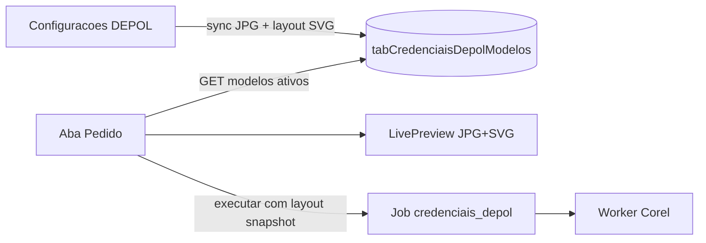

# Modelos DEPOL com layout SVG + prévia ao vivo

## Decisão travada

Uma única fonte de verdade por modelo: posição/tamanho do SVG (`TXT01`/`TXT02`/`TXT03`) em mm sobre a página 85×120. A prévia do pedido e o worker Corel usam o **mesmo** `LayoutJson` — sem duplicar “preview_config de texto” separado da Papelaria. A “mesma lógica” da Papelaria aqui é: **atualização client-side em tempo real** (sem round-trip ao digitar), sobre imagem base.

## Layout por modelo

Tabela nova [`deploy/sql/create_credenciais_depol_modelos.sql`](deploy/sql/create_credenciais_depol_modelos.sql) + ensure no startup:

- `tabCredenciaisDepolModelos`: `ID`, `ArquivoJpg` (basename único), `NomeExibicao`, `Ativo`, `Ordem`, `LayoutJson`, `AtualizadoEm`
- `LayoutJson`:

```json
{
  "page_w_mm": 85,
  "page_h_mm": 120,
  "svgs": {
    "1": { "x_mm": 5, "y_mm": 90, "w_mm": 75, "h_mm": 22 },
    "2": { "x_mm": 5, "y_mm": 85, "w_mm": 75, "h_mm": 28 },
    "3": { "x_mm": 5, "y_mm": 78, "w_mm": 75, "h_mm": 35 }
  }
}
```

Origem: canto inferior esquerdo da página (compatível com Corel). Defaults sensatos no sync se o modelo ainda não tiver layout.

## Admin — Configurações

Nova aba **Credenciais DEPOL** em [`ConfiguracoesPage.tsx`](apps/web/src/features/configuracoes/components/ConfiguracoesPage.tsx) (mesmo padrão da aba Papelaria).

Seção [`CredenciaisDepolModelosSection.tsx`](apps/web/src/features/configuracoes/components/CredenciaisDepolModelosSection.tsx):

1. **Sincronizar pasta** — lê JPGs de `credenciais_depol.jpg_dir`, upsert por `ArquivoJpg` (não remove configs existentes).
2. **Lista** — nome, ativo, ordem; só modelos ativos entram no pedido.
3. **Editor** — seleciona modelo; abas **1 / 2 / 3 linhas**; campos `x_mm`, `y_mm`, `w_mm`, `h_mm`; prévia ao vivo (JPG + SVG correspondente posicionado) com textos de amostra editáveis para calibrar.
4. **Salvar** layout + nome + ativo.

API admin (mesmo router DEPOL, permissão `sb_configuracoes` / padrão Papelaria admin):

- `POST /credenciais-depol/admin/modelos/sync`
- `GET /credenciais-depol/admin/modelos`
- `PUT /credenciais-depol/admin/modelos/{id}` (nome, ativo, ordem, layout)
- Reuso de thumbs: `GET /modelos/{nome}/thumb` e novo `GET /svgs/{nome}` (jail em `svg_dir`, só `TXT0N.svg`)

## Prévia no pedido

Em [`CredenciaisDepolPage.tsx`](apps/web/src/features/credenciais-depol/components/CredenciaisDepolPage.tsx) coluna 2:

- Novo componente `CredenciaisDepolLivePreview`: fundo JPG + ``/`<object>`/inline SVG posicionado em `%` a partir de mm (`x/page_w`, etc.).
- Conforme `num_linhas` (1–3), troca o SVG e aplica os textos nas shapes de texto do SVG (ordem / nomes `LINHA1..3` — mesma convenção do worker).
- Digitação de Linha 1–3 atualiza a prévia imediatamente.

`GET /modelos` passa a devolver só modelos **ativos** do banco + `layout` (não mais scan cego da pasta).

## Worker

Em [`credenciais_depol_generator.py`](worker/papelaria_worker/credenciais_depol_generator.py), após `Import` do SVG:

- Ler `layout.svgs[n]` do item/job (`dados.itens[].layout` ou lookup no payload).
- `SetSize(w_mm, h_mm)` + `SetPosition(x_mm, y_mm)` no shape importado (não mais “largado” sem posição).
- JPG continua full-bleed na página 85×120.

Na execução, a API inclui o layout resolvido do modelo em cada item do `DadosJson` do job (snapshot), para o worker não depender de DB.

## Fluxo



## Fora de escopo / isolamento

- Não alterar `PapelariaLivePreview` / `tabPapelariaModelos` / fluxo Corel de papelaria.
- Sem mockup 3D DEPOL.
- Sem editor drag-and-drop na v1 — ajuste fino por mm + prévia (como o modo numérico da Papelaria).

## Critérios de aceite

1. Em Configurações → Credenciais DEPOL, sync lista JPGs; é possível ativar e definir posição de TXT01/02/03 por modelo.
2. Aba Pedido só mostra modelos ativos; ao digitar, a prévia atualiza o SVG na posição configurada.
3. Job/worker posiciona o SVG importado conforme o layout salvo.
4. Papelaria e demais módulos inalterados funcionalmente.
