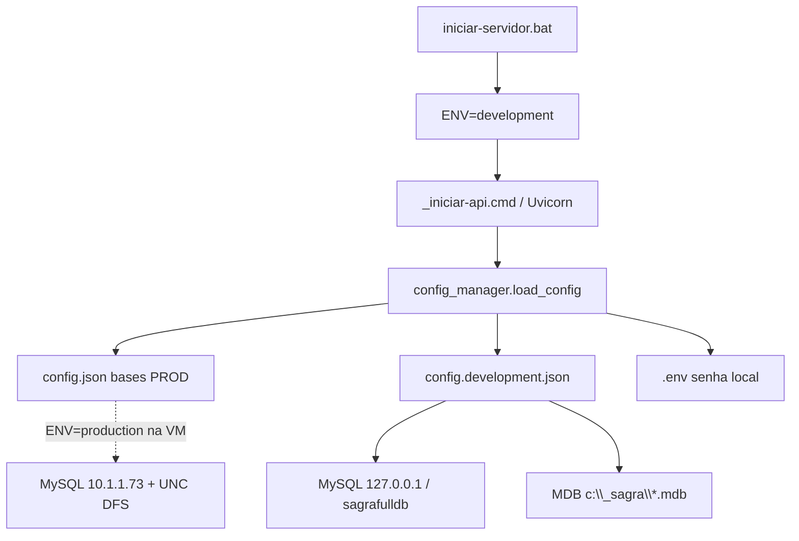

# Ambiente DEV pós-formatação + conexões automáticas

## Contexto

- Esta máquina é **somente DEV**. Produção roda em outra VM (`cgrafsysvm`).
- [`iniciar-servidor.bat`](iniciar-servidor.bat) já força `ENV=development` / `SAGRA_ENV=development` e sobe API `:8001` + Vite `:5173`.
- Hoje [`_apply_development_profile()`](app/backend/config_manager.py) só ajusta host/CORS/API — **não** remapeia MySQL nem MDBs. [`config/config.json`](config/config.json) e [`config/.env`](config/.env) ainda apontam para produção (`10.1.1.73` + UNC DFS).

## Diagnóstico desta máquina (já verificado)

| Item | Estado |
|------|--------|
| Python 3.14 + FastAPI/uvicorn/pymysql/pyodbc | OK |
| Node 22 + pnpm 9.15 + `node_modules` | OK |
| Driver ODBC Access | OK |
| XAMPP / MariaDB 10.4 | OK (serviço sobe) |
| Banco `sagrafulldb` no XAMPP | **Ausente** (só DBs padrão) |
| MDBs em `c:\_sagra\` | OK: OS Atual, Papelaria Atual, OS AntigaCore |
| `Sagra Base - Papelaria Antiga.mdb` | **Ausente** em `c:\_sagra\` |
| Lombada `c:\_sagra\Bancos Extras\CalcularLombada2010.mdb` | OK |
| [`config/.env`](config/.env) | Ainda `DB_HOST=10.1.1.73` + user de produção |

**Conclusão:** o `.bat` em si não precisa de reescrita grande; o bloqueio atual é **dados/config** (MySQL local vazio + `.env` apontando para a VM) e falta do **perfil automático** de conexões DEV.

## Abordagem escolhida (sem risco à produção)

Manter [`config/config.json`](config/config.json) como **baseline de produção** (caminhos UNC / `10.1.1.73`) — igual ao que a VM usa.

Criar overlay versionado [`config/config.development.json`](config/config.development.json) (sem senhas) com:

- `db_host`: `127.0.0.1`
- `db_port`: `3306`
- `db_user`: `root`
- `db_name`: `sagrafulldb` (mesmo nome; host separa DEV/PROD)
- `mdb_os_atual_path`: `c:\_sagra\Sagra Base - OS Atual.mdb`
- `mdb_papelaria_path`: `c:\_sagra\Sagra Base - Papelaria Atual.mdb`
- `mdb_os_antiga_path`: `c:\_sagra\Sagra Base - OS AntigaCore.mdb`
- `mdb_papelaria_antiga_path`: `c:\_sagra\Sagra Base - Papelaria Antiga.mdb`
- `mdb_lombada_path`: `c:\_sagra\Bancos Extras\CalcularLombada2010.mdb`
- `mysql_only`: `false` (dual-write local para testes)

Estender [`app/backend/config_manager.py`](app/backend/config_manager.py):

1. Após carregar `config.json`, detectar desenvolvimento via `ENV` do processo (já setado pelos bats).
2. Se desenvolvimento: fazer merge de `config.development.json` **depois** dos overrides genéricos de `.env` para host/paths/user/name — assim DEV não “herda” `DB_HOST=10.1.1.73` por acidente.
3. Em seguida reaplicar **somente** `DB_PASSWORD` / `SAGRA_DB_PASSWORD` do ambiente (no XAMPP: senha vazia).
4. Manter `_apply_development_profile()` atual (bind `127.0.0.1`, CORS Vite).
5. Log claro no boot: `DEV DB host=… name=… | MDB OS=… | Papelaria=…`.

Na VM (`ENV=production`), o overlay **não** carrega — zero mudança operacional.

Atualizar exemplos (não secrets reais):

- [`config/.env.example`](config/.env.example) — XAMPP `root` / senha vazia, nota de que host/MDB vêm do overlay DEV.
- [`config/config.example.json`](config/config.example.json) — referência ao arquivo `config.development.json`.

Ajuste **local** (gitignore) de `config/.env`: `DB_USER=root`, `DB_PASSWORD=` (vazio), `DB_NAME=sagrafulldb`. Host pode permanecer no exemplo, mas o manager em DEV ignora host do `.env` em favor do overlay.

Melhoria mínima no bat: em [`iniciar-servidor.bat`](iniciar-servidor.bat) / [`deploy/bat/_iniciar-api.cmd`](deploy/bat/_iniciar-api.cmd), ecoar que está em perfil DEV (sem nova lógica de DB no bat — o Python é a fonte da verdade).

## Pré-requisitos operacionais (nesta máquina)

1. **Copiar** `Sagra Base - Papelaria Antiga.mdb` para `c:\_sagra\` (faltando hoje).
2. **Importar dump** de produção no XAMPP como `sagrafulldb`:
   - subiro MySQL do XAMPP;
   - `mysql -u root < dump.sql` (ou via phpMyAdmin);
   - manter nome `sagrafulldb`.
3. Confirmar que nada crítico depende da rede DFS quando `ENV=development` (caminhos `network_paths` continuam UNC — só afetam fluxos que usam Deputados/Apogee; fora do escopo se rede não estiver montada).
4. Se algum dia o bat falhar por Python stub: `_resolve-dev-tools.cmd` já cobre; nesta máquina o `python` real já está no PATH.

Não há necessidade de reinstalar Python/Node/pnpm/ODBC/XAMPP nesta máquina com base no que está instalado.

## O que não muda

- Paths e MySQL de produção em `config.json` / templates em `deploy/templates/config/`.
- Contratos da API, dual-write, `MYSQL_ONLY` em produção.
- Fluxo de release/`pnpm package:release` da VM.

## Critérios de aceite

1. `iniciar-servidor.bat` sobe API + Vite; log mostra MySQL `127.0.0.1`/`sagrafulldb` e MDBs em `c:\_sagra\`.
2. `/health/live` 200; uma query MySQL simples (health/db se existir) conecta no XAMPP.
3. Abrir MDB OS Atual via código/ODBC no caminho local (sem UNC).
4. Com `ENV=production` (simulado ou na VM), continua usando `config.json` / host `10.1.1.73` + UNC — overlay ignorado.
5. Nenhuma alteração exige trocar arquivos ao alternar máquina: modo vem só de `ENV` setado pelos scripts de start.