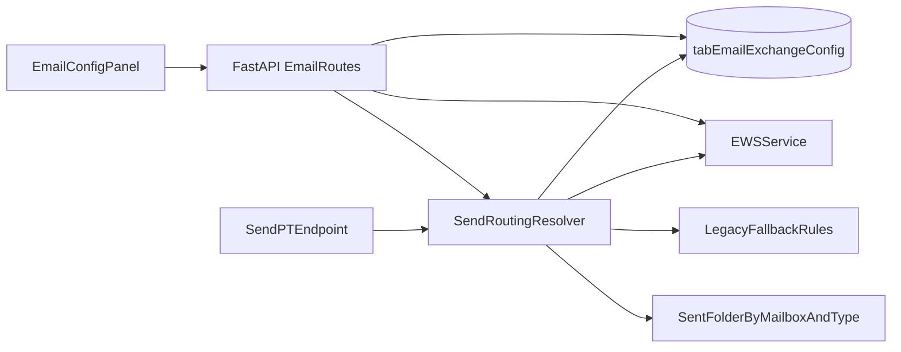

# Plano de implementação — Email Exchange Config V2

## Objetivo e decisões fechadas
- Escopo de configuração: **por usuário/ponto**.
- Local da UI: **somente** em [c:\dev\SagraWeb\apps\web\src\features\email\components\EmailConfigPanel.tsx](c:\dev\SagraWeb\apps\web\src\features\email\components\EmailConfigPanel.tsx) (via “Configurações do Exchange”).
- Estratégia: evolução **aditiva e compatível** (dual-read com fallback legado), mantendo fluxo atual funcional em todo o rollout.

## Estado atual (base para mudança)
- A tela de e-mail já usa config por usuário em [c:\dev\SagraWeb\app\backend\services\email_config_service.py](c:\dev\SagraWeb\app\backend\services\email_config_service.py) e painel em [c:\dev\SagraWeb\apps\web\src\features\email\components\EmailConfigPanel.tsx](c:\dev\SagraWeb\apps\web\src\features\email\components\EmailConfigPanel.tsx).
- Rotas principais em [c:\dev\SagraWeb\app\backend\routers\email_routes.py](c:\dev\SagraWeb\app\backend\routers\email_routes.py).
- Envio/salvamento em enviados depende de nomes hardcoded de pasta no Exchange; quando falha, cai no Sent Items padrão.

## Arquitetura alvo (compatível)

- Manter `monitored_targets` como está.
- Adicionar campos opcionais de V2 no mesmo registro por usuário (sem quebrar payload legado):
  - `send_routing`: regra de conta remetente por tipo de envio.
  - `sent_folder_routing`: regra de pasta de cópia enviada por conta+tipo.
  - `config_version`: versão lógica para auditoria/evolução.
- Ordem de precedência no envio:
  1) V2 por usuário/ponto
  2) regras existentes globais/legadas
  3) fallback atual (nomes fixos + Sent Items padrão)

## Entregas por fase

### Fase 1 — Backend preparado para V2 sem impacto funcional
- Evoluir contratos de leitura/gravação de config em [c:\dev\SagraWeb\app\backend\services\email_config_service.py](c:\dev\SagraWeb\app\backend\services\email_config_service.py):
  - parsing tolerante dos novos campos opcionais;
  - normalização e validação defensiva;
  - persistência sem apagar campos legados.
- Atualizar `GET /email/config` e `PUT /email/config` em [c:\dev\SagraWeb\app\backend\routers\email_routes.py](c:\dev\SagraWeb\app\backend\routers\email_routes.py) para aceitar/retornar V2 opcionalmente.
- Criar resolver interno de roteamento de envio (conta + pasta) reutilizado por `send-pt`.

### Fase 2 — APIs de descoberta e validação de destino de envio
- Reforçar endpoint de listagem de pastas para permitir seleção segura da pasta de enviados por conta (incluindo `sentitems` e filhos).
- Adicionar endpoint de “plano de envio” (dry-run) em [c:\dev\SagraWeb\app\backend\routers\email_routes.py](c:\dev\SagraWeb\app\backend\routers\email_routes.py): retorna conta/pasta efetiva e fallback aplicado.
- Garantir logs estruturados para diagnosticar fallback e erro de pasta inexistente.

### Fase 3 — UI completa em Configurações do Exchange
- Refatorar [c:\dev\SagraWeb\apps\web\src\features\email\components\EmailConfigPanel.tsx](c:\dev\SagraWeb\apps\web\src\features\email\components\EmailConfigPanel.tsx) para 3 blocos:
  - **Contas monitoradas**: visão consolidada por conta com quantidade de pastas e ações rápidas.
  - **Pastas monitoradas**: adicionar/remover com UX explícita por conta.
  - **Roteamento de enviados**: selecionar por tipo de envio a conta remetente e pasta destino.
- Atualizar tipos e client API:
  - [c:\dev\SagraWeb\apps\web\src\features\email\types.ts](c:\dev\SagraWeb\apps\web\src\features\email\types.ts)
  - [c:\dev\SagraWeb\apps\web\src\api\email.ts](c:\dev\SagraWeb\apps\web\src\api\email.ts)
  - [c:\dev\SagraWeb\apps\web\src\api\hooks\useEmailQueries.ts](c:\dev\SagraWeb\apps\web\src\api\hooks\useEmailQueries.ts)
- Manter modo de compatibilidade visual quando V2 não estiver presente (leitura parcial sem quebrar tela).

### Fase 4 — Integração de envio com roteamento V2
- Ajustar fluxo de `send-pt` em [c:\dev\SagraWeb\app\backend\routers\email_routes.py](c:\dev\SagraWeb\app\backend\routers\email_routes.py) para usar resolver V2.
- Preservar integralmente fallback atual para garantir continuidade (“funcionamento perfeito atual”).
- Expor feedback no frontend quando houver fallback (ex.: pasta não encontrada -> usado Sent Items padrão).

### Fase 5 — Qualidade, rollout e observabilidade
- Testes backend (unit + integração) cobrindo:
  - precedência de roteamento;
  - persistência/roundtrip de config V2;
  - compatibilidade de payload legado;
  - envio com pasta configurada vs fallback.
- Testes frontend (componentes/fluxos) cobrindo:
  - render de contas monitoradas;
  - adicionar/remover pastas;
  - salvar roteamento e reidratar UI.
- Rollout em etapas por usuários-piloto, com checklist de aceitação e rollback simples (desativar uso de campos V2 e manter legado).

## Critérios de aceite (DoD)
- Usuário consegue, em “Configurações do Exchange”:
  - visualizar todas as contas monitoradas;
  - adicionar e remover pastas monitoradas por conta;
  - configurar para cada tipo de envio a conta e a pasta de salvos enviados.
- Envio atual continua funcionando sem configuração nova (compatibilidade garantida).
- Em erro de configuração/pasta, sistema aplica fallback legado sem interromper operação.
- Testes automatizados cobrindo cenários críticos e sem regressões na rota `/email`.

## Riscos e mitigação
- **Perda de config por sobrescrita**: merge de payload no backend em vez de replace cego.
- **Pasta renomeada/removida no Exchange**: validação no save + dry-run + fallback automático.
- **Permissões de mailbox delegada**: validação de acesso por conta selecionada antes de persistir.
- **Regressão de UX**: migração por trás de comportamento opcional e testes de fluxo completo.

## Ordem sugerida de implementação
1. Backend compatível (modelo + rotas + resolver)
2. Frontend tipos/client
3. UI do painel completa
4. Integração final do envio
5. Testes + rollout controlado