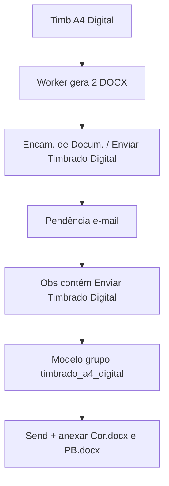

# E-mail Timbrado A4 Digital

## Contexto

- Modelos operacionais ficam em `tabEmailTemplateModel` (grupos `prova_os` / `prova_sp` / `problema_tecnico`), UI em Configurações → E-mail ([`EmailTemplatesSection.tsx`](apps/web/src/features/configuracoes/components/EmailTemplatesSection.tsx)).
- Hoje o envio escolhe só **prova vs PT** ([`email_dispatch_type_service.py`](app/backend/services/email_dispatch_type_service.py)); observação não troca modelo.
- Anexos de prova são **PDF only** ([`proof_files_service.py`](app/backend/services/proof_files_service.py) + [`email_routes.py`](app/backend/routers/email_routes.py)).
- Timbrado Digital já grava `{prefix}-TimbradoA4Digital-Cor.docx` e `-PB.docx` em Sefoc; complete **não** lança Encam.
- OFT: assunto `CGraf: Timbrado A4 Digital da SP /24`; corpo: *"Segue anexo arquivo Word contendo Timbrado A4 digital, editável, solicitado pela SP mencionada no Assunto deste e-mail."* + imagens SEFOC (topo/eco).

**Decisão de momento do andamento:** lançar **ao concluir o job com sucesso** (DOCX já existem). Lançar no clique deixaria pendência sem anexos.

## 1. Novo grupo de modelo operacional

Arquivos: [`email_template_model_service.py`](app/backend/services/email_template_model_service.py), tipos/UI em [`types.ts`](apps/web/src/features/configuracoes/types.ts), [`EmailTemplatesSection.tsx`](apps/web/src/features/configuracoes/components/EmailTemplatesSection.tsx), [`OperationalEmailEditorPanel.tsx`](apps/web/src/features/configuracoes/components/OperationalEmailEditorPanel.tsx) (e labels espelhados em `EmailTemplateModelsSection` se ainda tipado).

- Incluir `timbrado_a4_digital` em `VALID_GRUPOS`.
- Seed idempotente (ativo, `variante=sem_portal`, `anexar_pdf=1` reutilizado como “anexar arquivos”):
  - Nome: `Timbrado A4 Digital`
  - Assunto: `CGraf: Timbrado A4 Digital da SP {{nr_os}}/{{ano}}`
  - HTML: corpo do OFT + cabeçalho/rodapé no padrão visual dos modelos prova SP (imagens cid/`config/email_presets` ou HTML já usado em `proof_sp`), sem portal.
- Label UI: **Timbrado A4 Digital** na sidebar da aba E-mail (criar/editar/ativar como os outros).
- Não incluir no painel “tipo de envio ativo” de prova/PT ([`EmailDispatchModePanel`](apps/web/src/features/configuracoes/components/EmailDispatchModePanel.tsx)) — seleção é por observação, não por modo global.

## 2. Andamento ao concluir Timbrado Digital

Em [`_complete_timbrado_a4_digital_job`](app/backend/services/papelaria_jobs_service.py) (após validar os 2 DOCX):

- Registrar andamento via `add_movement_internal` (mesmo helper de `approve_job_prova`):
  - Situação: `Encam. de Docum.`
  - Setor: `SEFOC`
  - Observação: `Enviar Timbrado Digital`
  - Ponto: `SolicitadoPor` do job (fallback seguro se vazio)
- Constantes: `OBS_ENVIAR_TIMBRADO_DIGITAL = "Enviar Timbrado Digital"`.
- Não alterar o fluxo de `lancar_andamento` no create (`Em Execução` / `Preparando Prova` permanece opcional).

## 3. Detecção no envio de e-mail

Estender [`email_dispatch_type_service.py`](app/backend/services/email_dispatch_type_service.py):

- `EmailDispatchType` passa a incluir `"timbrado_digital"`.
- Helper `is_timbrado_digital_dispatch(os_id, ano)`: andamento atual `Encam. de Docum.` e observação contém `Enviar Timbrado Digital` (case-insensitive).
- Ordem em `resolve_email_dispatch_type`: **timbrado_digital antes de proof** (após checagens PT existentes, para não misturar com PT).

Em [`email_template_model_service.py`](app/backend/services/email_template_model_service.py):

- `resolve_timbrado_digital_send_plan()` → modelo ativo do grupo `timbrado_a4_digital`.
- `render_timbrado_digital_email(...)` com vars `nr_os`, `ano`, `produto`, etc. (mesmo `render_email_model`).

## 4. Anexar os 2 DOCX

- Novo helper (em `proof_files_service` ou serviço fino ao lado): `list/resolve_timbrado_digital_docx(ano, nro)` → procura em `{pasta_OS}/Sefoc/` os arquivos `*-TimbradoA4Digital-Cor.docx` e `*-TimbradoA4Digital-PB.docx` (preferir os mais recentes / nomes do último job via `__artefatos` se disponível).
- Em [`email_routes.py`](app/backend/routers/email_routes.py) (`get_pt_html` / preview + `send_pt_email`):
  - Se dispatch = `timbrado_digital`: usar plano/modelo Timbrado; **não** exigir PDF; `attachments_to_send = [cor, pb]`; validar tamanho (mesmo limite `SAGRA_EMAIL_ATTACHMENT_MAX_MB`).
  - UI pendência: se o seletor de PDF aparecer no modo anexo, para Timbrado **omitir picker de PDF** e mostrar os 2 DOCX como anexos fixos (ou lista read-only).
- Pós-envio: reutilizar meta de prova (`Aguard. Aprovação` + obs com destinatários), com texto alinhado a “Timbrado Digital enviado…”.

## 5. Testes

- Backend: detecção `is_timbrado_digital_dispatch` (obs correta vs “Enviar Prova N”); complete Digital dispara andamento com obs esperada (mock `add_movement_internal`); complete exige só DOCX e aceita e-mail plan sem SVG.
- Seed/grupo `timbrado_a4_digital` listável.
- Resolução de anexos DOCX (paths sob Sefoc; rejeita fora).

## Critérios de aceite

- Aba E-mail em Configurações lista o grupo/modelo Timbrado A4 Digital editável.
- Ao concluir “Timb A4 Digital”, aparece andamento `Encam. de Docum.` / `Enviar Timbrado Digital`.
- Na pendência dessa OS, o preview/envio usa o novo modelo e anexa os 2 DOCX Cor/PB.
- Pendências “Enviar Prova …” e PT continuam no fluxo atual (PDF/portal/PT).
