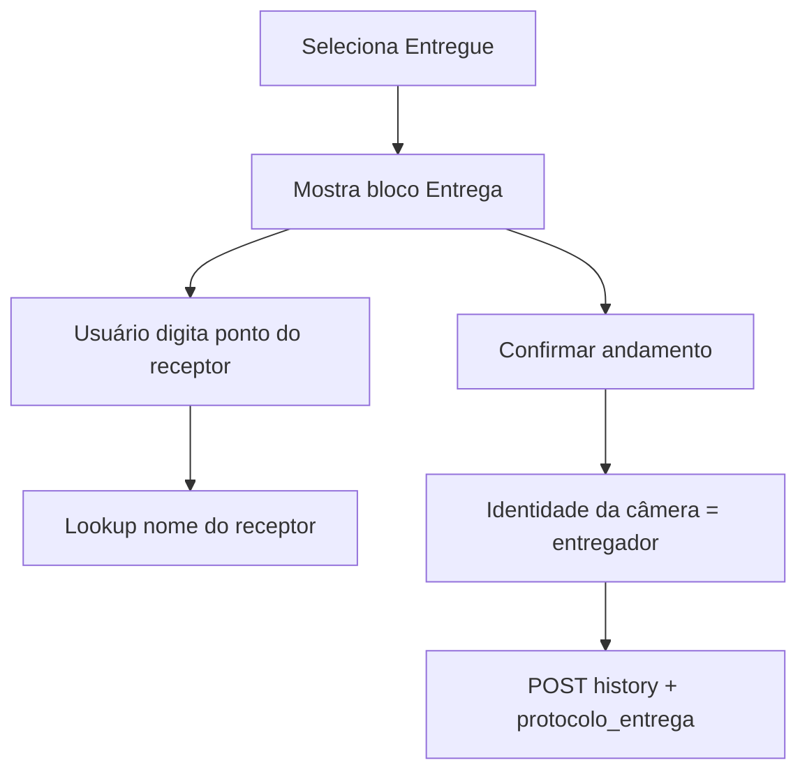

# Andamento Entregue no painel tablet

Escopo: apenas o lançamento de **Entregue** em `/painel/tablet`. Múltiplos setores ficam de fora.

## Contexto atual

- Em [`constants.ts`](apps/web/src/features/dashboard-tablet/constants.ts), `TABLET_BLOCKED_SITUACOES` inclui `"Entregue"`. Isso faz duas coisas ao mesmo tempo: (1) esconde/bloqueia o lançamento e (2) congela a OS quando a situação atual já é Entregue.
- Em [`TabletOsModal.tsx`](apps/web/src/features/dashboard-tablet/components/TabletOsModal.tsx), `postHistory` rejeita qualquer situação em `TABLET_BLOCKED_SITUACOES` com “deve ser lançada no desktop” e **não** envia `protocolo_entrega`.
- O backend já exige e persiste o payload: [`HistoryItem.protocolo_entrega`](app/backend/routers/os_routes.py) → [`apply_protocolo_on_andamento`](app/backend/services/os_protocolo_andamento_service.py). Contrato no front: [`ProtocoloEntregaPayload`](apps/web/src/features/os/types.ts) / `HistoryPayload`.
- No desktop, [`OsEntregaModal`](apps/web/src/features/os/components/OsEntregaModal.tsx) coleta o formulário completo; no tablet usaremos o subconjunto que você pediu.

Mapeamento dos campos:

| Papel | Fonte no tablet | Campo API | Coluna tabProtocolos |
|-------|-----------------|-----------|----------------------|
| Quem entrega (ponto) | Câmera (`matchedPonto`) | `entregue_por` | `PontoEntrega` |
| Quem entrega (nome) | Câmera (`matchedName`) — só exibição / `usuario` do andamento | — | — |
| Quem recebe (ponto) | Teclado numérico | `nr_ponto` | `RetiradaPonto` |
| Quem recebe (nome) | Lookup `fetchUserNameByPonto` (se existir) | `entregue_para` | `RetiradaNome` |

Datas (`data`, `data_entrega`) e `setor` (setor do painel) vão preenchidos automaticamente; `armazenado_em` e `recado_com` ficam vazios. Isso cobre o contrato do backend sem replicar o modal desktop inteiro.



## Implementação

### 1. Separar “congelada” de “não lançável no tablet”

Em [`constants.ts`](apps/web/src/features/dashboard-tablet/constants.ts):

- `TABLET_FROZEN_SITUACOES` = `Entregue`, `Cancelada`, `Cancelado` (OS já finalizada — sem novos andamentos).
- `TABLET_DESKTOP_ONLY_SITUACOES` = `Cancelada`, `Cancelado`, `Gravação Pendente` (não aparecem para lançar no tablet).
- Remover `Entregue` da lista de bloqueio de lançamento.
- Adicionar `isEntregueSituacao(s)` e `requiresProtocoloEntrega(s)` (ambos equivalem a `s.trim() === "Entregue"`).
- Incluir `"Entregue"` em `TABLET_PRIMARY_ANDAMENTOS` (junto de Recebido / Em Execução / Saída p/) para ficar acessível sem abrir “+ Andamentos”.

Atualizar [`constants.test.ts`](apps/web/src/features/dashboard-tablet/constants.test.ts) e o uso em `TabletOsModal`: `frozen` usa `TABLET_FROZEN_SITUACOES`; filtro de extras e guard de `postHistory` usam `TABLET_DESKTOP_ONLY_SITUACOES`.

### 2. UI de entrega no painel de lançamento

Em [`TabletOsModal.tsx`](apps/web/src/features/dashboard-tablet/components/TabletOsModal.tsx), quando `selectedSituacao === "Entregue"`:

- Bloco **Entrega** (mesmo padrão visual de “Setor destino”):
  - **Entregando:** texto somente leitura com ponto/nome da câmera (`matchedPonto` / `matchedName`), ou “Será o operador identificado na confirmação” se ainda não houver match.
  - **Recebido por (ponto):** display dos dígitos + teclado numérico embutido (reutilizar o mesmo padrão de teclas já existente no overlay de ponto do operador — sem misturar com o fluxo de cadastro facial).
  - Nome do receptor: ao completar dígitos, chamar `fetchUserNameByPonto`; mostrar o nome abaixo do ponto (ou “Ponto não cadastrado” se não houver).
- Validar no `handleConfirm` / `postHistory`: ponto do receptor obrigatório (dígitos não vazios).
- Ao trocar de situação ou fechar o modal, limpar estado do receptor.

Estilos mínimos em [`dashboard-tablet.css`](apps/web/src/features/dashboard-tablet/dashboard-tablet.css) para o bloco/teclado inline (reaproveitar classes `tablet-keypad-*` existentes onde couber).

### 3. Enviar `protocolo_entrega` no POST

Em `postHistory`, se for Entregue:

```ts
await addOsHistory(item.ano, item.nr_os, {
  situacao: "Entregue",
  setor: panelSector,
  obs: obs.trim(),
  usuario: String(ponto), // entregador (câmera)
  face_token: token,
  from_tablet: true,
  confirm_main_os_target: true,
  protocolo_entrega: {
    data: todayIsoDate(),
    data_entrega: todayIsoDate(),
    entregue_por: String(ponto),
    nr_ponto: receptorPontoDigits,
    entregue_para: receptorName || "",
    setor: panelSector,
  },
});
```

Remover o `throw`/erro “deve ser lançada no desktop” para Entregue. Manter o bloqueio para Cancelada/Cancelado/Gravação Pendente.

Nenhuma mudança de backend: o endpoint já valida e grava `protocolo_entrega`.

### 4. Testes

- Constantes: Entregue lançável; OS com situação Entregue continua congelada; Cancelada/Gravação Pendente seguem desktop-only.
- Helper de montagem do payload (função pura pequena, extrair de `TabletOsModal` se facilitar) garantindo `entregue_por` = ponto da câmera e `nr_ponto` = ponto digitado.
- Rodar `pnpm --filter @sagra/web test -- src/features/dashboard-tablet`.

## Fora de escopo

- Seleção de múltiplos setores / título “OPs na SEPAC e Expedição”.
- Replicar o formulário completo do `OsEntregaModal` (armazenado em, recado com, etc.).
- Lançar Cancelado/Cancelada ou Gravação Pendente no tablet.
