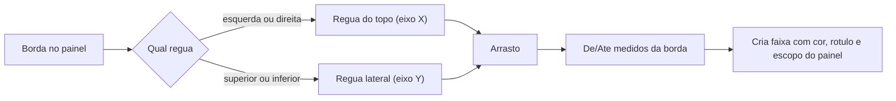

## Escopo de páginas por intervalo e faixa arrastada na régua

Duas adições ao Análise Lab. Nada muda na Prova WEB nem no portal.

### 1. Escopo de páginas (`1-15,20,23,25-30`)

Hoje a marca só tem `Pagina` (0 = todas). Passa a existir também uma especificação de páginas.

#### Modelo

Coluna nova em `tabAnaliseLabMarca` via o helper `_ensure_column` que já existe em [`analise_lab_schema.py`](app/backend/analise_lab_schema.py): `Paginas VARCHAR(255) NULL`.

Regra de escopo, em ordem:

- `Paginas` preenchido: vale só nas páginas da especificação (`Pagina` guarda a primeira página, mantendo útil o índice `(SessaoID, Pagina)`).
- `Paginas` vazio e `Pagina = 0`: todas as páginas (comportamento atual).
- `Paginas` vazio e `Pagina > 0`: só aquela página (marcas já existentes seguem válidas).

#### Parser (backend)

Em [`analise_lab_service.py`](app/backend/services/analise_lab_service.py), duas funções puras e testáveis:

```python
def parse_page_spec(spec: str) -> list[int]:   # ordenado, sem duplicatas
def format_page_spec(pages: Iterable[int]) -> str  # "1-15,20,23,25-30"
```

Validação: tokens `N` ou `N-M`, `N >= 1`, `N <= M`, separador `,` (aceitando espaços), total expandido limitado a `_MAX_PAGES` (400, o mesmo teto do render em [`prova_web_render_service.py`](app/backend/services/prova_web_render_service.py)). Erro vira `ValueError` com mensagem curta em PT-BR, que as rotas já convertem em 400.

`add_mark` / `update_mark` / `_row_to_mark` passam a tratar `paginas` (gravando a forma canônica), e `AnaliseLabMarkCreate` / `AnaliseLabMarkUpdate` em [`analise_lab_routes.py`](app/backend/routers/analise_lab_routes.py) ganham o campo.

#### Frontend

Novo `apps/web/src/features/analise-lab/analiseLabPageSpec.ts` (espelho do parser, sem duplicar regra de negócio crítica): `parsePageSpec`, `formatPageSpec`, `pageSpecIncludes(spec, page)`, `validatePageSpec(spec) -> string | null` e `isMarkVisibleOnPage(mark, pageNumber)`.

- [`AnaliseLabMarkTools.tsx`](apps/web/src/features/analise-lab/AnaliseLabMarkTools.tsx): ao desmarcar "Aplicar a todas as páginas", aparece o campo "Páginas" com placeholder `1-15,20,23,25-30`, pré-preenchido com a página atual, erro embaixo do campo e botão "Inserir marca" desabilitado enquanto inválido.
- [`AnaliseLabMarkEditor.tsx`](apps/web/src/features/analise-lab/AnaliseLabMarkEditor.tsx): troca o campo numérico "Página (0 = todas)" por um checkbox "Todas as páginas" mais o mesmo campo de especificação.
- [`AnaliseLabMarksLayer.tsx`](apps/web/src/features/analise-lab/AnaliseLabMarksLayer.tsx): o filtro de visibilidade passa a usar `isMarkVisibleOnPage`, valendo igual na inspeção e na aba Folhear.
- Lista de marcas: em vez de `· todas` ou `· p3`, mostra `· todas` ou `· p1-15,20…` (truncado).

#### Espelhamento com escopo

`shouldMirrorMark` em [`analiseLabGeometry.ts`](apps/web/src/features/analise-lab/analiseLabGeometry.ts) hoje exige `mark.pagina === 0`. Com escopo por lista isso passa a excluir casos válidos, então a regra simplifica para:

```ts
mirrored = mark.espelhar && (pageNumber % 2) !== ((mark.paginaOrigem || 1) % 2);
```

Uma marca de página única nunca cai em paridade diferente, então o comportamento atual se mantém. O checkbox "Espelhar em páginas opostas" passa a aparecer quando a marca atinge mais de uma página (todas ou especificação com 2+ páginas) e o tipo é `faixa`, `retangulo` ou `offset_corte`.

### 2. Faixa arrastada na régua

Na aba Inspeção, com a ferramenta **Faixa** ativa, arrastar sobre a régua cria a faixa. A borda de referência é a escolhida no campo "Borda" do painel; o arrasto define apenas De e Até. Ao soltar, a marca é criada na hora com cor, rótulo e escopo de páginas do painel.

Qual régua fica ativa depende da borda:

- Borda Esquerda ou Direita: faixa vertical, arrasta na régua horizontal (topo).
- Borda Superior ou Inferior: faixa horizontal, arrasta na régua lateral (esquerda).
- Todas as bordas: qualquer uma das duas réguas.

A régua inativa continua só decorativa. A ativa recebe `pointer-events-auto`, cursor `col-resize` / `row-resize` e destaque leve.

Conversão do intervalo arrastado para De/Até, sempre medidos a partir da borda escolhida:

```
esquerda:  from = xMin,      to = xMax
direita:   from = W - xMax,  to = W - xMin
superior:  from = yMin,      to = yMax
inferior:  from = H - yMax,  to = H - yMin
```

Em [`AnaliseLabInspector.tsx`](apps/web/src/features/analise-lab/AnaliseLabInspector.tsx): `onPointerDown` na régua com `setPointerCapture`, prévia da faixa desenhada sobre a página durante o arrasto (mesmo SVG de prévia já usado por medida e retângulo) e badge ao vivo "De 0,0 mm · Até 10,0 mm · Direita". Arrasto menor que 0,5 mm é descartado. Novas props: `edge`, `onCreateFaixaDrag({ fromMm, toMm })`; [`AnaliseLabPage.tsx`](apps/web/src/features/analise-lab/AnaliseLabPage.tsx) liga no `addMark` já existente.



### Testes

- pytest [`test_analise_lab.py`](app/backend/tests/test_analise_lab.py): `parse_page_spec("1-15,20,23,25-30")` devolve 22 páginas ordenadas; canonicalização junta sobreposições (`1-5,3-8` vira `1-8`); rejeita `0`, `5-1`, `abc` e mais de 400 páginas.
- vitest `analiseLabPageSpec.test.ts`: mesmos casos no cliente, mais `pageSpecIncludes` e `isMarkVisibleOnPage` (todas, página única legada, especificação).
- vitest [`analiseLabGeometry.test.ts`](apps/web/src/features/analise-lab/analiseLabGeometry.test.ts): espelhamento continua correto com escopo por lista e a conversão De/Até por borda.
- Regressão: `test_prova_web_*` e o contrato do flipbook seguem intactos.

### Verificação manual

Marcar faixa em `1-15,20,23,25-30` e conferir que aparece só nessas páginas; com espelhar ligado, checar a inversão entre par e ímpar; com Borda igual a Direita, arrastar na régua do topo perto da margem direita e conferir De/Até corretos; repetir com Borda Superior arrastando na régua lateral. Requer reiniciar a API (ALTER TABLE no startup).