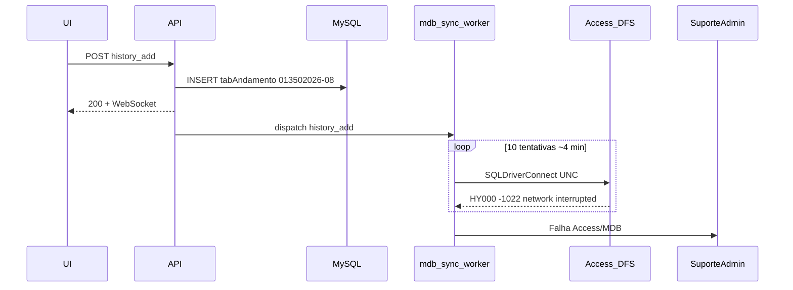

# Prevenir falha Access/MDB -1022 (history_add)

## Escopo

O andamento `013502026-08` da OS 1350/2026 **já está correto** — nenhuma recuperação operacional neste registro.

Escopo: só endurecer a conexão ODBC da API para o mesmo tipo de falha no futuro. Não altera rotas, UI, MySQL, dual-write nem o serviço `SAGRA-SyncAndamentos`.

## Causa (contexto)

O fluxo **não quebra o SAGRA Web**. O usuário já tem o andamento no MySQL quando o alerta é emitido.



- Rota: [`app/backend/routers/os_routes.py`](app/backend/routers/os_routes.py) grava MySQL, responde, e só então chama `_dispatch_mdb_sync("history_add", ...)`.
- Worker: [`app/backend/routers/mdb_writer.py`](app/backend/routers/mdb_writer.py) (`_execute_mdb_transaction`) tentou **10 vezes** (5 × 2 rodadas, espera 15s + pausa 120s) e abriu o ticket via [`create_system_mdb_alert`](app/backend/services/support_message_service.py).
- O erro ocorreu em **`SQLDriverConnect`**, ou seja, o driver nem abriu o arquivo. Não foi lock de registro, SQL inválido nem falha de negócio.
- Arquivo: `\\redecamara\DfsData\CGraf\ControleDeTrabalhos\BaseDeDados - SAGRA2\Sagra Base - OS Atual.mdb`.

Causa raiz (confiança alta): **interrupção SMB/DFS** no share do Access. O ACE/Jet responde exatamente com *“Your network access was interrupted. To continue, close the database, and then open it again”* (`-1022`). Isso é típico de hiccup de rede, failover DFS, ou **handle Jet zumbi no processo da API** (pyodbc usa **pooling ligado por padrão**; `close()` devolve o handle ao pool em vez de soltar o ACE).

O retry só ocorreu porque `_RETRIABLE_MARKERS` contém `"hy000"` (classe ODBC genérica). A mensagem real **não** contém `"network error"`.

## O que NÃO fazer

- Não aumentar retries (já bloqueia o worker único ~4 min e atrasa a fila).
- Não abrir o `.mdb` em modo exclusivo (derruba usuários do Access e o sync).
- Não desligar dual-write nem mudar fonte da verdade (MySQL).
- Não inserir andamentos à mão no Access para “consertar” falhas futuras: o catchup do sync faz INSERT (risco de PK duplicada); o dual-write da API é upsert e é seguro.
- Não mexer neste incidente: registro já confirmado correto.

## Correção de código (recorrência, baixo risco)

### 1. Soltar o ACE de verdade entre tentativas

Em [`app/backend/routers/mdb_writer.py`](app/backend/routers/mdb_writer.py), no import:

- `pyodbc.pooling = False` — o mesmo padrão já usado em [`app/services/sync_tables/sync_all.py`](app/services/sync_tables/sync_all.py). A API só usa pyodbc para Access (`lookup_sync`, `mdb_writer`). Sem isso, as 10 retentativas podem repetir o **mesmo** handle morto e sempre falhar em `SQLDriverConnect`.

### 2. Connection string compartilhada em modo compartilhado

Em [`app/backend/config_manager.py`](app/backend/config_manager.py) `get_mdb_connection_string`, hoje:

```text
DRIVER={Microsoft Access Driver (*.mdb, *.accdb)};DBQ={path};
```

Passar a incluir `Exclusive=0;Mode=Share Deny None;` (já usado nos scripts de `sync_tables`). Não trava o arquivo; reduz contenção com Access desktop + serviço de sync.

No `pyodbc.connect` do `mdb_writer`: `timeout=30` (o sync já tem `SYNC_CONNECT_TIMEOUT=30`; a API dual-write hoje não tem timeout de connect). Não aumenta retries.

### 3. Tratar `-1022` de forma explícita, sem mudar o volume de retry

Em `_RETRIABLE_MARKERS` / `is_retriable_mdb_error`: incluir `-1022` e `network access was interrupted`. Após esse erro, garantir `conn.close()` (já existe no `finally`) e **não** reutilizar handle (coberto pelo pooling desligado).

Não aumentar `MDB_RETRY_*`. Não criar segunda fila de reenvio: o catchup do `SAGRA-SyncAndamentos` já é a rede de segurança; um requeue extra competiria com o INSERT do sync.

### 4. Testes

Estender [`app/backend/tests/test_mdb_writer.py`](app/backend/tests/test_mdb_writer.py):

- `-1022` / “network access was interrupted” é retentável.
- `get_mdb_connection_string` contém `Exclusive=0` e `Mode=Share Deny None`.
- Após falha `-1022` simulada, a próxima tentativa chama `pyodbc.connect` de novo (conexão nova, não reuso).

Rodar `python -m pytest app/backend/tests/test_mdb_writer.py app/backend/tests/test_mdb_sync_admin_alert.py -q`.

## O que permanece igual

- Usuário continua sem esperar o Access (sync assíncrono).
- Alerta de admin continua após esgotar retries (visibilidade correta).
- Worker único FIFO (evita escrita concorrente no Jet).
- Catchup MySQL→MDB do serviço de sync continua sendo a recuperação automática do registro perdido.

## Incerteza residual

Sem os logs de produção (`sagra_api.log` / `logs/sync/sync_andamentos.log`) não dá para afirmar se o hiccup foi DFS, NIC, ou ACE zumbi no uvicorn. O código acima cobre os dois casos de software; a estabilidade do share continua sendo responsabilidade da rede/servidor de arquivos.
