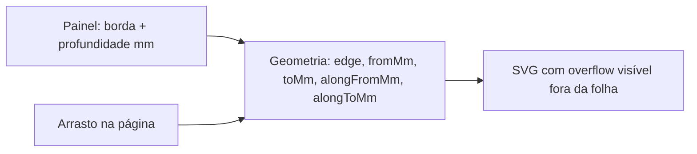

# Ferramenta Sangria no Análise Lab

## Comportamento acordado

- Parecida com faixa, mas **não ocupa a folha inteira** no eixo paralelo à borda.
- Banda **somente fora do papel** na borda escolhida: profundidade `P` → `fromMm = -P`, `toMm = 0` (ex.: −5 a 0).
- O arrasto na página define só o **trecho** (`alongFromMm` / `alongToMm`).
- Bordas: `top | right | bottom | left` (sem `all`).
- Espelhar em páginas opostas: igual à faixa (`left`↔`right`).



## Modelo de geometria

```ts
{
  edge: "left" | "right" | "top" | "bottom",
  fromMm: number,      // -P (fora)
  toMm: number,        // 0 (corta do papel)
  alongFromMm: number, // início do trecho
  alongToMm: number,   // fim do trecho ( > alongFrom )
}
```

Interpretação:

- `left`/`right`: profundidade no eixo X a partir da borda; `along*` = Y.
- `top`/`bottom`: profundidade no eixo Y a partir da borda; `along*` = X.

## Backend

Em [`app/backend/services/analise_lab_service.py`](app/backend/services/analise_lab_service.py):

- Incluir `"sangria"` em `MARK_TYPES`.
- Validar em `_validate_geometry`:
  - `edge` ∈ `{top,right,bottom,left}`
  - `toMm === 0` (ou normalizar para 0)
  - `fromMm` ∈ `[-50, 0)` (profundidade fora; default típico −5)
  - `alongFromMm < alongToMm`, ambos ∈ `[-50, 550]` (folga para trecho parcial e pequena extrapolação)
- Teste em [`app/backend/tests/test_analise_lab.py`](app/backend/tests/test_analise_lab.py): aceita −5/0 + trecho; rejeita profundidade positiva “só dentro” e `along` invertido.

Sem migração de schema: geometria já é JSON.

## Frontend — API e labels

- [`apps/web/src/api/analiseLab.ts`](apps/web/src/api/analiseLab.ts): `"sangria"` em `AnaliseLabMarkTipo`.
- [`apps/web/src/features/analise-lab/analiseLabLabels.ts`](apps/web/src/features/analise-lab/analiseLabLabels.ts): rótulo **"Sangria"**.
- [`analiseLabGeometry.ts`](apps/web/src/features/analise-lab/analiseLabGeometry.ts):
  - Helper `sangriaFromDrag(edge, depthMm, aMm, bMm, pageW, pageH)` → `{ fromMm: -depth, toMm: 0, alongFromMm, alongToMm }` a partir do arrasto no eixo paralelo.
  - `resolveMarkGeometry` / `canEspelhar`: espelhar `edge` left/right como faixa; `along*` inalterado.
  - Vitest cobrindo drag e espelho.

## Frontend — ferramenta e criação

- [`AnaliseLabMarkTools.tsx`](apps/web/src/features/analise-lab/AnaliseLabMarkTools.tsx): botão **Sangria**; campos **Borda** + **Profundidade (mm)** (default `5`); sem De/Até de faixa; checkbox espelhar com os demais espelháveis.
- [`AnaliseLabPage.tsx`](apps/web/src/features/analise-lab/AnaliseLabPage.tsx): incluir `sangria` em `canEspelharTipo`; estado `sangriaMm` (ou reusar `offsetMm` só nesta tool).
- [`AnaliseLabInspectorPage.tsx`](apps/web/src/features/analise-lab/AnaliseLabInspectorPage.tsx):
  - Arrasto tipo retângulo/medida **só no eixo paralelo** à borda (preview da banda fora + trecho).
  - `toMm` **sem clamp 0…página** quando `tool === "sangria"`: permitir margem de interação ~±`sangriaMm` (e um pouco mais) para o ponteiro fora da folha; o trecho `along*` continua no eixo da folha.
  - Callback `onCreateSangriaDrag({ pagina, alongFromMm, alongToMm })` → `addMark` com geometria montada (profundidade do painel).

## Frontend — desenho e edição

- [`AnaliseLabMarksLayer.tsx`](apps/web/src/features/analise-lab/AnaliseLabMarksLayer.tsx): `drawSangria` = `<rect>` com `fromMm`/`toMm` na borda e `along*` no eixo paralelo (ex. left: `x = from*sx`, `w = (to-from)*sx`, `y = alongFrom*sy`, `h = (alongTo-alongFrom)*sy`).
- Contêiner da página / SVG da layer: `overflow: visible` para a banda negativa não ser cortada (mínimo necessário no page wrapper da inspeção; folhear usa a mesma layer).
- [`AnaliseLabMarkEditor.tsx`](apps/web/src/features/analise-lab/AnaliseLabMarkEditor.tsx): editar borda, profundidade (`|fromMm|`), início/fim do trecho.

## Critérios de aceite

1. Criar sangria na borda esquerda com profundidade 5mm e trecho só no meio da altura → retângulo de −5→0 em X, não em Y full.
2. A faixa vermelha/azul aparece **fora** do papel (visível).
3. Com “todas as páginas” + espelhar, páginas opostas invertem left/right; a página desenhada permanece referência.
4. Editor altera profundidade/trecho e persiste.
5. Testes backend + vitest do helper de geometria passam.
