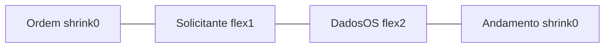

# Plano: rótulos à esquerda + largura Solicitante = Dados da OS

## Objetivo

1. Cada campo de **Solicitante** (Categoria, Nome, empilhados) com a **mesma largura** de um campo de **Dados da OS**.
2. Rótulos à **esquerda** do controle, com **`:`** após o texto (ex.: `Categoria:`).
3. Em **Ordem de serviço**: um único rótulo `Nr OS/Ano:` à esquerda; à direita `Nr OS` / `Ano` separados por `/`.
4. Escopo: [OsFiltersPanel.tsx](apps/web/src/features/os/components/OsFiltersPanel.tsx) + [SettingsModal.tsx](apps/web/src/features/settings/components/SettingsModal.tsx).

## Largura Solicitante = campo de Dados da OS

Hoje Solicitante está em `sm:w-[12rem] shrink-0` e Dados da OS em `flex-1` com `grid-cols-2`, o que desalinha.

**Abordagem:** na faixa de grupos (`os-filter-group-grid`), usar flex/grid com proporção **1 : 2** entre Solicitante e Dados da OS:

- Ordem de serviço / Andamento: `shrink-0` (conteúdo compacto, como hoje).
- Solicitante: `flex-1 min-w-0` (1 parte).
- Dados da OS: `flex-[2] min-w-0` + `grid-cols-2` (2 partes).

Assim a largura de Categoria/Nome ≈ largura de Título/Produto/Máquina/Prioridade. Sem `w-[12rem]` fixo no Solicitante.



## Rótulos à esquerda com ":"

### Controles compartilhados

Em [multi-select.tsx](apps/web/src/components/ui/multi-select.tsx) e [searchable-multi-select.tsx](apps/web/src/components/ui/searchable-multi-select.tsx):

- Adicionar prop `labelSide?: "top" | "left"` (default `"top"` — não regredir outros usos).
- Com `"left"`: root vira `flex items-center gap-2`; label `shrink-0 text-xs font-semibold` com texto `{label}:` (sem `mb-1 block`); controle `min-w-0 flex-1`.
- Ajustar posição do botão limpar (X): com label à esquerda, ancorar no botão (`top-1/2 -translate-y-1/2` no botão relativo), não em `top-[1.65rem]` do stack vertical.

### FilterField / Field locais

Em `OsFiltersPanel` e `SettingsModal`, atualizar `FilterField`/`Field` para layout horizontal equivalente (`flex items-center gap-2`, label `{label}:`).

### Ordem de serviço (Nr OS / Ano)

Substituir os dois rótulos separados por uma linha:

```
Nr OS/Ano:  [ Nr OS input ] / [ Ano MultiSelect ]
Processo:   [ input                 ]
```

- Label externo `Nr OS/Ano:` (FilterField wrapper ou row dedicada).
- Ano MultiSelect com `label=""` ou prop para ocultar label interno (`labelSide` + label vazio / `hideLabel`) + `aria-label="Ano"`.
- Processo: `Processo:` à esquerda, input à direita (mesma largura do bloco Nr OS+Ano).

Manter a grid compacta `grid-cols-[…]` só na área dos controles; a coluna de rótulos fica fixa (`shrink-0`, algo como `w-[5.5rem]` ou `min-w` baseado no maior rótulo do grupo) para alinhar verticalmente Processo com Nr OS/Ano.

Para Solicitante / Dados / Andamento: cada linha `rótulo | controle` (ou, em Dados da OS, cada célula do grid 2x2 no mesmo padrão).

## Arquivos a alterar

| Arquivo | Mudança |
|---------|---------|
| [multi-select.tsx](apps/web/src/components/ui/multi-select.tsx) | `labelSide`, formatação `:`, X reposition |
| [searchable-multi-select.tsx](apps/web/src/components/ui/searchable-multi-select.tsx) | Idem |
| [OsFiltersPanel.tsx](apps/web/src/features/os/components/OsFiltersPanel.tsx) | Proporção flex 1:2; FilterField esquerdo; Nr OS/Ano unificado; `labelSide="left"` nos MultiSelect |
| [SettingsModal.tsx](apps/web/src/features/settings/components/SettingsModal.tsx) | Mesmo padrão visual/proporção |

## Critérios de aceite

- Solicitante empilhado; largura visual de Categoria ≈ Título (uma coluna de Dados da OS).
- Todos os rótulos à esquerda com `:`; Nr OS/Ano unificado.
- Modal de criar filtros espelha o mesmo layout.
- MultiSelect/SearchableMultiSelect em outras telas (sem `labelSide`) continuam com label acima.
