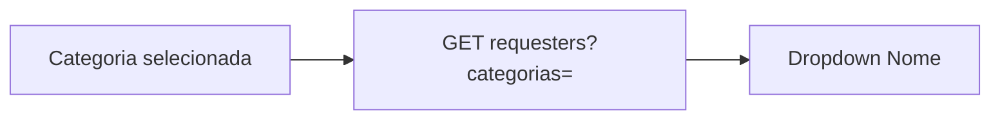

# Encadear filtro Nome à Categoria

## Contexto

No grupo **Solicitante** da lista de OS ([`OsFiltersPanel.tsx`](apps/web/src/features/os/components/OsFiltersPanel.tsx)), **Categoria** usa `GET /aux/categorias` e **Nome** usa `GET /os/filter-options/requesters`, que hoje lista nomes em `tab_os_filter_solicitantes` **sem** `CategoriaLink`.

A busca da lista já filtra OS com `p.CategoriaLink IN (...)` ([`os_search_service.py`](app/backend/services/os_search_service.py)). O dropdown Nome não.

A mesma combinação existe em [SettingsModal.tsx](apps/web/src/features/settings/components/SettingsModal.tsx) (filtros salvos). Cotas gráficas só tem Nome — fora do escopo.

## Abordagem

Não reescrever `tab_os_filter_solicitantes` (única por nome, sem categoria; exigiriam unique key + backfill obrigatório).

Quando houver categorias: consultar `tabProtocolos` com `CategoriaLink IN (...)`, o mesmo critério da busca. Sem categorias: manter a tabela auxiliar (typeahead rápido).

Índice idempotente `(CategoriaLink(64), NomeUsuario(64))` em `tabProtocolos` via [`os_search_indexes_schema.py`](app/backend/os_search_indexes_schema.py), no padrão já usado no startup.

## Backend

[`os_filter_options_routes.py`](app/backend/routers/os_filter_options_routes.py): `categorias: Optional[List[str]] = Query(None)` em `/os/filter-options/requesters`.

[`os_filter_options_service.py`](app/backend/services/os_filter_options_service.py) — `search_requesters(..., categorias=None)`:

- Limpar/limitar valores como a busca (`_clean_multi_filter_values`, máx. 20).
- Com categorias: `WHERE p.CategoriaLink IN (...)` + prefixo opcional em `NomeUsuario`, `GROUP BY` nome, `LIMIT`.
- Sem categorias: caminho atual da tabela auxiliar.
- Com categorias, **não** injetar rótulos extras do catálogo `cliente` (isso misturaria nomes de outras categorias). Só ocultar inativos, se o catálogo já fizer isso.

## Frontend

[`osFilterOptions.ts`](apps/web/src/api/osFilterOptions.ts) e [`useOsFilterOptions.ts`](apps/web/src/api/hooks/useOsFilterOptions.ts): `categorias?: string[]` na query e na `queryKey`.

[`OsFiltersPanel.tsx`](apps/web/src/features/os/components/OsFiltersPanel.tsx) e [`SettingsModal.tsx`](apps/web/src/features/settings/components/SettingsModal.tsx): passar `filters.categorias` / `criterios.categorias`. Ao mudar Categoria, limpar `solicitantes` (cascata: evita Nome de outra categoria + Categoria nova = lista vazia).

Hook de Cotas permanece compatível (`categorias` opcional).

## Testes

- Backend em [`test_os_filter_dropdowns.py`](app/backend/tests/test_os_filter_dropdowns.py): com categorias o SQL tem `CategoriaLink IN`; sem categorias continua na tabela auxiliar.
- Frontend: teste curto do client que serializa `categorias` na query (junto de um teste de API existente, se houver; senão um `.test.ts` mínimo em `osFilterOptions`).

## Critérios de aceite

- Sem Categoria: Nome igual ao atual.
- Uma ou várias categorias: Nome só com `CategoriaLink` correspondente (união / `IN`).
- Categoria alterada: nomes selecionados são limpos.
- Filtros salvos no SettingsModal com o mesmo encadeamento.
