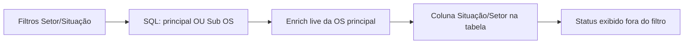

# Corrigir filtro de andamento da lista home

## O que está quebrado

A home (`OsHomePage` → `GET /os/search`) **não filtra no cliente**. O servidor inclui a OS se o último andamento da **OS principal** **ou** de uma **Sub OS** casa com Setor/Situação ([`build_main_or_sub_os_filter_sql`](app/backend/services/os_sub_os_queries.py)), e em seguida [`_enrich_operacional_from_live`](app/backend/services/os_search_service.py) **pinta** `situacao`/`setor` com o último andamento **da OS principal**.

A tabela mostra só a coluna da OS principal. Por isso aparecem OSs com andamento fora do filtro: a Capa/Miolo casou, a linha mostra o status da principal.

Há um segundo vazamento: no caminho paginado (a home) **não há refiltro após o enrich**. O lookup por Nr OS já faz isso ([`_filter_exact_lookup_choice_filters`](app/backend/services/os_search_service.py)); a lista normal não. Se o SQL usou a materializada (`OS_SEARCH_PREFER_MATERIALIZED=1` em produção) ou `tabAndamento` hardcoded no join live, a linha entra com um status e a tela mostra outro.

O realtime ([`osRealtimeSync.ts`](apps/web/src/features/os/osRealtimeSync.ts)) **não** injeta lista sem filtro; o refetch usa os filtros atuais.

## O que NÃO mudar

Painéis já tratam Sub OS como **linha própria**, não como “OS principal disfarçada”:

- [`/pcp/queue`](app/backend/routers/pcp_routes.py) une OS principal + [`fetch_sub_os_queue_rows`](app/backend/services/os_sub_os_queries.py)
- Dashboard une `/os/search` (principal) + PCP (Sub OS) em [`mergeDashboardQueueSources`](apps/web/src/features/dashboard-setor/utils.ts)

Essa via permanece. Também fora de escopo: `includeFinished`, realtime, sync MDB, CRUD de Sub OS.

## Correção (mínima)

Tudo em [`os_search_service.py`](app/backend/services/os_search_service.py) + helper em [`os_sub_os_queries.py`](app/backend/services/os_sub_os_queries.py). Sem mudança de UI.

1. **SQL da busca = só OS principal**  
   Em `execute_os_search`, o filtro de setor/situação deixa de usar o `OR EXISTS (Sub OS)`. Acrescentar flag `include_sub_os=False` em `build_main_or_sub_os_filter_sql` (default `True` só para não quebrar testes do helper). A home, o export XLSX e o `/os/search?painel=1` dos dashboards passam a incluir só quem **exibe** o andamento filtrado. Sub OS continua na fila PCP.

2. **Refiltro após enrich na lista paginada**  
   Depois de `_enrich_operacional_from_live`, aplicar o mesmo critério da coluna visível (`_main_matches_situacao_setor`) sempre que houver filtro de situação/setor — não só no lookup por Nr OS. Linha cuja situação/setor live não está no filtro sai. Remover a exceção de Sub OS também no exact lookup, para Nr OS + filtro de andamento ficar coerente com a lista.

3. **Join live na mesma tabela do enrich**  
   [`_live_andamento_join_sql`](app/backend/services/os_search_service.py) hoje faz `FROM tabAndamento`. Enrich usa `get_andamento_table()`. Trocar o join para a tabela canônica, senão filtro e tela leem tabelas diferentes em MySQL case-sensitive.

`annotate_search_sub_os_matches` / auto-expand na tabela ficam inofensivos (quase nunca `matched_via_sub_os=true`). Não remover agora.

## Testes

Em [`test_os_ultimo_andamento_search.py`](app/backend/tests/test_os_ultimo_andamento_search.py) / [`test_os_search_gap_fallback.py`](app/backend/tests/test_os_search_gap_fallback.py):

- Com `setor`/`situacao`, o SQL de `execute_os_search` **não** contém `tab_os_sub_os` / `EXISTS` de Sub OS.
- Lista paginada: enrich muda `situacao` para valor fora do filtro → linha descartada; valor dentro do filtro → linha mantida.
- Exact lookup: principal fora do filtro e `has_sub_os=true` **não** mantém a linha (hoje o post-filtro ainda inclui via Sub OS).

Rodar: `python -m pytest app/backend/tests/test_os_ultimo_andamento_search.py app/backend/tests/test_os_search_gap_fallback.py app/backend/tests/test_sub_os_listas_paineis.py -q`

Não alterar testes de PCP/Sub OS em painel.

## Aceite

- Filtro Setor/Situação na home: cada linha da OS principal tem situação e setor **dentro** dos valores selecionados.
- Expandir `+` continua mostrando Sub OS; Sub OS **não** faz a OS principal entrar na lista se o andamento dela não casa.
- Painel/dashboard: cards de Sub OS seguem vindo da fila PCP.
- Export XLSX da home usa o mesmo critério.
