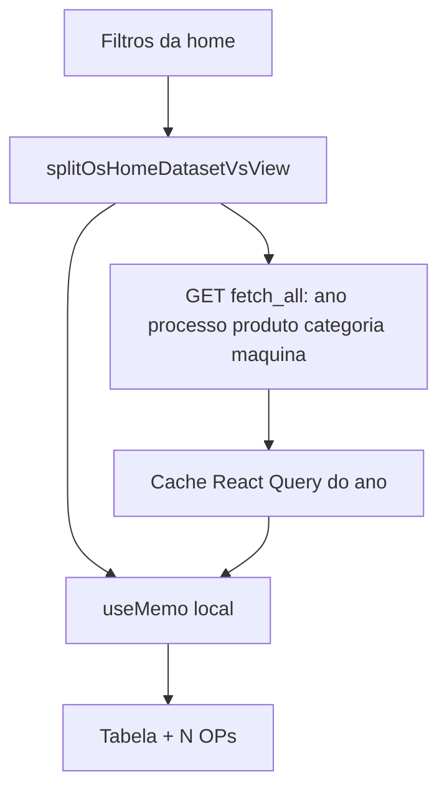

# Filtrar a lista da home sem nova consulta

## Por que cada filtro espera

A home já carrega o ano de uma vez (`fetch_all`). Mesmo assim, **qualquer** mudança em [`OsHomePage.tsx`](apps/web/src/features/os/components/OsHomePage.tsx) reconstrói `searchFilters`, troca a query key do TanStack Query e chama de novo `GET /os/search?fetch_all=true`.

Não há filtro local sobre as linhas já carregadas. O overlay “Atualizando lista…” aparece (debounce de 200 ms em situação/setor + round-trip). O backend até usa o fast path (~445 ms para ~2500 OSs do ano), mas o usuário percebe como “consulta do zero” — na paginação antiga a resposta era 20 linhas.

Com ano na lista, situação/setor **já vêm** em cada linha (`situacao`, `setor`, `prioridade`, `titulo`, `solicitante`). O servidor só aplica isso em Python depois de hidratar o ano de novo.

## Estratégia

Separar **conjunto** (o que define o GET) de **visão** (o que fatia o que já está na memória).

Só aplicar visão no cliente quando há **filtro de ano** (caso default da home). Sem ano (todos os anos), situação/setor continuam no servidor — conjunto grande demais e hoje cai no join lento.

**Visão (instantâneo, sem GET):**
- `situacao`, `setor`, `prioridade`
- `titulo` (contains, case-insensitive, mínimo 3 caracteres como hoje)
- `solicitantes` / `solicitante`
- `includeOs` / `includeSp`
- `nrOs` (igualdade na lista do ano)
- `sortBy` / `sortDir` (incluindo situação/setor — hoje isso força o join de ~5 s)

**Conjunto (GET de novo):**
- `anos`
- `processo`, `produtos`, `categorias`, `maquinas`
- lookup Nr OS **sem** ano (busca em todos os anos)

Produto/categoria/máquina ficam no servidor: não estão completos na linha (`EXISTS` em detalhes; OS pode ter mais de um produto).

## Implementação

Novo módulo [`apps/web/src/features/os/osHomeViewFilters.ts`](apps/web/src/features/os/osHomeViewFilters.ts):

- `toOsHomeDatasetFilters(filters)` — zera campos de visão para a query key / `searchOs` / registro no [`osActiveSearchStore.ts`](apps/web/src/features/os/osActiveSearchStore.ts) (WebSocket refetch o **ano**, não a fatia).
- `applyOsHomeViewFilters(rows, filters)` — replica `_filter_rows_by_displayed_andamento` + OS/SP + título/solicitante/Nr OS; marca `matched_via_sub_os` como [`annotate_search_sub_os_matches`](app/backend/services/os_sub_os_queries.py).
- `sortOsHomeViewRows` — mesmos desempates do backend (`ano`+`nr_os`; prioridade Prometido/Solicitado; tie-break).
- `countUniqueOsProtocols(rows)` — rótulo “N OPs”.

Em [`OsHomePage.tsx`](apps/web/src/features/os/components/OsHomePage.tsx):

- `useOsSearch(datasetFilters)` com `fetchAll: true`.
- `rows` = visão sobre `searchQuery.data`.
- `meta.total_records` = contagem única local (não o total do ano sem filtro).
- Overlay / `markUserListFetch` / `isChoiceFilterPending` **só** para filtros de conjunto. Situação/setor/prioridade/ordenação não mostram “Atualizando…”.
- Tirar situação/setor/prioridade do debounce de 200 ms (aplicar no `useMemo` na hora).
- Export XLSX continua com **todos** os filtros (`exportOsListXlsx(searchFilters)` atuais) — ação pontual, precisa bater com a tela.

Painel, relatório `limit=1` e `GET /os/search` paginado **não mudam**.

## Testes

- [`osHomeViewFilters.test.ts`](apps/web/src/features/os/osHomeViewFilters.ts): situação/setor nas linhas (incl. Sub OS); título curto não filtra; Nr OS no ano; “N OPs” não conta componente; sort `ano`/`situacao`.
- Dataset key: mudar situação **não** altera `osSearchQueryKey(toOsHomeDatasetFilters(...))`.
- Ajustar [`osSearchQueryKey.test.ts`](apps/web/src/features/os/osSearchQueryKey.test.ts) só se a home passar a serializar o dataset.

Verificar na UI: ano já carregado → mudar setor/situação → lista e contagem imediatas, sem overlay; mudar ano ou produto → GET + overlay como hoje.
