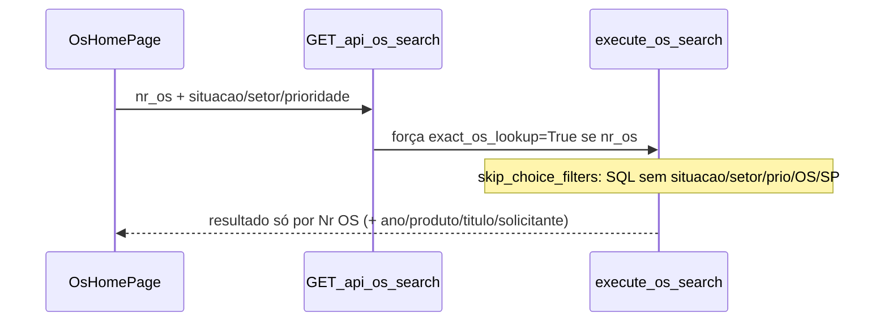

# Filtros da home: Nr OS, entregues e dropdowns pesquisáveis

## Diagnóstico

### Nr OS ignora outros filtros (não é bug acidental)

Fluxo atual:

- Frontend marca `exactOsLookup` em [`osSearchUtils.ts`](apps/web/src/features/os/osSearchUtils.ts) e envia os filtros de escolha.
- Backend em [`os_routes.py`](app/backend/routers/os_routes.py) **força** `exact_os_lookup=True` quando `nr_os` vem preenchido.
- Em [`os_search_service.py`](app/backend/services/os_search_service.py), `skip_choice_filters` omite SQL de situação/setor/prioridade e toggles OS/SP (testado em `test_exact_os_lookup_skips_setor_situacao_filters`).
- Esse fast path é intencional (igualdade indexável em `NroProtocolo`, sem JOIN global de andamento, sem COUNT) e deve ser **mantido**.

### Checkbox “Exibir entregues e canceladas”

- Em [`OsFiltersPanel.tsx`](apps/web/src/features/os/components/OsFiltersPanel.tsx); default `includeFinished: false` em [`osFiltersStore.ts`](apps/web/src/features/os/osFiltersStore.ts).
- Com `false`, o backend exclui `Entregue` / `Cancelada` / `Cancelado` — redundante com o multiselect Situação.

### Dropdowns sem digitação

- Situação/Setor/Prioridade usam [`MultiSelect`](apps/web/src/components/ui/multi-select.tsx) **sem** campo de busca.
- Produto/Solicitante já usam [`SearchableMultiSelect`](apps/web/src/components/ui/searchable-multi-select.tsx).
- Nos andamentos ([`OsHistoryPanel.tsx`](apps/web/src/features/os/components/OsHistoryPanel.tsx)) o “digitar para achar” é `<select>` nativo (type-ahead do browser), incompatível com multiselect. A UX alinhada aos filtros já pesquisáveis da home é o input “Digite para filtrar...”.

**Escopo fixado:** só a home de OS (não alterar Relatório / Cotas Gráf, que mantêm o checkbox próprio).

---

## 1. Nr OS + demais filtros (performance preservada)

Em [`execute_os_search`](app/backend/services/os_search_service.py):

- Manter `use_exact_fast_path` / SQL sem JOIN de andamento / sem COUNT.
- Após `_enrich_operacional_from_live` (onde `situacao`/`setor` já vêm live), aplicar filtro em Python no conjunto pequeno:
  - `situacao` / `setor` (main match; se não bater e `has_sub_os`, validar match via Sub OS com helper leve — mesma semântica de `build_main_or_sub_os_filter_sql`)
  - `prioridade` (`EntregPrazoLink` já na row)
  - `include_os` / `include_sp` (faixas &lt;5000 / ≥5000)
- Reativar `annotate_search_sub_os_matches` no fast path quando houver situação/setor (hoje é pulado por `skip_choice_filters`).
- Manter `_filter_out_finished_rows` só quando `include_finished=false` (outros consumidores da API).

Atualizar testes em [`test_os_ultimo_andamento_search.py`](app/backend/tests/test_os_ultimo_andamento_search.py):

- SQL continua sem `subfx_sit` / `prio_0` no fast path.
- Novos asserts: com Nr OS + situação/setor/prioridade, o resultado Python respeita os filtros.

Frontend:

- Remover/ajustar hint obsoleto em [`filterStatus.ts`](apps/web/src/features/os/filterStatus.ts) (`getExactOsLookupHint` — filtros deixam de ser ignorados).
- Comentário em [`types.ts`](apps/web/src/features/os/types.ts) sobre `exactOsLookup`.

---

## 2. Remover checkbox e listar tudo por padrão

Só na home de OS:

- Remover o checkbox de [`OsFiltersPanel.tsx`](apps/web/src/features/os/components/OsFiltersPanel.tsx); manter “Exibir OSs” / “Exibir SPs”.
- `includeFinished: true` em `defaultOsFilters`; forçar `true` em [`buildOsHomeSearchFilters`](apps/web/src/features/os/osSearchUtils.ts) para não depender de persistência antiga.
- Parar de persistir/sincronizar `includeFinished` em [`osFiltersStore.ts`](apps/web/src/features/os/osFiltersStore.ts) e [`OsFilterPreferencesSync.tsx`](apps/web/src/components/auth/OsFilterPreferencesSync.tsx).
- Atualizar hints em [`filterStatus.ts`](apps/web/src/features/os/filterStatus.ts) (não mais “exclui entregues e canceladas”).
- Ajustar testes frontend que assumem `includeFinished: false` na home.

Comportamento: sem Situação → todas as situações (incl. entregues/canceladas); com Situação → só as selecionadas.

---

## 3. Digitar para localizar no MultiSelect

Em [`multi-select.tsx`](apps/web/src/components/ui/multi-select.tsx), espelhar o padrão de `SearchableMultiSelect`:

- Input de busca no painel aberto; filtrar opções por label/value (case-insensitive, locale `pt-BR`).
- Manter selecionados visíveis mesmo se não baterem na busca.
- Limpar busca ao fechar; focar o input ao abrir.
- Sem mudança de API (`value: string[]`, checkboxes) — Situação/Setor/Prioridade na home (e Relatório/Settings que reutilizam o componente) ganham busca sem trocar de componente.

Não substituir por `<select>` nativo (quebraria multiselect).

---

## Verificação

- Backend: testes de exact lookup + novos casos de pós-filtro.
- Frontend: testes de `osSearchUtils` / `filterStatus` / query string com `include_finished=true`.
- Manual: Nr OS + Situação; listagem sem filtros mostra entregues; digitar em Situação/Setor/Prioridade sem perder multiselect.
