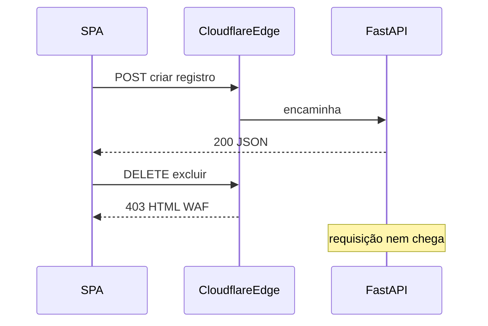

# Corrigir 403 de exclusão via Cloudflare

## Diagnóstico (causa raiz)

A mensagem exibida pelo app — **“Acesso bloqueado pelo proxy (403)”** — só é gerada em [`apps/web/src/lib/api.ts`](apps/web/src/lib/api.ts) quando o status é **403** e o corpo é **HTML** (`<!doctype html` / `<html>`), não JSON da FastAPI:

```115:119:apps/web/src/lib/api.ts
        if (isHtmlApiResponse(text)) {
          throw new Error(
            res.status === 403
              ? "Acesso bloqueado pelo proxy (403). Feche e abra o app, faça login novamente e tente de novo."
```

Isso aponta para **bloqueio na borda Cloudflare** (página HTML do WAF/Managed Rules), não para:

- `CloudflareTunnelSecurityMiddleware` → JSON `{"error":"Access Denied","message":"..."}`
- `APIAccessMiddleware` → JSON `{"detail":"..."}`

Criar registros usa **POST**; excluir usa **DELETE**. Nginx, Workers e CORS **já permitem DELETE**. Com sessão válida, o middleware da app trata DELETE igual a POST. O padrão “POST create funciona / DELETE excluir falha / 403 HTML” é típico de regra WAF que penaliza métodos menos comuns.

Evidência de padrão já adotado no repo: exclusão de IP usa **POST** [`/admin/ip/delete`](app/backend/routers/ip_admin_routes.py) (não DELETE).



## Abordagem escolhida (segura e mínima)

**Migrar o SPA para `POST …/delete` (ou sufixo `/delete` na mesma rota), reutilizando o mesmo handler e as mesmas dependências de auth/RBAC.** Manter os `@router.delete` existentes para LAN/clientes antigos — **não remover** código de exclusão.

Não fazer:

- Desligar ou afrouxar `CloudflareTunnelSecurityMiddleware`
- Abrir exclusão sem sessão / allowlist pública
- Alterar Workers para “engolir” DELETE (frágil)
- Confiar só em ajuste no dashboard CF (complementar, não substituto)

Segurança preservada:

- Mesmos `Depends` / checks de sessão, IP e permissão
- Cookie `sagra_session` `HttpOnly` + `SameSite=lax` (CSRF cross-site já mitigado)
- Header `X-Requested-With` mantido via `apiFetch`
- Nenhuma rota de delete passa a ser pública sem autenticação

## Escopo de alteração

### Backend — aliases POST nos mesmos handlers

Adicionar rota espelho `POST` que chama a **mesma função** (sem duplicar lógica SQL/tombstone). Convenção: sufixo `/delete` quando a rota DELETE atual não termina em recurso “deletável” óbvio, espelhando IP admin.

| DELETE atual | POST alias |
|---|---|
| `/os/{ano}/{id}/history/{cod_status}` | `/os/{ano}/{id}/history/{cod_status}/delete` |
| `/os/.../sub-os/.../history/{history_id}` | `.../history/{history_id}/delete` |
| `/os/{ano}/{id}/vinculo/{v_num}/{v_ano}` | `.../vinculo/{v_num}/{v_ano}/delete` |
| `/admin/users/{ponto}` | `/admin/users/{ponto}/delete` |
| `/analise/item/{item_id}` | `/analise/item/{item_id}/delete` |
| `/settings/filters/saved/{filter_id}` | `.../{filter_id}/delete` |
| `/os/.../notificacao-watch` | `/os/.../notificacao-watch/delete` |
| `/push/subscribe` | `/push/subscribe/delete` |
| `/admin/modelos/{modelo_id}` | `/admin/modelos/{modelo_id}/delete` |
| rotas DELETE em [`admin_system_routes.py`](app/backend/routers/admin_system_routes.py) | equivalente `/delete` |
| `/api/admin/clientes/{id}` | `/api/admin/clientes/{id}/delete` |

Arquivos principais: [`os_routes.py`](app/backend/routers/os_routes.py), [`os_sub_os_routes.py`](app/backend/routers/os_sub_os_routes.py), [`user_admin_routes.py`](app/backend/routers/user_admin_routes.py), [`analise_routes.py`](app/backend/routers/analise_routes.py), [`settings_routes.py`](app/backend/routers/settings_routes.py), [`os_notificacao_routes.py`](app/backend/routers/os_notificacao_routes.py), [`papelaria_routes.py`](app/backend/routers/papelaria_routes.py), [`admin_system_routes.py`](app/backend/routers/admin_system_routes.py), [`cliente_gabinete_routes.py`](app/backend/routers/cliente_gabinete_routes.py).

Padrão de registro (sem copiar corpo):

```python
@router.delete("/os/{ano}/{id}/history/{cod_status}", ...)
@router.post("/os/{ano}/{id}/history/{cod_status}/delete", ...)
def delete_os_history(...):
    # lógica existente intacta
```

`is_mobile_session_friendly_api_route` já trata mutações `POST` em `/api/*` (exceto admin) — aliases de OS/notificação continuam compatíveis com túnel/celular.

### Frontend — trocar só o cliente HTTP

Em [`apps/web/src/api/`](apps/web/src/api/) (`os.ts`, `adminUsers.ts`, `analise.ts`, `settings.ts`, `osNotificacao.ts`, `adminSystem.ts`, `cliente-portal.ts`): trocar `{ method: "DELETE" }` por `POST` no path `/delete` correspondente. **Não** alterar UI, validações ou fluxos de negócio.

### Mensagem de erro (ajuste leve)

Em `api.ts`, deixar a mensagem de 403 HTML mais precisa (ex.: bloqueio do proxy/WAF no método), sem sugerir só “faça login de novo” — evita diagnóstico errado.

### Testes de regressão

- Teste(s) de rota: `POST …/delete` e `DELETE` original resolvem o mesmo endpoint / mesmo status com auth mock (pelo menos andamento OS + um admin).
- Atualizar asserts em [`test_os_notificacao_mobile_access.py`](app/backend/tests/test_os_notificacao_mobile_access.py) se paths mudarem no cliente (DELETE legado pode permanecer nos asserts).
- Smoke frontend: typecheck; se houver testes de API client, atualizar paths.

### Verificação manual (obrigatória)

1. Via **Cloudflare** (`cgraf.online` / workers): criar andamento (POST) e excluir (novo POST `/delete`) — deve retornar JSON 200, não HTML 403.
2. Via **LAN**: DELETE legado e POST novo ambos ok.
3. Confirmar no Network: exclusão usa `POST`, status sem HTML Cloudflare.
4. Se **editar** (PUT/PATCH) também falhar com 403 HTML no mesmo ambiente, estender o mesmo padrão — **só então**; o relato atual indica falha específica de exclusão.

### Ops (complementar, fora do código)

No dashboard Cloudflare, revisar Managed Rules / “Block uncommon HTTP methods” e criar exceção para `/api/*` se desejado. O fix no código deve bastar mesmo sem esse passo.

## Critérios de aceite

- Exclusão via acesso externo não retorna 403 HTML / “bloqueado pelo proxy”.
- Criação, edição e demais fluxos POST/GET inalterados.
- Auth/RBAC das exclusões idênticos aos atuais.
- Endpoints `DELETE` legados continuam funcionando na intranet.
- Nenhuma lógica de tombstone/SQL removida ou reescrita além do registro de rota.