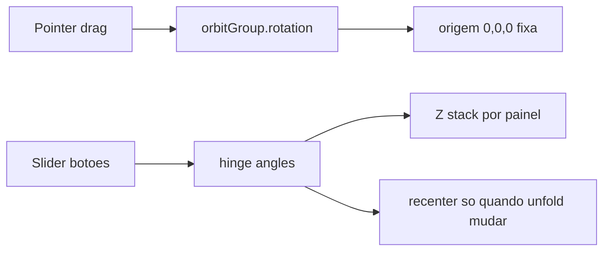

# Corrigir órbita e dobras múltiplas do mockup folheto

## Causas

1. **Centro “flutua”:** [`recenterPivot()`](apps/web/src/features/prova-web/foldMockupThree.ts) roda **em todo frame** via `render()`, recalculando o AABB com o produto já sob `orbitGroup.rotation`. O centro mundial muda a cada grau de giro → `pivotGroup.position` compensa e o objeto **translada** na tela.

2. **Sentido invertido / gesto confuso:** no pointer down, hit perto da dobra entra em modo `fold` (desdobra em vez de girar). No modo órbita, o sinal de `rotY`/`rotX` não corresponde ao “arrastar o objeto” esperado.

3. **Painéis se cruzam com 3+ faces (2+ dobras):** em tríptico / quádruplo / sanfona, todos os painéis ficam praticamente no mesmo plano ao fechar (~170°) sem empilhamento em Z. Resultado: interpenetração, z-fighting e visual de “metade de uma página de cada lado”.

## Premissas fechadas

- **Arrastar em qualquer lugar = só órbita** (sentido do mouse).
- **Desdobrar = slider / Abrir / Fechar / Passo** apenas.
- Centro do produto **fixo** no centro da viewport; só rotação.
- Accordion com **camadas** (offset Z por face) + ângulo fechado que não atravessa o irmão anterior.

---

## 1. Centro fixo

Em [`foldMockupThree.ts`](apps/web/src/features/prova-web/foldMockupThree.ts):

- Remover `recenterPivot()` de `render()`.
- Recentrar **só** quando as dobras mudam (`setHingeAnglesFromUnfold`) e após o build inicial:
  - zerar temporariamente `orbitGroup.rotation`
  - `Box3.setFromObject(contentGroup)` / centro
  - `pivotGroup.position = -center`
  - restaurar a rotação da órbita
- `orbitGroup` permanece em `(0,0,0)`; a câmera continua a olhar a origem.

---

## 2. Órbita alinhada ao mouse

Em [`ProvaWebFoldMockup3D.tsx`](apps/web/src/features/prova-web/ProvaWebFoldMockup3D.tsx):

- Pointer down/move: **sempre** modo `orbit` (remover `pickHingeNear` / modo `fold` no drag).
- Mapeamento tipo “pegar o produto”:
  - arrastar **direita** → `rotY` acompanha a mão (**inverter** o sinal atual de `+ dx`)
  - arrastar **baixo** → `rotX` alinhado ao livro (`rotX -= dy` em sensibilidade equivalente)
- Sensibilidade ~0,01 rad/px (~mesmo feeling do livro com `0.45` em graus CSS).
- Hint: “Arraste para girar · use o controle para desdobrar”.

---

## 3. Correção multi-dobra (3+ painéis)

Em `buildAccordion` / aplicação de ângulos em [`foldMockupThree.ts`](apps/web/src/features/prova-web/foldMockupThree.ts):

**Empilhamento (obrigatório):**

- Cada painel na cadeia recebe `position.z = sign * thickness * index` (ou `±(index + 1) * thickness`) no grupo do painel, de forma que ao fechar as faces fiquem **em camadas** e não no mesmo plano.
- Espessura efetiva um pouco maior no empilhamento fechado (~0,6–1,0 mm) para leitura clara.
- Respeitar `sentido` (valley/mountain): o sinal do offset Z acompanha o `sign` da dobra que “entra” aquele painel (sanfona alternada).

**Ângulo fechado:**

- Usar ângulo fechado `min(165°, CLOSED)` e, se necessário, reduzir levemente por índice (`closed - index * 2°`) só para 3+ dobras, evitando que a face N atravesse a N−2.
- Manter 0° = aberto plano.

**Verificação dedicada:**

- Tríptico (2 dobras), quádruplo e sanfona: fechado sem faces atravessando; aberto plano; ao desdobrar pelo slider as faces passam uma pela outra **só** no sentido da dobradiça, sem metade “fantasma”.
- Biparte (1 dobra) regressão: comporta-se como hoje, só com órbita/centro corrigidos.

---

## 4. Isolamento / verificação geral

- Sem mudança em livro CSS / papelaria / backend / `foldMockup` API.
- Checklist: centro fixo ao girar; mouse no sentido certo; desdobrar só no toolbar; multi-dobra sem cruzar.
