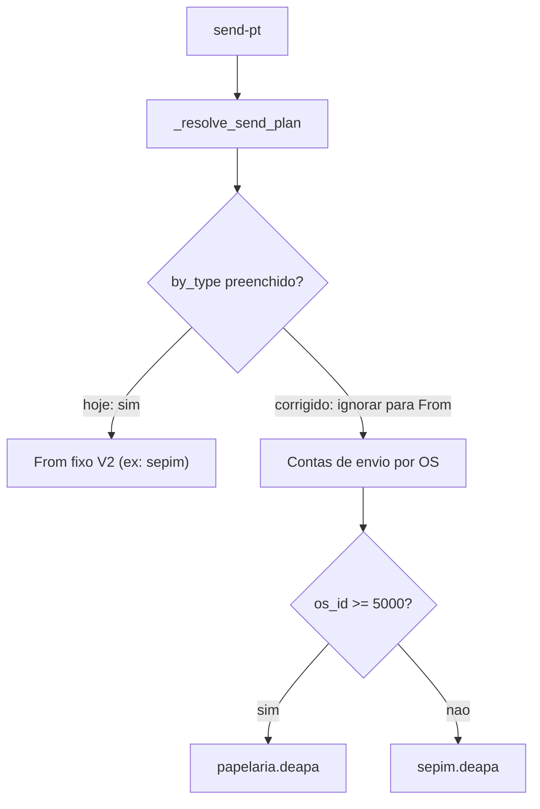

# Corrigir remetente papelaria (≥5000)

## Causa raiz

As **Contas de envio (Exchange)** em [EmailTemplatesSection.tsx](apps/web/src/features/configuracoes/components/EmailTemplatesSection.tsx) gravam `send_mailboxes.os_lt_5000` / `os_gte_5000` (MySQL via [email_template_service.py](app/backend/services/email_template_service.py)). Isso já está correto no seu ambiente.

No envio `POST /api/email/send-pt`, [`_resolve_send_plan`](app/backend/routers/email_routes.py) escolhe o From nesta ordem:

1. `send_routing.by_type[pt|proof|…]` (painel Email / V2) — **conta fixa, ignora o nº da OS**
2. só então `send_mailboxes` (Contas de envio)
3. legado `SendMailboxOsLt/Gte5000`

Por isso o painel de Contas de envio “parece certo” e o sistema continua saindo como `sepim.deapa@camara.leg.br` para SP ≥ 5000: o override V2 ganha da config que você está olhando.

## Correção (comportamento desejado)

- **From**: sempre pelas Contas de envio (`os_id >= 5000` → `os_gte_5000`, senão `os_lt_5000`), com fallback legado se global vier vazio.
- **`send_routing.by_type`**: deixa de definir remetente (não sobrescreve Contas de envio). Continua irrelevante para From; pastas de enviados seguem em `sent_folder_routing.by_mailbox` na mailbox **já resolvida** por OS.
- **Outros e-mails** (ativação, reset, &lt; 5000): inalterados na prática — continuam na conta configurada para `os_lt_5000` / activation.
- Limiar permanece **≥ 5000** (igual ao rótulo da UI Contas de envio).

## Alterações de código

1. **[`app/backend/routers/email_routes.py`](app/backend/routers/email_routes.py)** — em `_resolve_send_plan`, remover a preferência de mailbox via `by_type`; selecionar só global → legado. Manter resolução de pasta com a mailbox resultante.
2. **[`apps/web/src/features/email/components/EmailConfigPanel.tsx`](apps/web/src/features/email/components/EmailConfigPanel.tsx)** — no bloco de roteamento por tipo, remover o select de conta remetente (ou torná-lo informativo: “remetente vem de Contas de envio”) para não sugerir override que o backend não aplica mais. Manter escolha de pasta de enviados por tipo, usando a mailbox de roteamento já selecionada na UI só como contexto de pastas, sem persistir From por tipo.
3. **Save config** — ao salvar, persistir `send_routing.by_type` vazio (ou omitir endereços), para limpar overrides antigos em `__GLOBAL__` e alinhar DB com o novo contrato.
4. **[`app/backend/services/os_arquivos_service.py`](app/backend/services/os_arquivos_service.py)** — trocar `resolve_send_mailbox(os_id, "os_lt_5000")` por `resolve_send_mailbox(os_id)` para convites de arquivos de SP ≥ 5000 também respeitarem Contas de envio (mesmo critério).
5. **Testes** — atualizar [`test_email_config_v2.py`](app/backend/tests/test_email_config_v2.py): `by_type` preenchido **não** deve mais vencer global; caso `os_id=7000` → `global.gte`; `os_id=1200` → `global.lt`. Ajustar teste do painel se o select de mailbox sumir.

## Validação

- `pytest app/backend/tests/test_email_config_v2.py -q`
- Smoke: enviar prova/PT de OS ≥ 5000 e confirmar `routing.mailbox` / `mailbox_source` = `global` e endereço papelaria; OS &lt; 5000 continua sepim.
- Após um save no painel Email, `SendRouting.by_type` sem contas fixas no MySQL.
