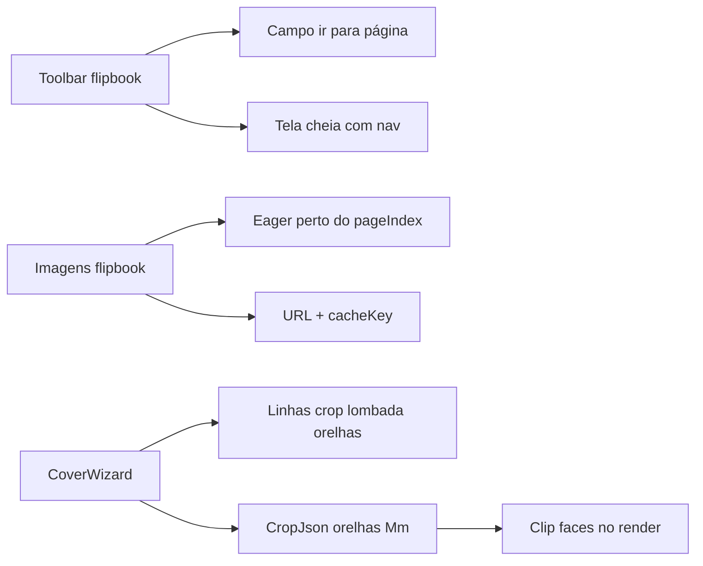

# Flipbook UX, crop no portal e orelhas na capa

## Premissas fechadas

- Escopo de UX (página / carga / fullscreen): **apenas flipbook** Prova WEB (staff + portal via [`ProvaWebFlipbook.tsx`](apps/web/src/features/prova-web/ProvaWebFlipbook.tsx) / shell). **Não** Mockup 3D nem papelaria.
- Carga progressiva: **cliente** — abrir assim que o manifest chegar; imagens sob demanda (banda eager ao redor da página atual). Sem mudança no pipeline síncrono de render no servidor (exceto cache HTTP/URL).
- Orelhas: assistente de capa (staff) com **guias na preview** + **aplicação no render** do flipbook/mockup (clip das faces), sem alterar mockup 3D dobrável.
- Portal crop: caso **flipbook Prova WEB regular**; correção defensiva (bust de cache + headers), sem trocar o contrato do flipbook.

Princípio: nada disso altera montagem `capa1→capa2→miolo→capa3→capa4`, `page-flip`, gutter, Mockup 3D, papelaria ou assistente de miolo além do necessário.



---

## 1. Ir para página específica

Arquivo: [`ProvaWebFlipbook.tsx`](apps/web/src/features/prova-web/ProvaWebFlipbook.tsx).

- Na toolbar, ao lado do rótulo atual, campo numérico (1-based) + Confirmar / Enter.
- Mapear número digitado → índice 0-based clampado; chamar `flipRef.current.turnToPage(idx)` (API já tipada).
- Sincronizar o campo quando o evento `flip` atualiza `pageIndex` (sem conflitar com digitação em andamento — só sync quando o input não está focado).
- Manter Home/Prev/Next/End e atalhos de teclado; se o input estiver focado, não interceptar setas que o usuário usa no campo (ou só setas fora do input, como hoje).

Não criar componente de rota novo — mudança local no toolbar.

---

## 2. Carga progressiva de imagens (cliente)

Mesmo arquivo flipbook.

Hoje: `loading={index < 4 ? "eager" : "lazy"}` e todos os nós HTML existem (exigência do PageFlip).

Plano seguro:

- Manter **todos** os `.prova-web-page` no DOM (PageFlip).
- **Não** usar `src` definitivo em todas de uma vez: placeholders (`data-src` / `src` só quando na janela).
- Janela eager: páginas com índice em `[pageIndex - 2, pageIndex + 3]` (ajustável) + capas se ainda não vistas; restante `loading="lazy"` **ou** sem `src` até entrar na janela (evita tempestade HTTP na abertura).
- Ao mudar `pageIndex`, preencher `src` das páginas da nova janela; imagens já carregadas permanecem (atributo setado uma vez).
- Zoom overlay continua usando URLs já conhecidas (mesmo `pageUrl`).
- Remount do livro ainda keyed por `manifest.cacheKey` — sem regressão de crop.

Critério: o livro/controles aparecem assim que o manifest resolve; capa e vizinhança pintam primeiro; miolo interno chega depois, sem travar a UI.

---

## 3. Tela cheia com produto + navegação

- Botão **Tela cheia** na toolbar do flipbook.
- Alvo do Fullscreen API: wrapper que inclui **área do livro + barra de navegação** (e, no portal, o conteúdo útil do painel — não o chrome externo do site inteiro se possível). Preferência: `requestFullscreen()` no root do [`ProvaWebViewerShell`](apps/web/src/features/prova-web/ProvaWebViewerShell.tsx) quando há abas, ou no root do flipbook (livro+toolbar) quando não.
- Fallback se Fullscreen API falhar: classe CSS `fixed inset-0 z-[80]` no mesmo wrapper (padrão do zoom backdrop / Analise), sem quebrar o zoom existente.
- Esc sai da tela cheia; botão toggle; layout `h-full` para o book redimensionar (reusar `baseSize` / stretch do PageFlip — se necessário `update()`/`flip` resize leve no evento `fullscreenchange`).
- Zoom modal e jump-to-page continuam disponíveis dentro da tela cheia.

Não alterar Mockup 3D nesta entrega.

---

## 4. Portal: capa cropada incorreta (correção defensiva)

Hipótese principal para flipbook regular com código atual: **PNG do portal cacheado no browser** (URL estável só com `token`, sem `Cache-Control`), enquanto o staff vê disco fresco após gerar.

Medidas (não exclusivas):

1. **Cache bust na URL da imagem** — incluir `cacheKey` (ou hash curto) na query:
   - Staff: [`provaWebPageUrl`](apps/web/src/api/provaWeb.ts) / flipbook `buildPageUrl`
   - Portal: [`proofFlipbookPageUrl`](apps/web/src/api/proof-portal.ts)
   - Assets spine: idem
2. **Headers** nas respostas PNG/asset staff e portal: `Cache-Control: private, max-age=0, must-revalidate` (ou `no-store` alinhado a `preview-base`).
3. **Confirmar** em runtime que portal chama `ensure_prova_web_pages(..., crop_json=record.get("cropJson"))` (já no tree; não remover).
4. Smoke: mesma OS, `page_1.png` bytes staff vs portal após bypass de cache devem coincidir.

Sem mudar geometria de crop do render neste item.

---

## 5. Orelhas na capa (wizard + render + guias)

### Modelo de dados

Estender `ProvaWebCapaCrop` / `CropJson.capa` em [`provaWeb.ts`](apps/web/src/api/provaWeb.ts) e backend [`_capa_config`](app/backend/services/prova_web_render_service.py):

```json
"capa": {
  "layout": "spread",
  "lombadaMm": 8,
  "orelhaEsquerdaMm": 0,
  "orelhaDireitaMm": 0,
  "crop": { ... },
  "sheets": [ ... ]
}
```

- Defaults `0` (sem regressão).
- Só fazem sentido em `layout === "spread"` (wizard zera ou esconde em `pages`).

### UX no assistente

Em [`ProvaWebCoverWizard.tsx`](apps/web/src/features/prova-web/ProvaWebCoverWizard.tsx):

- Na etapa lombada (renomear copy para **Lombada e orelhas**): inputs mm para orelha esquerda (junto à capa 4) e direita (junto à capa 1), passo 0,1.
- Etapa **Crop** / preview: estender [`PdfCropPreview`](apps/web/src/features/prova-web/ProvaWebCropPanel.tsx) (props opcionais de guias) com linhas verticais %:
  - bordas do crop externo (já existe retângulo verde)
  - faixa da lombada (âmbar, centro ± `lombadaMm/2`)
  - faixas das orelhas (outra cor, ex. azul) entre crop externo e início da face útil
- Legenda curta: Crop / Lombada / Orelha / Face.
- Sem atrasar abertura: guias são CSS sobre o canvas já carregado.

### Render (isolado do flipbook assembly)

Em [`prova_web_render_service.py`](app/backend/services/prova_web_render_service.py), no clip de meia-página spread (`_outer_crop_half_clip` ou equivalente):

- Após crop externo e reserva de lombada, reservar também `orelhaEsquerdaMm` na face esquerda (borda externa) e `orelhaDireitaMm` na face direita — o conteúdo das orelhas **não** entra em `cover-front` / `cover-back` finais (igual filosofia da lombada).
- Spine.png continua só a faixa de lombada.
- Bump `_LAYOUT_VERSION` (ex. 5) + `cacheKey` já inclui `CropJson` → invalidação natural.
- Validação: orelhas + lombada + crop não podem zerar a face útil (≥ ~5 mm).

Mockup 3D: continua usando faces já clipadas; **não** adicionar dobradiça de orelha nesta entrega (escopo fechado).

---

## 6. Isolamento / não regressão

| Área | Proteção |
|------|----------|
| Papelaria / Mockup produto | Intocada |
| PageFlip montagem HTML | Mantém todos os nós; só muda política de `src` |
| Gutter CSS | Intacto |
| Miolo crop panel | Guias de orelha só via props opcionais (default off) |
| Versões `orelha* = 0` / ausentes | Idêntico ao comportamento atual |
| Portal token / auth | Sem mudança de permissão |

---

## 7. Verificação

- Digitar página 50 / Enter: salto correto; label e input sincronizam ao folhear.
- OS grande: UI do flipbook aparece com manifest; imagens da vizinhança carregam antes do miolo distante.
- Tela cheia: livro + toolbar (e abas Folhear/Mockup se existirem no shell); Esc restaura.
- Portal e staff: capa aberta com crop+lombada — mesmos pixels após hard refresh; URLs com `cacheKey` mudam ao gerar Prova N+1.
- Orelhas 0 vs 15 mm: faces mais estreitas no render; overlay do wizard alinha com a geometria; lombada 0 e orelhas 0 = visual/render atual.
- Regressão: Folhear, Mockup 3D, papelaria, assistente miolo.

## Fora de escopo

- Render streaming / PNG sob demanda no servidor.
- Orelhas dobráveis no Mockup 3D.
- Ligar orelhas/lombada ao calculador `lombadaCalc` / OS.
- Fullscreen do site inteiro fora do wrapper da prova.
