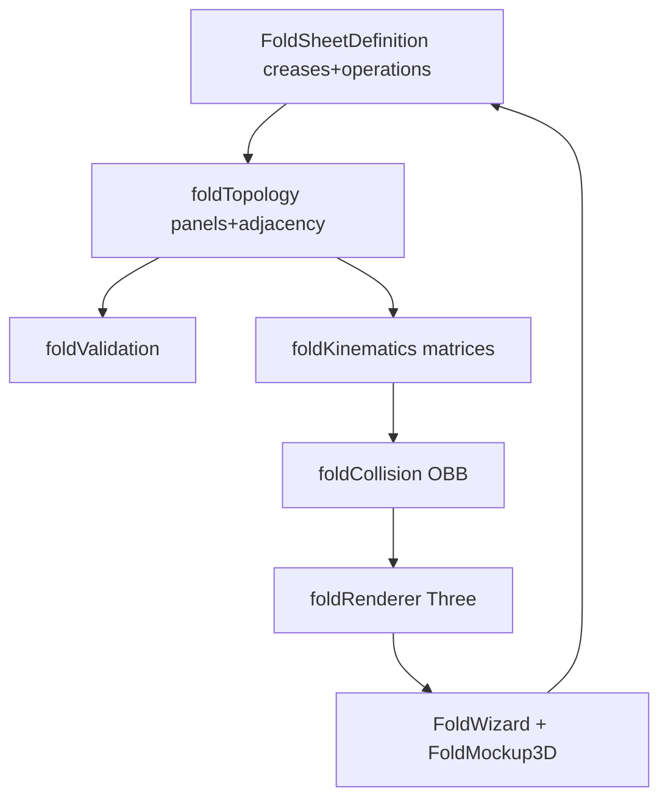

# Motor dinâmico de mockup 3D para folders

## Premissas fechadas (pelo relatório + sua escolha)

- **Arquitetura:** vincos → painéis → grafo → operações (`movingSide` + `towards`) → solver matricial → espessura/colisão → renderer/interação. Sem heurísticas por preset (`buildCFold` / `buildAccordion` / `buildCrossFold` removidos).
- **Entrega:** big bang — o mockup folheto só volta a ser considerado pronto após aceitação da seção 25 do relatório (cenários funcionais + invariantes geométricos). Internamente o trabalho segue as etapas 1→5 do relatório, mas sem merge intermediário que mantenha o motor antigo em produção.
- **Schema:** corte limpo. `CropJson.folheto.dobras[]` / `sentido valley|mountain` deixam de ser o contrato. Registros antigos: ao abrir o assistente, mostrar aviso e **obrigar reconfiguração** (preset default); não tentar converter comportamento automático.
- **Isolamento:** não alterar caminhos `unico`, `capa_miolo`, `ProvaWebBookMockup3D`, papelaria, flipbook de livro. `ProvaWebViewerShell` continua a bifurcar por `foldMockup` vs `bookMockup`.

---

## Contrato de dados (substitui `FoldDobra`)

Em [`apps/web/src/api/provaWeb.ts`](apps/web/src/api/provaWeb.ts) e espelho em [`app/backend/services/prova_web_fold_service.py`](app/backend/services/prova_web_fold_service.py):

- `FoldCrease`: `{ id, axis, positionMm, spanStartMm?, spanEndMm? }`
- `FoldOperation`: `{ id, creaseId, order, movingSide: negative|positive, towards: front|back, targetAngleDeg, phaseId? }`
- `FoldSheetDefinition` (derivado no render): dimensões úteis, `thicknessMm`, creases, operations, `backArtworkTransform`
- `FoldPanelPageAssignment[]` por `panelId` (substitui arrays indexados `frente[]`/`verso[]` no contrato novo; UI ainda pode editar em grade L→R)
- Remover do contrato persistido: `dobras`, `sentido`, `sequenciaPaginas` indexado legado
- Manifest `foldMockup` deixa de expor `hinges` baseados em hierarquia fixa; passa a expor creases + operations + panels (topologia plana) + `panelPages` por id + flags de validação

**Detecção de legado:** se `folheto.dobras` existir sem `creases`/`operations`, backend/fe tratam como config inválida → assistente exige “Configurar novamente”.

---

## Organização de código

Extrair de [`foldMockupThree.ts`](apps/web/src/features/prova-web/foldMockupThree.ts) (~858 linhas) para:

`apps/web/src/features/prova-web/fold-engine/`

| Módulo | Responsabilidade |
|--------|------------------|
| `foldTypes.ts` | Tipos puros |
| `foldNormalization.ts` | `quantizeMm(ε=0.01)`, quebras X/Y, IDs estáveis |
| `foldTopology.ts` | Painéis grade, adjacência, BFS conjunto móvel |
| `foldValidation.ts` | Geometria / topologia / sequência → erro\|aviso\|info |
| `foldProgress.ts` | Progressão por `order`/`phaseId` (evoluir `unfoldLevelProgress`) |
| `foldKinematics.ts` | Eixo mundial, sinal via probe, `makeRotationAroundLine`, matrizes desde folha aberta |
| `foldCollision.ts` | OBB, busca binária ângulo seguro, compensação de pilha |
| `foldStacking.ts` | `paperThicknessMm` / `renderGapMm` / `creaseRadiusMm` separados |
| `foldGeometry.ts` | BoxGeometry + faixa de vinco |
| `foldMaterials.ts` | Physical + fallback Basic para prova “fiel” |
| `foldRenderer.ts` | Cena Three, apply matrices, dispose |
| `foldInteraction.ts` | Orbit / drag aba / zoom / snap / inércia |
| `foldCamera.ts` | Fit por bounding sphere, damping, “Enquadrar” |
| `foldPresets.ts` | Só geradores de creases+operations (sem lógica de render) |

Math puro (sem Three quando possível) em `foldNormalization` / progress / collinear checks; reexportar testes de [`foldMockupMath.ts`](apps/web/src/features/prova-web/foldMockupMath.ts) e **remover** `effectiveClosedDeg`.

Facade: `createFoldScene` em `foldRenderer.ts` (ou thin reexport) para não quebrar imports do shell/portal de uma vez.

Backend: reimplementar `normalize_folheto_config` / `build_fold_mockup` no mesmo modelo (painéis + creases + operations + validations). Topologia em Python alinhada (mesmos IDs `p{row}_{col}` / `p{col}`).

---

## Etapa A — Modelo, topologia, validação, presets

1. Tipos + normalização com tolerância (fim do `Set(posicaoMm)` frágil).
2. `buildFoldTopology(definition)` → panels + adjacency edges ligadas a `creaseId`.
3. `resolveMovingPanels(topology, operation, remainingGraph)` via BFS após remoção temporária das arestas do vinco.
4. Validação: painel mín. 15 mm entre vincos vizinhos; lado móvel não-vazio; não mover a folha inteira; vincos duplicados; IDs únicos.
5. Presets só como geradores — corrigir duplicidade `quad_vertical` ≡ `sanfona_vertical`; separar explicitamente:
   - Tríptico sanfona / tríptico carteira (L e R) / portão (`phaseId` compartilhado) / sanfona 4 / enrolada 4 / paralela dupla / cruzada V-primeiro / cruzada H-primeiro / personalizada
6. UI wizard ([`ProvaWebFoldWizard.tsx`](apps/web/src/features/prova-web/ProvaWebFoldWizard.tsx)): modo personalizado (+/− dobra, eixo, posição, lado móvel, direção frente/verso, ordem, ângulo); diagrama destacando conjunto móvel; erros/avisos em tempo real.
7. Sequência de páginas por `panelId` com default 1…N / 2N…N+1 como **sugestão editável**.

## Etapa B — Solver genérico (remove construtores especiais)

1. Todos os painéis filhos diretos de `contentGroup` (sem árvore hinge).
2. Em cada progresso do slider: reset matrizes → aplicar operações ordenadas (phases juntas se `phaseId` e conjuntos disjuntos) → `matrixWorld` nos meshes.
3. `resolveWorldHinge`: transformar segmentos do vinco; exigir paralelos + colineares (tolerâncias do relatório); senão erro claro (não animar errado).
4. `resolveRotationSign` por probe + normal frontal + `towards`.
5. Remover `buildCFold` / `buildAccordion` / `buildCrossFold` / `stackSign` / Z heurístico / `effectiveClosedDeg`.
6. `targetAngleDeg` default **180**; o fechamento efetivo vem da colisão (Etapa C), não de chainIndex.

## Etapa C — Espessura e colisão

1. `FoldPhysicalProperties`: paper ~0.22 / renderGap ~0.015 / creaseRadius ~0.35 (configurável depois).
2. Painéis como `BoxGeometry` (frente/verso/bordas) + faixa flexível de vinco 0,5–2 mm.
3. OBB por painel; excluir contato permitido só na região do vinco ativo.
4. `findMaximumSafeAngle` (binária ~12 iterações); compensação de pilha por deslocamento normal mínimo após rotação ideal.
5. Aceitar fechamento “quase 180°” com gap físico, não produto semiaberto artificial.

## Etapa D — Interação

1. Estados: idle | orbit | fold | zoom.
2. Arraste no fundo → órbita; arraste em painel móvel → progress da operação; wheel/pinch → zoom; duplo clique / botão → enquadrar.
3. Snap aberto/fechado + inércia leve; limite pelo ângulo seguro.
4. Pick por painel + resolver operação aplicável (não depender de `pickHingeNear` com eixos locais quebrados); distância ponto–linha 3D se necessário.
5. Render **sob demanda** (parar rAF quando idle) — grande ganho móvel.

## Etapa E — Visual e câmera

1. Preferir `MeshPhysicalMaterial` + studio lights + ACES; **modo “cores fiéis”** (Basic / exposure neutro) disponível para prova de impressão (requisito SAGRA de fidelidade à arte).
2. Anisotropy até 8; contact shadow suave.
3. Fit por bounding sphere do conteúdo *atual*; `recenterPivot` suave no slider, preservando pivot no drag direto.
4. Artwork transform configurável (`mirrorX/Y`, rotation) em vez de sempre espelhar UV do verso.

---

## Backend e portal

- [`prova_web_fold_service.py`](app/backend/services/prova_web_fold_service.py): presets → creases/operations; `build_fold_mockup` devolve topologia + operações + `panelPages` por id + `validation`.
- [`prova_web_render_service.py`](app/backend/services/prova_web_render_service.py): branch `folha_dobrada` só muda o schema consumido; PNG frente/verso inalterados.
- Portal ([`ClienteProofFlipbookPanel`](apps/web/src/features/cliente)): continua lendo `manifest.foldMockup`; sem DB antigo válido, fluxo “gerar prova” já recria manifest.

---

## Testes (qualidade de aceite)

**Unit (vitest + pytest)** — topologia, BFS móvel L/R/T/B, Z-fold e carteira sem branches especiais, cruzada nas duas ordens, preserva comprimento/eixo, determinismo/reversibilidade, sem NaN/scale, colisão, configs inválidas, quantizeMm.

**Property (fast-check, etapa final):** posições/ordens/lados válidos → invariantes em vários progressos.

**Regressão modes:** garantir que testes existentes de crop capa/miolo e livro não quebram; smoke `folha_dobrada` emitindo novo `foldMockup`.

**Aceite manual/checklist (relatório §25):** biparte ambos lados; Z e carteira; sanfona/enrolada 4; portão; paralela; cruzada; ordem alterada; +/− dobra; aberto = geometria original.

**Visual (Playwright, após motor estável):** screenshots 0/25/50/75/100% por preset principal — opcional nesta entrega se o ambiente CI já tiver Playwright; senão checklist local documentado.

---

## O que NÃO fazer

- Continuar patchando `position.z`, `chainIndex`, `effectiveClosedDeg` ou branches por nome de preset.
- Motor físico genérico (Ammo/Cannon) como solução principal.
- Misturar CSS do livro com o fold engine.
- Manter dual-path (antigo + novo) em produção após o big bang — só durante desenvolvimento local até cutover.
