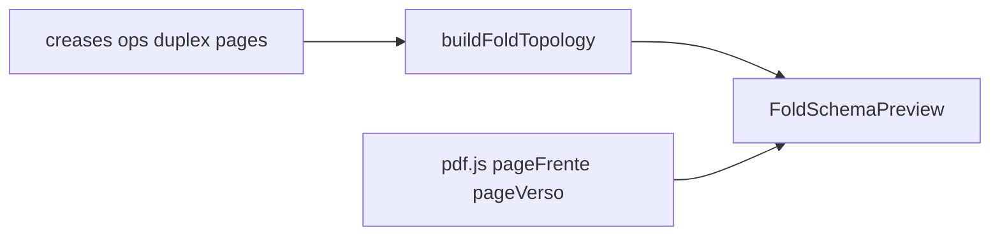

# Prévia didática de vincos/operações no wizard

## Objetivo

Na seção **Vincos e operações** de [`ProvaWebFoldWizard.tsx`](apps/web/src/features/prova-web/ProvaWebFoldWizard.tsx), o usuário precisa ver **qual faixa do PDF** é cada painel e **como a sequência dobra**, sem adivinhar `movingSide`/`towards`/`order`.

Somente no assistente staff; prévia **ao vivo** (muda com vincos/ops). Sem animação 1ª→2ª.

## Abordagem

Novo componente [`FoldSchemaPreview.tsx`](apps/web/src/features/prova-web/FoldSchemaPreview.tsx) no lugar do `TopologyDiagram` atual (mesmo slot na seção). Dois painéis lado a lado: **Frente** e **Verso** (se houver página verso).

### Visual (cada face)

1. Raster da página PDF (crop + área útil) como fundo.
2. Overlays nos painéis (`topology.panels`): borda + badge **`p0` / `p1` / `p2`** no centro da faixa.
3. Linhas de vinco (já existem via posições).
4. Por operação ordenada (`order` ASC):
   - Badge **`1ª`**, **`2ª`**, … no vinco.
   - Seta do conjunto móvel (`resolveMovingPanels`) **para** o lado estacionário / sobre o miolo, conforme `movingSide`.
   - Cor/símbolo leve para `towards` (ex.: “sobre a frente” vs “sobre o verso”) — legenda curta.
5. Painel `basePanelId` (miolo) destacado (âmbar, como hoje).
6. Op selecionada: painéis móveis em verde mais forte + seta em destaque.

### Verso

- Mesma geometria de painéis; arte = `pageVerso`.
- Com duplex ligado (`backArtworkTransform.mirrorX`): faixas/UV alinhados ao remap já usado no mockup ([`foldDuplex.ts`](apps/web/src/features/prova-web/fold-engine/foldDuplex.ts)) — label `p0` continua no painel geométrico da frente, mas a arte amostrada é a faixa duplex correta (como o 3D), para o usuário ver o que fica atrás de cada aba.
- Vincos guia no verso: posição espelhada só se duplex (igual crop preview).

### Dados / motor (reuso)

- `buildFoldTopology`, `resolveMovingPanels`, `toSheetDefinition`, `usableAfterCrop`
- `folheto.pageFrente` / `pageVerso`, `crop`, `basePanelId`, ops
- Raster: mesmo pipeline de [`ProvaWebCropPanel.tsx`](apps/web/src/features/prova-web/ProvaWebCropPanel.tsx) (`provaWebSourcePdfUrl` + pdf.js) — extrair helper fino de “render page to canvas/dataURL” se necessário, sem acoplar o crop panel ao schema

### UX de setas (regra concreta)

Para vinco vertical: `movingSide=negative` → seta da esquerda → direita (aba esquerda dobra sobre o miolo); `positive` → seta da direita → esquerda. Horizontal: análogo (cima/baixo). Número da ordem na base da seta. Várias ops: setas empilhadas/offset para não sobrepor.

### Integração no wizard

- Remover uso de `TopologyDiagram` na seção de ops (função local pode sair ou ficar só se ainda usada).
- `PresetDiagram` / `SavedModelDiagram` **inalterados** (thumbnails pequenos).
- Props do preview: `folheto`, `topology`, `usable`, `selectedOpId`, `ano`/`osId`/`arquivoUnico`.
- Texto de ajuda curto sob o schema: “Faixas = painéis no PDF. Setas = dobra (ordem). Verde = aba móvel da operação selecionada.”

### Testes

- Unit: helper de geometria da seta / faixa duplex (`movingSide` → direção SVG; duplex band widths) em `foldSchemaPreview.test.ts`.
- Manual: carteira esquerda/direita — setas 1ª/2ª batem com o fechamento esperado; trocar `order`/`movingSide` atualiza na hora.

## Fora de escopo

- Animação sequencial 2D
- Viewer 3D / portal
- Novo modelo de dados de operações
- Editar seta por drag (continua nos selects)