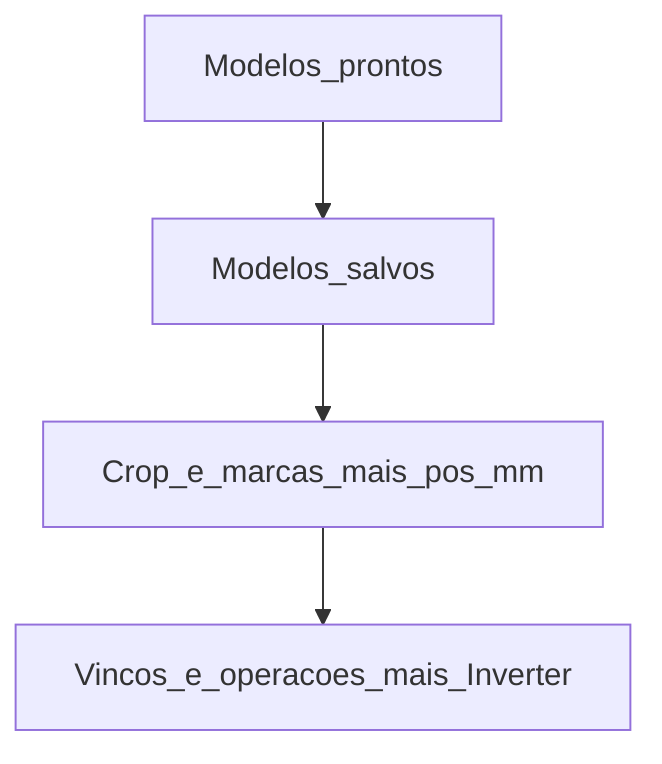

# Wizard folheto: páginas ocultas + crop após modelos

Escopo: só [`ProvaWebFoldWizard.tsx`](apps/web/src/features/prova-web/ProvaWebFoldWizard.tsx) (+ defaults em [`provaWebFoldPresets.ts`](apps/web/src/features/prova-web/provaWebFoldPresets.ts)). Sem mudanças em livro, mockup 3D ou pipeline de fold.

## Nova ordem das seções

1. Modelos prontos do sistema  
2. Modelos salvos pelos usuários  
3. Crop e marcas de vinco (+ inputs de **posição mm** dos vincos)  
4. Vincos e operações (+ botão **Inverter páginas**)  
5. ~~Páginas do PDF~~ — removida da UI

## 1. Defaults de página e duplex

Em [`defaultFolhetoCrop`](apps/web/src/features/prova-web/provaWebFoldPresets.ts):

- `pageFrente: 1` (página **2**)
- `pageVerso: 0` (página **1**)
- `backArtworkTransform.mirrorX` já é `true` via `DEFAULT_ARTWORK_BACK` — manter

No wizard / `cropJson` / efeito de clamp `pageCount`:

- Fallbacks `?? 1` / `?? 0` (frente/verso) em vez de `?? 0` / `?? 1`
- Forçar `mirrorX: true` no estado ao montar/hidratar e no payload de confirmação (sem checkbox)

Atualizar aviso `pageCount > 2` (~591–595) para: páginas **2 (frente)** e **1 (verso)**.

## 2. Remover seção Páginas; manter Invert

- Remover o bloco inteiro “Páginas do PDF…” (~1203–1310): selects Frente/Verso + checkbox duplex.
- Mover o botão swap para o header de **Vincos e operações**, caption **“Inverter páginas”** (visível se `pageCount >= 2`).
- Lógica do swap igual (troca `pageFrente` ↔ `pageVerso`); defaults do swap usam os novos fallbacks.

## 3. Posição mm na seção Crop

- Extrair o `<label> Posição … mm` de cada item da lista de operações (~1011–1050) e colocar em **Crop e marcas de vinco**, após `ProvaWebCropPanel` (lista por vinco: V/H + input mm + `posDraftByCrease` / `commitCreasePos` já existentes).
- Na lista de operações, deixar ordem, móvel, towards, ângulo, stagger, reorder/remove — **sem** campo Posição.
- Ajuste do texto de ajuda em Vincos (não mais “informe a posição em mm” aí).

Arrastar marcas no preview do crop (`onFoldPosicaoChange`) permanece.

## 4. Reordenar JSX

Mover o `<section>` de Crop para depois do bloco de Modelos salvos (antes de Vincos). Sem mudar lógica de `ProvaWebCropPanel`.

## 5. Testes

- Atualizar expectativas de default em [`hydrateFolheto.test.ts`](apps/web/src/features/prova-web/hydrateFolheto.test.ts) se cobrirem `pageFrente`/`pageVerso` default.
- Smoke rápido: wizard abre com frente=2/verso=1; Invert troca; duplex sempre on; posição só no crop; seção Crop após salvos.

## Não mudar

- Persistência de modelos salvos / pack de páginas (invert ainda altera estado).
- Schema de fold, mockups, Folhear, presets tipográficos, crop math.
