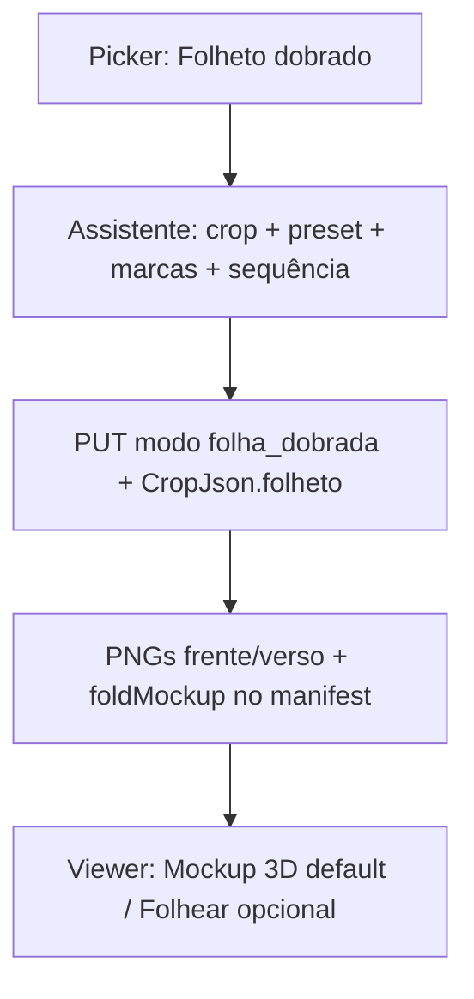

# Folheto / informativo com dobras na Prova WEB

## Premissas fechadas

- **Onde:** novo modo no picker da Prova WEB: **Folheto dobrado** (além de Único e Capa+Miolo).
- **Arquivo:** 1 PDF com **1 ou 2 páginas** (frente; verso opcional). Sem capa/miolo.
- **Config:** **presets didáticos + ajuste fino** (biparte, tríptico, quádruplo, sanfona, cross-fold limitado).
- **Viewer:** aba principal **Mockup 3D** (desdobrar + órbita 360°); Folhear opcional só frente/verso planos.
- **Portal:** staff e cliente.
- **Stack:** CSS `preserve-3d` (família do livro/papelaria). Sem three.js nesta entrega.
- **Isolamento:** caminhos `unico`, `capa_miolo`, bookMockup, papelaria e assistente de capa **intactos**.



---

## 1. Modo e persistência

- Novo literal `folha_dobrada` em:
  - [`provaWeb.ts`](apps/web/src/api/provaWeb.ts) (`ProvaWebModo`)
  - [`ProvaWebUpdate.modo`](app/backend/routers/prova_web_routes.py)
  - [`MODE_*`](app/backend/services/prova_web_render_service.py) + branch de fontes (1 PDF, como `unico`)
- `tabProvaWeb.Modo` já é `VARCHAR(16)` — cabe `folha_dobrada`.
- Colunas de arquivo: reusar `ArquivoUnico` (mesmo path); **não** exigir capa/miolo.
- `CropJson` ganha seção `folheto` (demais seções ignoradas neste modo).

Formato canônico:

```json
{
  "folheto": {
    "preset": "triptico_vertical",
    "crop": { "top": 3, "right": 3, "bottom": 3, "left": 3, "source": "trimbox" },
    "dobras": [
      { "id": "d1", "eixo": "vertical", "posicaoMm": 98, "sentido": "valley", "ordem": 1 },
      { "id": "d2", "eixo": "vertical", "posicaoMm": 196, "sentido": "mountain", "ordem": 2 }
    ],
    "pageFrente": 0,
    "pageVerso": 1
  }
}
```

- `posicaoMm`: distância a partir da borda **esquerda** (vertical) ou **superior** (horizontal) da área **após crop**.
- `sentido`: `valley` | `mountain` (didático: “dobrar para dentro / para fora” relativo à face impressa da frente).
- `ordem`: sequência de dobra (1 = primeira a fechar ao embalar; ao **desdobrar** no mockup, invertida).
- Defaults por preset; usuário ajusta mm (passo 0,1) e sentidos; validação: dobras internas à área útil, gap mínimo entre dobras ~8 mm, face útil ≥ ~15 mm.

Presets iniciais (posições em frações da largura/altura útil, aplicadas após crop):

| Preset | Dobras |
|--------|--------|
| `biparte_vertical` | 1 V @ 50% |
| `biparte_horizontal` | 1 H @ 50% |
| `triptico_vertical` | 2 V @ 33%/67% |
| `triptico_horizontal` | 2 H @ 33%/67% |
| `quad_vertical` | 3 V @ 25/50/75% |
| `sanfona_vertical` | 3 V (mesmas pos.) com sentidos alternados |
| `cruzado` | 1 V @ 50% + 1 H @ 50% (ordem fixa: V depois H) |

---

## 2. Picker + assistente didático

[`ProvaWebFilePicker.tsx`](apps/web/src/features/prova-web/ProvaWebFilePicker.tsx):

- Terceiro modo **Folheto dobrado** (ícone distinto).
- Um slot de PDF; validação leve: meta `pageCount ≤ 2` (aviso se > 2, usar só pág. 1–2).
- Continuar → assistente (não gerar ainda).

Novo [`ProvaWebFoldWizard.tsx`](apps/web/src/features/prova-web/) orquestrado por branch em [`ProvaWebCropAssistant.tsx`](apps/web/src/features/prova-web/ProvaWebCropAssistant.tsx):

Etapas numeradas:

1. **Crop da folha** — reusar [`ProvaWebCropPanel`](apps/web/src/features/prova-web/ProvaWebCropPanel.tsx) (TrimBox etc.).
2. **Preset** — cards com diagramas simples (biparte / tríptico / …).
3. **Marcas de dobra** — preview PDF (frente) com retângulo de crop + **linhas de dobra** arrastáveis (mm), legenda por eixo; espelhar métricas (posição / distância às bordas).
4. **Sentido e sequência** — lista ordenável (1…N) com ícone valley/mountain e seta “fecha primeiro → …”; preview esquemático empilhamento flat (não 3D ainda).
5. **Resumo** — miniaturas frente/verso + lista de dobras; **Gerar Prova WEB**.

UX didática: cores distintas por dobra; “como no impresso” (linhas = vinco); tooltips curtos. Sem bloquear abertura com detecção pesada.

---

## 3. Render / manifest

Em [`prova_web_render_service.py`](app/backend/services/prova_web_render_service.py):

- Branch `MODE_FOLHA_DOBRADA`:
  - Aplica crop mm à(s) página(s); gera `page_1.png` (frente) e opcional `page_2.png` (verso) — **sem** montagem de livro.
  - Roles: `cover-front` / `page` ou novos `sheet-front` / `sheet-back` (preferir roles simples `page` com flag, ou `sheet-front`/`sheet-back` no manifest para o Folhear).
  - **Não** chama `_assemble_book` / **não** emite `bookMockup`.
- Emite `foldMockup`:

```json
"foldMockup": {
  "preset": "triptico_vertical",
  "lombadaMm": 0,
  "pageWidthMm": 210,
  "pageHeightMm": 297,
  "panels": [
    { "id": "p0", "xMm": 0, "yMm": 0, "wMm": 70, "hMm": 297 },
    { "id": "p1", "xMm": 70, "yMm": 0, "wMm": 70, "hMm": 297 },
    { "id": "p2", "xMm": 140, "yMm": 0, "wMm": 70, "hMm": 297 }
  ],
  "hinges": [
    { "between": ["p0","p1"], "eixo": "vertical", "sentido": "valley", "ordem": 1 },
    { "between": ["p1","p2"], "eixo": "vertical", "sentido": "mountain", "ordem": 2 }
  ],
  "hasVerso": true
}
```

- Painéis derivados de crop + `dobras` ordenadas (partition da área útil). Cross-fold gera grid 2×2.
- `cacheKey` já inclui `CropJson`; bump `_LAYOUT_VERSION` (ex. 6).
- Flipbook ignora `foldMockup`; usa só `pages[]` (1–2).

---

## 4. Mockup 3D: desdobrar + 360°

Novo [`ProvaWebFoldMockup3D.tsx`](apps/web/src/features/prova-web/ProvaWebFoldMockup3D.tsx) + CSS dedicado (não acoplar a `PapelariaProofMockup3D` nem ao livro).

**Geometria:**

- Cadeia de painéis com `transform-origin` na aresta da dobradiça (accordion real, não só `foldOpen` global ignorando hierarchy).
- Texturas: `background-position/size` a partir do PNG da frente (e verso nas faces internas / costas dos painéis quando `hasVerso`).
- Animação **Desdobrar**: slider 0–100% que abre as dobras na **ordem inversa** à de fechamento (ou botão “Passo a passo”); cada hinge interpola ângulo 0°↔±175° conforme `sentido`.
- **Órbita 360°:** pointer drag `rotateY` / `rotateX` limitado no contentor externo (mesmo padrão de [`ProvaWebBookMockup3D`](apps/web/src/features/prova-web/ProvaWebBookMockup3D.tsx)), independente do estado de abertura.
- Controles: Abrir / Fechar / Passo / Reset vista; hint “Arraste para girar · use o controle para desdobrar”.

**Limites honestos desta entrega:** CSS 3D não simula colisão de papel nem espessura de gramatura; realismo vem de hinging correto, verso mapeado e órbita livre. Cross-fold 2×2 com sequência V→H.

---

## 5. Shell do visualizador + portal

Estender [`ProvaWebViewerShell.tsx`](apps/web/src/features/prova-web/ProvaWebViewerShell.tsx):

```
se foldMockup → default tab "mockup"; tabs Mockup 3D | Folhear (2 págs)
senão se bookMockup.lombadaMm > 0 → Folhear | Mockup livro (como hoje)
senão → só Folhear
```

- Staff: [`ProvaWebPage.tsx`](apps/web/src/features/prova-web/ProvaWebPage.tsx) — papelaria **continua** exclusiva; `folha_dobrada` usa shell (não mockup de produto).
- Portal: [`ClienteProofFlipbookPanel`](apps/web/src/features/cliente/components/proof/ClienteProofFlipbookPanel.tsx) / `isProvaWeb` — mesmo shell; URLs com `cacheKey` (já existente).
- Manifest portal já devolve `pages`; incluir `foldMockup` no payload (espelho staff).

---

## 6. Isolamento / não regressão

| Área | Proteção |
|------|----------|
| `unico` / `capa_miolo` | Branches separados no assistente e no render |
| Flipbook livro + gutter | Intacto; Folhear do folheto só 1–2 páginas |
| `bookMockup` / lombada / orelhas | Só capa_miolo |
| Papelaria | `isPapelaria` sem mudanças |
| Cache | Novo modo inválida por CropJson + layout version |

---

## 7. Verificação

- Gerar biparte e tríptico: painéis batem com marcas em mm; desdobrar abre na ordem certa.
- PDF 1 pág vs 2 págs: verso ausente → costas procedurais claras; com verso → arte correta.
- Órbita 360° com folheto fechado e aberto.
- Portal e staff: mesmos painéis após `?v=cacheKey`.
- Regressão: Capa+Miolo + Mockup livro; Único; papelaria.

## Fora de escopo (de propósito)

- three.js / física de papel.
- Mais de 2 páginas ou binding tipo livro neste modo.
- Detectar dobras automaticamente no PDF.
- Migrar configs da papelaria `dobras[]` legadas.
- Orelhas de capa neste modo.
