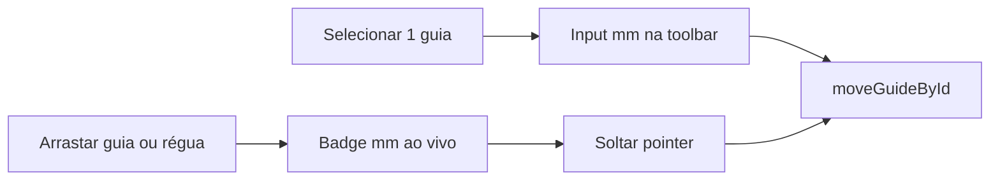

# Posição editável nas linhas guia (Inspeção)

## Contexto

As “linhas guia” da Inspeção vivem em [`AnaliseLabInspectorPage.tsx`](apps/web/src/features/analise-lab/AnaliseLabInspectorPage.tsx) (`guidesX` / `guidesY`). Hoje `valueMm` já é calculado no drag, mas **não é renderizado**. A toolbar ([`AnaliseLabToolbar.tsx`](apps/web/src/features/analise-lab/AnaliseLabToolbar.tsx)) só mostra cor/excluir da seleção e Δ entre duas guias paralelas. Já existe `moveGuideById` em [`analiseLabViewPrefs.ts`](apps/web/src/features/analise-lab/analiseLabViewPrefs.ts) — falta UI.

Padrão de referência: badges + input mm do vinco em Prova WEB (`ProvaWebCropPanel` / `ProvaWebFoldWizard`).

## 1. Badge de posição na linha

Em [`AnaliseLabInspectorPage.tsx`](apps/web/src/features/analise-lab/AnaliseLabInspectorPage.tsx), para cada guia X/Y e no preview ao puxar da régua:

- Renderizar um `<text>` (ou foreignObject com label) junto à linha com `{valueMm.toFixed(1)} mm`
- Vertical: label perto do topo (ex. `x + 4`, `y = 12`), rotacionado se ajudar a leitura
- Horizontal: label perto da esquerda
- Atualizar ao vivo com `guideDrag.currentMm` / `rulerDrag.currentMm`
- Destaque visual leve quando selecionada; `pointerEvents="none"` no texto para não atrapalhar o drag (edição fica na toolbar)

## 2. Campo editável na toolbar (1 guia selecionada)

Em [`AnaliseLabToolbar.tsx`](apps/web/src/features/analise-lab/AnaliseLabToolbar.tsx) + wiring em [`AnaliseLabInspector.tsx`](apps/web/src/features/analise-lab/AnaliseLabInspector.tsx):

- Quando `selectedGuideIds.length === 1`, mostrar input `type="number"` (step 0.1, min 0) com o `posMm` atual e sufixo “mm”
- Props novas: `selectedGuidePosMm`, `onSelectedGuidePosMmChange(mm: number)`
- No blur/Enter: clamp à largura/altura da página ativa (passar `pageWidthMm` / `pageHeightMm` ou clamp no handler do Inspector) e chamar `moveGuideById`
- Durante digitação, estado local no toolbar evita jitter; sincronizar quando a seleção ou `posMm` externo mudar

## 3. Sem mudanças de modelo

Reutilizar `GuideLine`, `moveGuideById`, `addGuideMm`. Sem persistência nova além do localStorage já existente.

## 4. Testes

- Estender [`analiseLabViewPrefs.test.ts`](apps/web/src/features/analise-lab/analiseLabViewPrefs.test.ts) se houver helper de clamp novo; senão teste mínimo do clamp no Inspector (ou helper puro `clampGuidePosMm(axis, mm, pageW, pageH)` em prefs)
- Smoke manual: inserir pela régua → ver mm; arrastar → mm ao vivo; selecionar → digitar valor exato → linha salta

## Critérios de aceite

1. Toda guia visível mostra a posição em mm com 1 casa decimal
2. Ao arrastar (guia ou preview da régua), o texto acompanha o valor
3. Com uma guia selecionada, o usuário digita um mm específico na toolbar e a linha assume essa posição (respeitando limites da página)
4. Folhear continua sem guias (`hideViewAids`)
