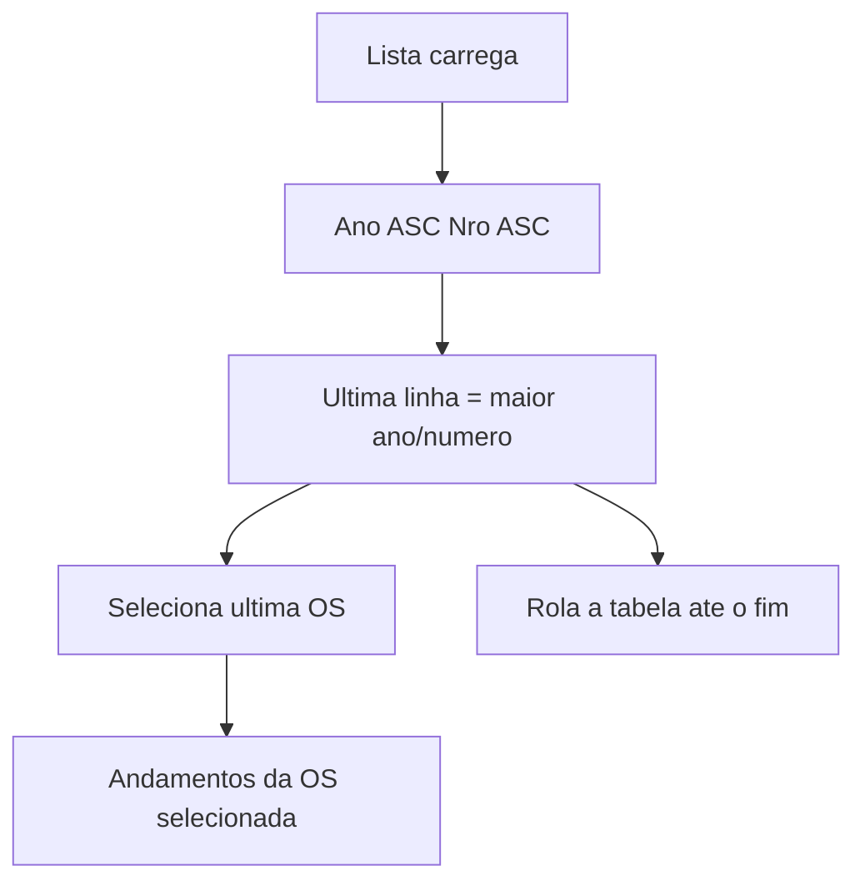

# Lista da home: todos os registros, ordem crescente e auto-seleção

## Comportamento alvo

- Sem seletor de página nem botões anterior/próxima. A **contagem** permanece no rodapé (ex.: `N OPs`).
- Ordenação padrão: **ano ASC, depois número ASC**. Com isso, o último item da lista é a OS de maior ano/número (a mais recente no filtro ativo).
- Ao carregar/atualizar a lista: **rolar até o fim** e **selecionar o último item**, como em [`OsHistoryPanel.tsx`](apps/web/src/features/os/components/OsHistoryPanel.tsx) (`lastAutoKeyRef` + `scrollTop = scrollHeight`). Clique do usuário em outra OS da mesma lista não é sobrescrito.
- Clique nos cabeçalhos da tabela continua podendo mudar a ordenação.

O filtro padrão da home continua sendo o **ano corrente** ([`getDefaultAnos()`](apps/web/src/features/os/osFilterDefaults.ts)); “todos os registros” = todos os que passam nos filtros atuais, não o histórico inteiro do banco.

## 1. Carregar tudo e manter a contagem

A home hoje manda `page` + `limit` (padrão 20, máx. **500**) em [`buildOsSearchQueryString`](apps/web/src/api/os.ts). Relatório, painel e dashboard usam o mesmo `GET /os/search` com `limit` pequeno — **não** buscar tudo nesses callers.

**Backend** ([`os_search_service.py`](app/backend/services/os_search_service.py), [`os_routes.py`](app/backend/routers/os_routes.py)):

- Manter `OS_SEARCH_MAX_LIMIT = 500` para painel/dashboard/mobile.
- Aceitar `fetch_all=true` em `GET /os/search` e em `execute_os_search`.
- Com `fetch_all`, reutilizar o teto já usado no export ([`OS_SEARCH_EXPORT_MAX_ROWS = 10_000`](app/backend/services/os_search_export_service.py)): uma busca com `page=1` e esse limite (sem alterar o clamp padrão de 500).
- Continuar com `include_total` para a contagem. `has_next` fica falso se couber no teto.

**Frontend:**

- Em [`osFiltersStore.ts`](apps/web/src/features/os/osFiltersStore.ts): `sortBy: "ano"`, `sortDir: "asc"`; parar de persistir `limit` (usuários com 20/50 no `localStorage` continuariam paginados).
- Em [`buildOsHomeSearchFilters`](apps/web/src/features/os/osSearchUtils.ts) / query string da home: `fetch_all=true` + `include_total=true`. Preview de relatório (`limit: 1`) não envia `fetch_all`.
- Em [`OsOrdersTable.tsx`](apps/web/src/features/os/components/OsOrdersTable.tsx): remover `<select>` de page size e botões prev/next; rótulo passa a `N OPs` / `Nenhuma OP encontrada` / `Carregando...`. Manter “Gerar Relatório”.
- Em [`OsHomePage.tsx`](apps/web/src/features/os/components/OsHomePage.tsx): remover `handlePageChange` / `handlePageSizeChange` e as props correspondentes.

## 2. Ordenação ano ↑, número ↑

Só inverter `sortDir` no front **não basta**. Com `sort_by=ano`, o SQL atual é `AnoProtocolo ASC, AnoProtocolo DESC, NroProtocolo DESC` ([`_build_os_search_order_clause`](app/backend/services/os_search_service.py) + [`_os_search_stable_tiebreak_sql`](app/backend/services/os_search_service.py)).

Ajuste pontual: se `sort_by` for `ano` ou `nr_os`, desempate na **mesma direção** (ano: `Ano {dir}, Nro {dir}`; nr_os: `Nro {dir}, Ano {dir}`). Default da home: `sort_by=ano&sort_dir=asc`.

Não alterar `OS_SEARCH_DEFAULT_ORDER` (prioridade + data), usado quando não há `sort_by` (painéis).

## 3. Auto-selecionar e ir ao último item

Espelhar andamentos:

- **Seleção** em `OsHomePage`: se a lista não está vazia e não há edição de andamento (`historyEditing`), selecionar `rows[rows.length - 1]` quando a seleção atual for nula ou a identidade do último item mudar. Reusar `osRowKey`. Não selecionar se o usuário já escolheu outra OS da mesma lista (mesmo `lastAutoKeyRef` do history).
- O effect que zera seleção quando a OS sai do resultado continua; em seguida o auto-select preenche com o último.
- **Scroll** em `OsOrdersTable`: no scroll container (`parentRef`), `requestAnimationFrame(() => { list.scrollTop = list.scrollHeight })` após carregar (não ao clicar numa OS do meio). A tabela já é virtualizada; a altura total do spacer cobre o scroll.

No mobile, selecionar uma OS já troca para a aba Detalhes — o último item selecionado terá o mesmo efeito.

## 4. Testes

- Backend: `_build_os_search_order_clause("ano", "asc")` → `AnoProtocolo ASC` + `NroProtocolo ASC`; `fetch_all` não fica preso no clamp 500.
- Frontend: default `sortBy/sortDir`; query string da home com `fetch_all=true` e `include_total`; preview de relatório **sem** `fetch_all`.
- Helper de auto-select (chave do último item / não sobrescrever seleção do usuário) se extraído para módulo testável.

Rodar `pnpm --filter @sagra/web test` nos arquivos tocados e pytest nos testes de search.

## Fora de escopo

- Painéis TV/dashboard, export XLSX e preview de relatório continuam com os `limit` atuais.
- Não remover ordenação por clique na coluna.
