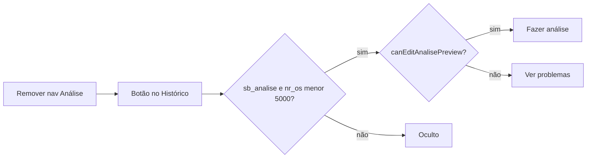

# Ajustes da página Início (detalhes, tramitação e análise)

## Contexto

A home (`/`) é [`OsHomePage.tsx`](apps/web/src/features/os/components/OsHomePage.tsx): lista de OSs + grid 60/40 com [`OsDetailsPanel`](apps/web/src/features/os/components/OsDetailsPanel.tsx) e [`OsHistoryPanel`](apps/web/src/features/os/components/OsHistoryPanel.tsx) dentro de **um único card**. Criação/edição de andamento já usa `editing` + `isEditMode`. O item **Análise** do sidebar está em [`nav-config.ts`](apps/web/src/components/layout/nav-config.ts) e tem gates extras em [`Sidebar.tsx`](apps/web/src/components/layout/Sidebar.tsx).

## 1. Separação visual Detalhes × Histórico

Em `OsHomePage`, trocar o card único (`section` com `border` envolvendo os dois painéis) por **dois painéis independentes** no mesmo grid `lg:grid-cols-[60%_40%]`, com `gap-2` (ou `gap-3`) entre colunas e, no mobile, o mesmo gap vertical.

- Cada coluna vira um container com `rounded-lg border border-sagra-border bg-white shadow-sm` (e o accent `border-t-4 border-t-secondary-blue` pode ficar só no de detalhes, ou nos dois — manter nos dois para simetria).
- Em modo `embedded`, [`OsDetailsPanel`](apps/web/src/features/os/components/OsDetailsPanel.tsx) / [`OsHistoryPanel`](apps/web/src/features/os/components/OsHistoryPanel.tsx) continuam sem borda própria (o wrapper novo fornece a moldura).

## 2. Título da seção

Em `OsHistoryPanel`, alterar o título da OS principal:

- De: `HISTÓRICO E NOVO ANDAMENTO`
- Para: `HISTÓRICO DE TRAMITAÇÃO`

Manter o título de Sub OS (`HISTÓRICO — …`) como está.

## 3. Ocultar excluir ao lançar novo andamento

No footer do `OsHistoryPanel`, renderizar o botão de lixeira **somente quando não estiver em criação**:

- Ocultar se `editing && !isEditMode` (fluxo do botão **Novo**).
- Em visualização e em edição (`isEditMode`), manter o comportamento atual (visível; disabled sem seleção / enquanto `saving`).

## 4. Desabilitar listas durante edição/criação

Estado `editing` hoje é local ao `OsHistoryPanel`. Propagar para a home:

- Novo callback opcional `onEditingChange?: (editing: boolean) => void` em `OsHistoryPanel` (+ `useEffect` para notificar e resetar `false` ao trocar OS / desmontar).
- Em `OsHomePage`: `const [historyEditing, setHistoryEditing] = useState(false)` e passar para a tabela.

**Lista de andamentos** (`OsHistoryPanel`): quando `editing`, no container da tabela:

- `pointer-events-none` + overlay relativo com `cursor-not-allowed` (ou wrapper `cursor-not-allowed` + overlay absoluto), opacidade reduzida leve.
- Manter o guard `if (!editing)` nos `onClick` das linhas (já existe).

**Lista de OSs** ([`OsOrdersTable`](apps/web/src/features/os/components/OsOrdersTable.tsx)): nova prop `selectionLocked?: boolean`.

- Com `selectionLocked`: não chamar `onSelectRow` / não expandir linhas; aplicar `cursor-not-allowed` na área da lista (tbody/viewport) e feedback visual discreto (`opacity` / overlay).
- Paginação/ordenação/export podem permanecer ativos (não alteram a OS selecionada em edição).

## 5. Remover Análise do sidebar e botão no histórico

**Sidebar**

- Remover o item `{ label: "Análise", to: "/analise", ... }` de `NAV_ITEMS` em [`nav-config.ts`](apps/web/src/components/layout/nav-config.ts).
- Remover em [`Sidebar.tsx`](apps/web/src/components/layout/Sidebar.tsx) o `analiseSearch` e os `onClick` especiais de `/analise` (alerts de OS não selecionada / `nr_os >= 5000`).
- Manter rota `/analise`, permissão `sb_analise` e mapas `ROUTE_PERMISSIONS` (acesso direto por URL/bookmark continua válido).

**Botão em `OsHistoryPanel`**

Visível quando **todos** forem verdadeiros (critério atual do sidebar + permissão):

- `can("sb_analise")` via `useAccessControl`
- OS selecionada
- `nr_os < 5000` (Sub OS já herda `nr_os` do pai em [`osTableRows.ts`](apps/web/src/features/os/osTableRows.ts))

Navegação: `Link` (ou `navigate`) para `/analise` com `search: { ano, id }` da OS principal (`ano`/`nr_os` efetivos).

**Caption** — espelhar a regra de edição da [`AnalisePage`](apps/web/src/features/analise/components/AnalisePage.tsx) **sem** o `window.confirm` / `startAnalise`:

Extrair helper puro (ex.: [`apps/web/src/features/analise/analiseAccess.ts`](apps/web/src/features/analise/analiseAccess.ts)):

- `isSefocSetor`, `canPromptStartAnalise` (mover/reutilizar)
- `canEditAnalisePreview({ userSetor, situacao, lastPonto, currentPonto })` → `true` nos mesmos casos em que a página entraria em modo edição **se** o usuário confirmasse o início (ou seja: SEFOC + `canPromptStartAnalise` **ou** `Recebido` com mesmo ponto **ou** `Problemas Técnicos`)

Caption:

- `canEditAnalisePreview` → **"Fazer análise"**
- caso contrário (ainda com botão visível) → **"Ver problemas"**

Dados: último andamento da OS principal (`SituacaoLink` / `Ponto` de `OsHistoryRow`). Em visão de Sub OS, usar `useOsHistory(ano, id)` só para o caption (hoje o hook é desligado em Sub OS) **ou** uma leitura do último item já carregado quando não for Sub OS; para Sub OS, ligar a query da OS principal apenas enquanto o botão puder aparecer.

Posição: header da seção ou barra de ações junto a Novo/Editar — preferência: **barra de ações à direita**, ao lado de Novo/Editar, visível também durante edição (navegar para análise não exige cancelar), ou só quando `!editing` se conflitar com space — default: **visível sempre que elegível**, no footer junto aos demais botões (esquerda do grupo Novo/Editar ou após eles).

## Arquivos principais

| Arquivo | Mudança |
|---------|---------|
| [`OsHomePage.tsx`](apps/web/src/features/os/components/OsHomePage.tsx) | Dois cards + `historyEditing` → tabela |
| [`OsHistoryPanel.tsx`](apps/web/src/features/os/components/OsHistoryPanel.tsx) | Título, delete, lock lista, botão análise, `onEditingChange` |
| [`OsOrdersTable.tsx`](apps/web/src/features/os/components/OsOrdersTable.tsx) | `selectionLocked` |
| [`nav-config.ts`](apps/web/src/components/layout/nav-config.ts) | Remover item Análise |
| [`Sidebar.tsx`](apps/web/src/components/layout/Sidebar.tsx) | Remover lógica `/analise` |
| Novo `analiseAccess.ts` (+ teste unitário curto se houver padrão) | Critério caption/edição |

## Verificação

- Desktop: gap claro entre Detalhes e Histórico de tramitação.
- Novo andamento: lixeira sumida; lista de andamentos e lista de OSs com `not-allowed` e sem seleção.
- Editar andamento: mesmas travas nas listas; lixeira permanece (modo edição).
- OS `nr_os >= 5000` ou sem `sb_analise`: botão análise ausente; sidebar sem Análise.
- OS elegível SEFOC em situação liberada: "Fazer análise"; não-SEFOC ou situação só leitura: "Ver problemas"; clique abre `/analise?ano=&id=`.
