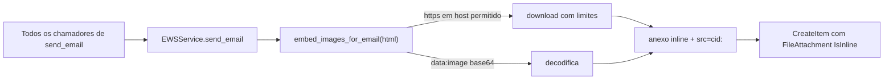

# Imagens embutidas (cid:) em todos os e-mails do SAGRA

## Diagnóstico

- O editor visual permite inserir imagem por URL (`window.prompt("URL da imagem:", "https://")` em [apps/web/src/features/email/components/editor/EmailEditorToolbar.tsx](apps/web/src/features/email/components/editor/EmailEditorToolbar.tsx)) ou por upload (vira `data:image/...;base64`).
- O HTML vai cru para [app/backend/services/ews_service.py](app/backend/services/ews_service.py) `send_email`. O Outlook bloqueia imagens remotas por padrão, e o destinatário fora da rede não alcança `cgrafsysvm`.
- Base64 direto no `src` (`data:`) também não resolve: o Outlook desktop (motor do Word) e o Gmail não exibem `data:` URIs. O formato confiável é anexo inline com `ContentId` e `src="cid:..."`, ou seja, o base64 vai dentro do MIME. O `send_email` já suporta isso via `inline_images`.
- Hoje só o fluxo PT faz essa conversão (`embed_indication_images_for_email` em [app/backend/services/pt_report_html_service.py](app/backend/services/pt_report_html_service.py)), e apenas para imagens de indicação e `data:`.

## Abordagem

### 1. Novo serviço `app/backend/services/email_inline_images_service.py`

- `embed_images_for_email(html, *, verify_ssl) -> tuple[str, list[tuple[str, bytes, str, str]]]` (mesmo formato de tupla de `inline_images`).
- Varre `` (aspas simples/duplas):
  - `cid:` existente: ignora (PT e Apogee já chegam convertidos).
  - `data:image/(png|jpeg|jpg|gif|webp);base64,...`: decodifica e vira cid.
  - `http(s)://` com host permitido: baixa e vira cid.
  - Qualquer outro caso: mantém o `src` original.
- Hosts permitidos (intranet/SAGRA):
  - padrão: hostname sem ponto (ex.: `cgrafsysvm`), `*.camara.leg.br`, `*.camara.gov.br` e o host de `SAGRA_PUBLIC_WEB_BASE` / `SAGRA_PUBLIC_DOMAIN`;
  - extensível via env `EMAIL_INLINE_IMAGE_ALLOWED_HOSTS` (lista separada por vírgula, aceita `*.dominio`).
- Limites do download: `requests.Session` com `trust_env=False` (conexão direta, mesmo padrão de `_configure_ews_session_proxies`), timeout de 10s, `allow_redirects=False`, `Content-Type` precisa ser `image/*`, até 4 MB por imagem, até 20 imagens por e-mail, deduplicação por URL. Se a resposta for 401, tenta de novo uma vez com `HttpNegotiateAuth` (imagens da intranet com autenticação Windows).
- Se uma imagem falhar, registra `logger.warning` e mantém a URL original; o envio nunca é interrompido por isso.
- CID no formato `img-{n}-{sha256[:10]}@sagra`; nome do arquivo derivado do path da URL, ou `imagem{ext}` pelo mime.

### 2. Integração central em `EWSService.send_email`

- Novo parâmetro `embed_images: bool = True`.
- Antes de montar o XML: `html_body, extra = embed_images_for_email(html_body, verify_ssl=self.verify_ssl)` e `inline_images = [*(inline_images or []), *extra]`.
- Com isso, todos os envios passam a embutir as imagens: `send-pt` (prova, timbrado, PT, Apogee), `/send`, teste de modelo, gravação externa, ativação, reset de senha, arquivos da OS e `email_template_model_service`.
- A cópia em `app/services/services/ews_service.py` (serviços de sync) fica fora do escopo.

### 3. Fluxo PT

- `embed_indication_images_for_email` continua rodando antes, porque resolve as URLs `/api/analise/item/.../indication/...` lendo direto do disco. O que ela já converteu chega como `cid:` e o serviço central ignora. Não é preciso mexer em [app/backend/routers/email_routes.py](app/backend/routers/email_routes.py).

### 4. Testes

- `app/backend/tests/test_email_inline_images_service.py`: `data:` vira cid; https em host permitido vira cid (requests mockado); host não permitido mantém a URL; content-type que não é imagem, tamanho acima do limite, timeout e redirect mantêm a URL; deduplicação; `cid:` existente fica intacto.
- Teste de `send_email` com `_post` mockado: o XML contém `<t:IsInline>true</t:IsInline>` e o `ContentId` usado no corpo; `embed_images=False` preserva o HTML.
- Rodar `pytest app/backend/tests/test_email_inline_images_service.py app/backend/tests/test_email_template_models.py app/backend/tests/test_email_pendencias.py app/backend/tests/test_ews_gal_resolve.py`.
