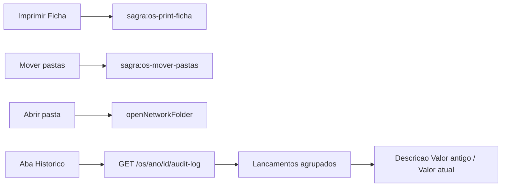

# Ações do menu e aba Histórico no modal da OS

## Permissões (regra geral)

Todo botão/aba novo neste plano segue as **mesmas chaves do menu de contexto**. Sem a permissão, o controle **não aparece** (não só desabilita). Já existentes no rodapé (Nova OS, Duplicar OS, Editar) continuam com as gates atuais.

- **Imprimir Ficha** → `ctx_imprimir_ficha`
- **Abrir pasta** → `ctx_abrir_pasta`
- **Mover pastas** → `ctx_mover_pastas`
- **Aba Histórico** → `ctx_detalhes_os` (igual à opção Histórico do menu)

## Contexto dos botões

O duplo clique abre [`OsGerenciaDetailModal.tsx`](apps/web/src/features/os/components/OsGerenciaDetailModal.tsx). A aba Material (layout modal) usa [`OsOriginalFilesPanel.tsx`](apps/web/src/features/os/components/OsOriginalFilesPanel.tsx).

Fluxos já existentes em [`OsContextMenu.tsx`](apps/web/src/features/os/components/OsContextMenu.tsx):

- Imprimir Ficha → `sagra:os-print-ficha`
- Mover Pastas → `sagra:os-mover-pastas`
- Abrir Pasta → `openNetworkFolder` (hoje privado no menu; extrair para helper compartilhado)

Não confundir **Abrir pasta** (pasta de rede da OS) com o **Abrir** da pré-visualização (arquivo selecionado).

## 1. Rodapé do modal

Em [`OsGerenciaDetailModal.tsx`](apps/web/src/features/os/components/OsGerenciaDetailModal.tsx):

1. Remover **Fechar**. `X`, Escape e overlay continuam via `requestClose`.
2. Adicionar **Imprimir Ficha** no grupo esquerdo (Nova OS / Duplicar OS), só em OS existente (`showComposeActions`), gated por `ctx_imprimir_ficha`. Clique dispara `sagra:os-print-ficha`.

`[Nova OS] [Duplicar OS] [Imprimir Ficha] ........ [Editar]`

## 2. Header de Pastas Original

Em [`OsOriginalFilesPanel.tsx`](apps/web/src/features/os/components/OsOriginalFilesPanel.tsx), o título vira barra:

`Pastas Original ........ [Mover pastas] [Abrir pasta]`

- **Mover pastas** à esquerda de **Abrir pasta**.
- Gates `ctx_mover_pastas` / `ctx_abrir_pasta`.
- Desabilitados se `ano`/`osId` inválidos.
- Mover: evento `sagra:os-mover-pastas`. Abrir: helper extraído com `{ ano, nr_os: osId }`.
- Se o overlay de Mover Pastas ficar atrás do modal de detalhes (ambos `z-[10002]`), subir [`OsMoverPastasModal`](apps/web/src/features/os/components/OsMoverPastasModal.tsx) para `10005`.

## 3. Aba Histórico (só no modal)

Não é o painel de andamentos da home ([`OsHistoryPanel.tsx`](apps/web/src/features/os/components/OsHistoryPanel.tsx)). Fonte: `GET /os/{ano}/{id}/audit-log` (`tab_os_audit_log`), o mesmo do modal **Histórico completo** do menu.

Nav: item extra **Histórico** só em [`OsGerenciaDetailModal.tsx`](apps/web/src/features/os/components/OsGerenciaDetailModal.tsx), depois de Cota e Orçamento. **Não** entra em [`GERENCIA_SECTIONS`](apps/web/src/features/gerencia/components/GerenciaFormSections.tsx) (página Gerência). Sem `ctx_detalhes_os`, a aba não aparece. Em Nova OS / Duplicar, a aba some ou fica vazia (não há OS persistida).

Layout da aba (dois painéis, como Material):

- **Esquerda — lista de lançamentos** (um por evento, não por campo), colunas:
  - Data
  - Hora
  - Tipo de registro (`formatAuditActionLabel`: Criação, Alteração, Andamento, Vínculo, etc.)
  - Ponto
  - Nome Usuário
- **Direita — Descrição** do lançamento selecionado:
  - Tabela com identificação do campo + **Valor antigo** + **Valor atual** (campo é necessário para saber o que mudou; valores vazios como `(vazio)`).
  - Clique numa linha da esquerda preenche a direita.
  - Eventos sem diff de campo (vínculo, exclusão de andamento, link gerado) mostram a `descricao` / payload na mesma área.

### Agrupamento (um salvamento = um lançamento)

Hoje [`diff_entity_fields`](app/backend/routers/os_audit_service.py) grava **uma linha por campo**. Um save com 10 campos vira 10 linhas.

- Em `log_os_save` e `log_andamento_updated`, usar **um único `evento_em`** (e, se couber sem migração, o mesmo `ref_cod` de lote) para todos os diffs daquela operação.
- No frontend, helper em [`auditLogFormat.ts`](apps/web/src/features/os/auditLogFormat.ts): agrupar linhas consecutivas com o mesmo `acao` + `ponto` + `evento_em` (segundo). A lista da esquerda tem um item; a da direita lista todos os campos daquele lote.
- Dados antigos com timestamps quase iguais no mesmo segundo/ponto/ação entram no mesmo grupo.

### Nome do usuário

O log só guarda `ponto`. Em `fetch_audit_log`, `LEFT JOIN tabUsuarios` pelo ponto e devolver `usuario_nome` em [`OsAuditLogRow`](app/backend/schemas/os.py) / [`types.ts`](apps/web/src/features/os/types.ts). Sem cadastro: `"—"`.

## 4. Testes

- [`OsOriginalFilesPanel.test.tsx`](apps/web/src/features/os/components/OsOriginalFilesPanel.test.tsx): botões visíveis só com permissão; Mover dispara o evento.
- Novo teste de agrupamento em `auditLogFormat`: N campos no mesmo `evento_em` → 1 lançamento com N linhas de descrição.
- Nav do modal: Histórico presente na lista do modal, ausente em `GERENCIA_SECTIONS`.
- Checks focados: `pnpm --filter @sagra/web test` nos arquivos tocados.

## Fora de escopo

- Não alterar itens/textos do menu de contexto nem o modal **Histórico completo** (continua linha a linha).
- Não misturar com andamentos da home (`OsHistoryPanel`).
- Sem aba Histórico na página Gerência.
- Sem coluna nova `lote_id` (agrupar por `evento_em` compartilhado).

## Verificação

- Sem cada permissão, o botão/aba correspondente some; com permissão, funciona como o menu.
- **Fechar** sumiu; X / Escape / overlay fecham.
- Aba Material: Mover pastas e Abrir pasta; **Abrir** da prévia continua no arquivo.
- Aba Histórico: salvar vários campos de uma vez → **um** lançamento à esquerda; à direita, todos os pares antigo/atual.
- Criação da OS aparece como inclusão (tipo Criação), não como N lançamentos.
- Menu de contexto inalterado.
