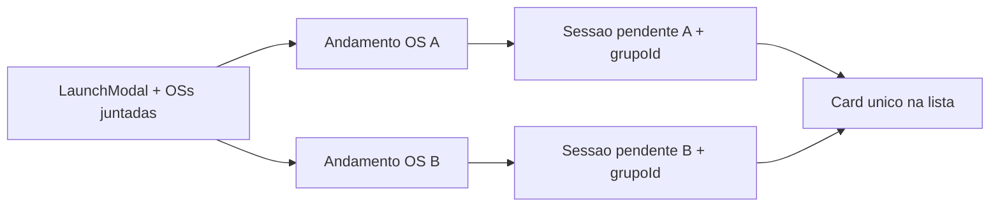

# Juntada de OSs na Gravação Pendente

## Premissas (defaults até confirmação)

- **Escopo UI:** opção de juntada disponível para qualquer OS no modal (papelaria é o caso de uso principal; sem hard-gate `>= 5000` no backend).
- **Independente do vínculo permanente:** a juntada é um agrupamento **desta sessão de gravação**, não cria/exige `tabOSVinculadas`. Evita acoplar ciclo de birô ao vínculo operacional da home.
- **Cada OS continua com andamento + sessão próprios** (histórico/status intactos); o grupo só amarra as sessões para lista e ações.

## Modelo de dados

Nova coluna + tabela (DDL idempotente no ensure de schema, padrão do projeto):

Em [`gravacao_pendente_schema.py`](app/backend/services/gravacao_pendente_schema.py):

- `tab_os_gravacao_pendente.JuntadaGrupoId` (`CHAR(36)` / UUID, nullable, index) — mesmo valor em todas as sessões do grupo.
- `tab_os_gravacao_pendente_juntada` (opcional se preferir só o UUID compartilhado): ou simplesmente derivar membros por `JuntadaGrupoId` nas sessões ativas/enviadas.

Em [`gravacao_externa_schema.py`](app/backend/services/gravacao_externa_schema.py) (ou espelho ao enviar):

- `tab_os_gravacao_externa.JuntadaGrupoId` — copiado de `OrigemPendenteId` / sessão origem no `enviar_para_gravacao_externa`, para a lista Externa também agregar.

Cada membro do grupo:

1. Recebe `INSERT tabAndamento` (Gravação Pendente) com obs/chapas equivalentes.
2. Recebe `insert_pendente_session_cursor` com **os mesmos arquivos/chapas** e o **mesmo `JuntadaGrupoId`**.
3. Mantém `(OsAno, OsNro)` próprio.

## Lançamento (frontend)

[`GravacaoPendenteLaunchModal.tsx`](apps/web/src/features/gravacao-externa/components/GravacaoPendenteLaunchModal.tsx):

- Nova seção **“OSs juntadas”**: input número/ano + adicionar; lista com remover; OS atual implícita (não listar como “extra”).
- Validar OS existente via API leve já usada no vínculo (`GET` OS / search) antes de confirmar.
- Estender `GravacaoPendenteLaunchResult` com `juntadas: { nr_os, ano }[]`.

[`OsHistoryPanel.tsx`](apps/web/src/features/os/components/OsHistoryPanel.tsx):

- No confirm, enviar `gravacao_pendente_juntadas` no payload de history (além de arquivos/chapas).
- Backend cria andamento+sessão na OS principal **e** nas juntadas na mesma transação (ou transação por OS com rollback coordenado).

## Backend

[`os_routes.py`](app/backend/routers/os_routes.py) / `HistoryItem` + [`gravacao_pendente_service.py`](app/backend/services/gravacao_pendente_service.py):

- Aceitar `gravacao_pendente_juntadas: list[{numero, ano}]`.
- Gerar `juntada_grupo_id = uuid4()`.
- Para principal + cada juntada: cancelar ativa prévia daquela OS, inserir andamento, inserir sessão com arquivos/chapas clonados e `JuntadaGrupoId`.
- Rejeitar se alguma juntada já tiver sessão **ativa** de Gravação Pendente, ou se não existir.
- Não usar `history/replicate` do vínculo (fluxo diferente; evita prompt de grupo).

[`enviar_para_gravacao_externa`](app/backend/services/gravacao_pendente_service.py):

- Se a sessão tiver `JuntadaGrupoId`, enviar **todas** as sessões ativas do grupo (andamento Externa + cópia de arquivos) na mesma operação.
- Propagar `JuntadaGrupoId` nas linhas externas.

## Listas: card único

[`list` de pendente / externa](app/backend/routers/gravacao_pendente_routes.py) (+ externa equivalente):

- Agregar por `COALESCE(JuntadaGrupoId, concat(ano,'-',nr_os))`.
- Item da lista passa a expor `membros: [{nr_os, ano}, ...]` (ordenados) + campos “âncora” (primeiro membro ou o de menor nr) para APIs de detalhe/ação.
- Frontend: `formatOsListLabel` composto → `12345/26 e 654321/26` (e `", "` / ` e ` para 3+).

Arquivos:

- [`GravacaoPendenteTab.tsx`](apps/web/src/features/gravacao-externa/components/GravacaoPendenteTab.tsx)
- [`GravacaoExternaTab.tsx`](apps/web/src/features/gravacao-externa/components/GravacaoExternaTab.tsx)
- Types em [`gravacaoPendente.ts`](apps/web/src/api/gravacaoPendente.ts) / [`gravacaoExterna.ts`](apps/web/src/api/gravacaoExterna.ts)

**Detalhe / ações:** ao selecionar o card, detalhe e download usam a sessão âncora; enviar/excluir/cancelar aplicam ao **grupo inteiro** quando houver `juntada_grupo_id`.

## Compatibilidade

- Sessões sem `JuntadaGrupoId`: comportamento atual (1 card = 1 OS).
- Controles de cota/histórico: somar chapas **uma vez por grupo** (não N vezes) ao enviar/controle — usar grupo_id como chave de dedupe onde a cota for debitada.
- Edição de arquivos (`PUT .../arquivos`): atualizar arquivos em **todas** as sessões do mesmo grupo.

## Testes

- Hydrate/launch payload com juntadas.
- Serviço: insert multi-OS com mesmo grupo_id; list aggregation; enviar externa propaga grupo.
- UI label `formatOsJuntadaLabel`.

## Fora de escopo nesta entrega

- Alterar “Vincular OS” / `tabOSVinculadas`.
- Merge visual na home de OSs.
- Worker papelaria / Corel.
