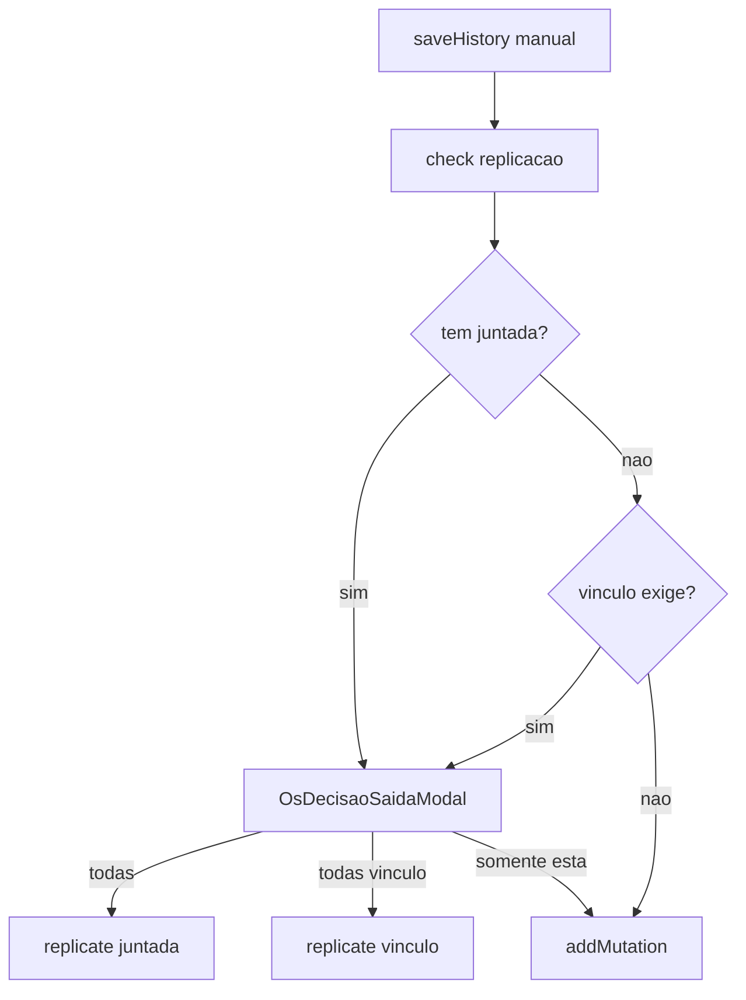

# Juntada: obs, replicação manual e cards

## Contexto atual

- Juntada = `JuntadaGrupoId` compartilhado em `tab_os_gravacao_pendente` / `tab_os_gravacao_externa`; fan-out operacional já existe (enviar/iniciar/concluir/entrega).
- Só o andamento **Gravação Pendente** inclui `OSs juntadas: …` na obs ([`os_routes.py`](app/backend/routers/os_routes.py) + repair em [`gravacao_pendente_service.py`](app/backend/services/gravacao_pendente_service.py)); etapas seguintes montam chapas sem essa linha ([`andamento_helpers.py`](app/backend/routers/andamento_helpers.py)).
- Lançamento manual já tem fluxo de confirmação para **vínculo** ([`OsHistoryPanel.tsx`](apps/web/src/features/os/components/OsHistoryPanel.tsx) + [`OsDecisaoSaidaModal.tsx`](apps/web/src/features/os/components/OsDecisaoSaidaModal.tsx)); `POST .../history/replicate` só espelha via `tabOSVinculadas`.
- Cards usam `solicitante · produto` em [`GravacaoPendenteTab.tsx`](apps/web/src/features/gravacao-externa/components/GravacaoPendenteTab.tsx) e [`GravacaoExternaTab.tsx`](apps/web/src/features/gravacao-externa/components/GravacaoExternaTab.tsx).

## 1. Observações com juntada em todas as etapas automáticas

Centralizar a linha de juntada reutilizando [`format_juntada_membros_label`](app/backend/services/gravacao_pendente_service.py):

```python
# ex.: andamento_helpers.py
def with_juntada_obs_prefix(obs_body: str, membros_label: str) -> str:
    if not membros_label:
        return obs_body
    line = f"OSs juntadas: {membros_label}"
    return f"{line}\n\n{obs_body}" if obs_body else line
```

Aplicar o prefixo **antes** de `format_andamento_obs` em todos os pontos que geram andamento do fluxo:

| Etapa | Onde |
|--------|------|
| Gravação Pendente (já tem) | Unificar para o helper (launch + repair) |
| Saída p/ (enviar) | [`_enviar_uma_sessao_cursor`](app/backend/services/gravacao_pendente_service.py) (~2035) |
| Recebido (iniciar) | [`iniciar_gravacao`](app/backend/services/gravacao_externa_service.py) (~1072) |
| Gravação Ext. Concluída | pontos de obs em concluir (~1517 / ~1654) |
| Recebido / entrega | [`lancar_entrega_chapas`](app/backend/services/gravacao_externa_service.py) (~2042) |
| Caminhos de fallback/repair de envio/recebido | trechos com `format_gravacao_*_obs` no mesmo serviço |

Membros do label: membros do `JuntadaGrupoId` da sessão (mesma regra do launch: principal + irmãs). Sem juntada, comportamento inalterado.

Atualizar [`docs/gravacao-externa-andamentos.md`](docs/gravacao-externa-andamentos.md) para documentar a linha de juntada em todas as etapas.

## 2. Pergunta de replicação no lançamento manual (juntada)

**Detecção:** nova função no service de pendente (ou helper compartilhado), ex. `resolve_juntada_grupo_for_os(nro, ano)` — busca `JuntadaGrupoId` mais recente da OS em pendente/externa e lista membros do grupo (`OsNro`/`OsAno`). Se houver outras OSs → `requires_confirmation`.

**API:** estender o check existente [`GET /os/{ano}/{id}/vinculo/replicacao-check`](app/backend/routers/os_routes.py) (ou chamada composta no front) para, **antes**/além do vínculo:

- se OS em juntada com irmãs → `requires_confirmation: true`, `origem: "juntada"`, `membros` no formato já usado pelo modal;
- senão → comportamento atual de vínculo.

**Replicação “todas”:** estender [`POST .../history/replicate`](app/backend/routers/os_routes.py) aceitando alvo `juntada` (query/body flag) — targets = membros do `JuntadaGrupoId`, mesmo `situacao`/`setor`/`obs` formatada (escolha confirmada pelo usuário). “Somente esta OS” = `add` normal; **não** criar exceção de vínculo.

**UI:** reutilizar [`OsDecisaoSaidaModal`](apps/web/src/features/os/components/OsDecisaoSaidaModal.tsx) com variante de texto (`origem === "juntada"` → título/copy “OSs juntadas” em vez de “grupo vinculado”). Em [`OsHistoryPanel.saveHistory`](apps/web/src/features/os/components/OsHistoryPanel.tsx), disparar o fluxo para **qualquer** lançamento manual novo na OS principal quando a juntada exigir confirmação (exceto o próprio launch de Gravação Pendente via modal, que já replica na criação).



## 3. Subtítulo dos cards: “Juntada de OPs”

Nas listas da página `/gravacao-externa` (pendente, em andamento e aguardando retirada), quando o item for juntada (`juntada_grupo_id` e `membros.length > 1`):

```tsx
{isJuntada ? "Juntada de OPs" : `${item.solicitante || "—"}…`}
```

Arquivos: [`GravacaoPendenteTab.tsx`](apps/web/src/features/gravacao-externa/components/GravacaoPendenteTab.tsx) (~294) e [`GravacaoExternaTab.tsx`](apps/web/src/features/gravacao-externa/components/GravacaoExternaTab.tsx) (~356). Painel de detalhe lateral permanece com solicitante/produto (confirmado).

## 4. Testes

- Backend: assert de prefixo `OSs juntadas:` nas obs de enviar/iniciar/concluir/entrega com juntada; check de replicação retorna juntada; replicate por juntada cria N andamentos com mesma obs.
- Frontend: teste unitário/simples do subtítulo “Juntada de OPs” nos cards (ajustar testes existentes de tab se necessário).
- Rodar testes focados: `test_gravacao_*_juntada.py`, helpers de obs, e testes de tab afetados.
